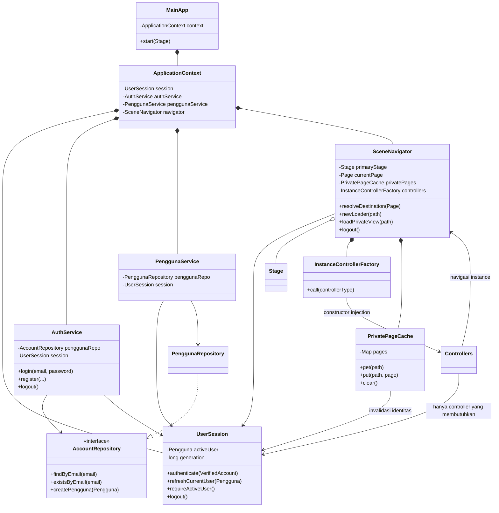

# Laporan P1B-1 — Konteks pengguna dan navigasi per instance

Tanggal: 30 Oktober 2026. Status: implementasi dan regresi terisolasi selesai. Bukti berlaku untuk pemisahan konteks dalam satu JVM/classloader, bukan kesiapan seluruh aplikasi JPro multiuser. Tidak melanjutkan otomatis ke paket berikutnya.

## 1. Baseline dan masalah sebelum perubahan

Instruksi repository dicari kembali; tidak ditemukan AGENTS.md pada proyek/direktori induk yang diperiksa. [Rancangan Tahap A](RANCANGAN_TAHAP_A.md), [laporan P0](LAPORAN_P0.md), [laporan P1A](LAPORAN_P1A.md), source dan seluruh pemanggil sesi/autentikasi/navigasi/FXMLLoader dibaca sebelum perubahan. Metadata Git tetap tidak tersedia (`git status --short` gagal). Manifest SHA-256 dibuat pada awal pekerjaan sebagai pembanding file; tidak melakukan git init/reset atau mengembalikan perubahan pengguna.

Baseline P1A sudah menutup password universal, fallback akun pada autentikasi, dan pembentukan sesi mentah. Namun masih ada masalah scope:

- UserSession.getInstance menjadi satu tempat identitas aktif untuk semua pemanggil dalam classloader.
- AuthService dan PenggunaService mengambil sesi global, sehingga constructor account provider saja belum menentukan instance pemilik login.
- SceneNavigator memegang Stage static dan semua method navigasinya static.
- Controller mengambil sesi sendiri, membuat AuthService/PenggunaService tanpa dependency sesi, atau memakai navigator static.
- Ada dua lokasi FXMLLoader produksi: navigator dan halaman di MainLayout. Keduanya belum memasang factory yang memasok dependency instance.
- Cache node/controller memang merupakan field MainLayout, tetapi tidak memiliki invalidasi identitas yang tegas. Logout belum mengosongkan cache dan belum ada penolakan shell lama setelah pergantian sesi.
- PenggunaRepository.getDefaultPengguna membaca sesi global untuk menyalin nama ke objek default. Ini dependency identitas yang tidak semestinya berada pada repository.
- Close handler MainApp memanggil stop pada pengingat global. Satu instance tidak boleh menghentikan worker bersama pengguna lain.

Perubahan dibatasi pada scope sesi/navigator/dependency dan penyesuaian pemanggil. Tidak mengubah algoritma kesehatan, skor, skema, seed, data, framework, dependency, konfigurasi Gradle/JPro atau application.mainClass.

## 2. Desain yang diimplementasikan

### 2.1 Composition root per aplikasi

Kelas baru `Frontend2/src/main/java/com/sehatharian/context/ApplicationContext.java` dimiliki field **nonstatic** MainApp. Pada `MainApp.start(Stage)`, context dibuat dengan repository akun/profil, lalu navigator context dipasangkan dengan Stage yang diberikan kepada instance tersebut.

Setiap ApplicationContext membuat dan menyimpan:

1. Satu `new UserSession()` anonim, tanpa singleton atau current-context global.
2. AuthService dengan AccountRepository dan sesi tersebut melalui constructor.
3. PenggunaService dengan PenggunaRepository dan sesi yang sama.
4. SceneNavigator dengan sesi/service terkait, factory controller dan cache halaman privatnya sendiri.

Controller **tidak menerima ApplicationContext sebagai service locator**. Factory meneruskan dependency bertipe yang diperlukan: sesi, AuthService, PenggunaService atau SceneNavigator. Tidak ada ThreadLocal, registry context global, DI framework, token jaringan, atau default constructor service yang membuat sesi pengganti secara diam-diam.

### 2.2 Sesi dan autentikasi

UserSession sekarang objek biasa dengan constructor publik. `getInstance` dan field instance static dihapus. Encapsulation identitas, copy/snapshot dan proof VerifiedAccount P1A dipertahankan. AuthService mempunyai field final UserSession yang diinjeksi; register/login/logout hanya mengubah field sesi tersebut. PenggunaService membaca/memperbarui sesi yang diinjeksi, bukan sesi global.

Kontrak P1A tetap berlaku: email dan BCrypt; tidak ada password universal, fallback default/demo, penerimaan hash kosong/rusak, atau auto-login sebelum repository melaporkan akun committed. Gagal login tidak mengganti akun yang sudah terverifikasi. PasswordUtil dan implementasi transaksi createPengguna tidak diubah pada tahap ini.

UserSession juga mempunyai generation per objek dan listener invalidasi identitas yang disimpan pada objek tersebut. Login/registrasi berhasil dan logout menaikkan generation serta memberi tahu cache/navigator milik sesi itu. Login gagal dan refresh profil dengan pemilik sama tidak mengubah generation. Listener hanya digunakan untuk invalidasi lokal; bukan event bus global atau cleanup seluruh output.

### 2.3 Navigator, Stage dan FXMLLoader

SceneNavigator menjadi objek instance. Stage adalah field nonstatic, dipasang eksplisit lewat attachStage; pemanggilan navigasi render sebelum Stage dipasang gagal jelas. Tidak mencari Stage/context dari singleton. Pemanggilan ulang attachStage dengan Stage berbeda pada navigator yang sudah terpasang ditolak.

Enum `SceneNavigator.Page` mencatat 13 path FXML aktual, metadata judul/ukuran dan status privat. Enum ini metadata immutable, bukan lokasi identitas/Stage global. `resolveDestination(Page)` adalah keputusan guard yang dipakai `show` produksi sekaligus dapat diuji tanpa toolkit: halaman privat untuk sesi anonim diarahkan ke LOGIN. `newLoader` untuk akses langsung ke FXML privat tetap menolak sesi anonim.

**Seluruh pembuatan FXMLLoader produksi kini berada pada SceneNavigator.newLoader** dan memasang InstanceControllerFactory milik navigator. MainLayout tidak lagi membuat FXMLLoader sendiri. Binding fx:controller/fx:id/onAction pada FXML dipertahankan.

`InstanceControllerFactory` mengimplementasikan Callback bawaan JavaFX dan secara eksplisit membuat 13 controller yang tersedia. Controller privat memerlukan identitas aktif sebelum konstruktor dipanggil. Tipe tidak terdaftar atau dependency null ditolak; tidak ada fallback reflection/no-arg constructor yang menciptakan context lain.

### 2.4 Cache dan logout dasar

`PrivatePageCache<T>` adalah cache per sesi yang benar-benar dipakai SceneNavigator dengan `T = LoadedView(root, controller)`. Pasangan root/controller menggantikan dua map terpisah pada MainLayout. Cache tidak static, key memakai path FXML, get/put memerlukan sesi sah, dan semua entry dikosongkan segera saat identitas berubah atau logout. Data cached A tidak menjadi data cached B.

Alur logout produksi: `MainLayoutController.handleLogout → navigator.logout → AuthService.logout → UserSession.logout`. Identitas/preferensi lokal dibersihkan; listener mengosongkan cache navigator itu; halaman logis kembali LANDING dan, jika Stage sudah dipasang, scene privat dilepas sebelum halaman publik dimuat. Jika pemuatan publik gagal, scene privat tidak dibiarkan terlihat. Tidak memanggil Platform.exit, menghentikan database global atau mengeluarkan sesi context lain.

MainLayout menyimpan generation saat dibuat. Shell lama tidak boleh memuat halaman privat setelah logout/pergantian identitas; logout dari shell lama tidak mengeluarkan sesi penggantinya. Pemeriksaan generation juga dipakai sebelum hasil pemuatan FXML privat dipasang/disimpan dan pada callback banner tertunda milik shell tersebut. Ini perlindungan lokal yang terbatas, bukan pembatalan semua callback aplikasi.

`SceneNavigator.dispose` membersihkan sesi/cache, melepas scene dari Stage miliknya, lalu melepaskan referensi Stage navigator. Close handler MainApp memakai dispose ini, menggantikan penghentian pengingat singleton. Pengingat global belum diisolasi dan belum dibersihkan menyeluruh; tidak ada klaim bahwa semua resource instance sudah bebas referensi setelah ditutup.

## 3. Diagram class/dependency sesuai implementasi



Controllers pada diagram adalah kelompok 13 kelas aktual, bukan superclass/interface baru. Tidak menambah inheritance atau interface domain hanya agar diagram terlihat memenuhi semua konsep PBO.

### Bukti dependency dipakai jalur aplikasi

- `MainApp.start` membuat ApplicationContext, memanggil attachStage dan showLandingPage melalui navigator context.
- `ApplicationContext` benar-benar meneruskan UserSession yang sama ke AuthService, PenggunaService dan SceneNavigator.
- `SceneNavigator.newLoader` benar-benar memanggil setControllerFactory. `show` dan `loadPrivateView` memakai loader itu.
- `MainLayoutController.muatTampilan` benar-benar memakai navigator.loadPrivateView, memasang parent controller dan menyegarkan fitur seperti sebelumnya.
- LoginController/CreateAccountController memakai AuthService yang diberikan factory; OnboardingController memakai sesi/PenggunaService/navigator dari instance yang sama.
- Controller fitur/sidebar/profil memakai sesi constructor, bukan lookup global. PenggunaRepository tidak lagi membaca sesi untuk mengubah nama default.
- Cache invalidasi dipanggil oleh perubahan identitas nyata pada UserSession, bukan hanya fungsi yang tersedia tetapi tidak digunakan.

## 4. Penerapan OOP dan alasan

| Konsep | Penerapan yang benar-benar digunakan | Alasan |
| --- | --- | --- |
| Encapsulation | Identitas private, proof autentikasi P1A, snapshot profil, dependency final, Stage/cache instance tersembunyi | Menghindari pemanggil mengubah pemilik sesi secara langsung atau mencari current user global |
| Composition | MainApp memiliki context; context memiliki sesi/service/navigator; navigator memiliki factory/cache | Lifecycle dan ownership dependency terlihat pada graph objek, bukan static global |
| Constructor injection | Seluruh controller menerima dependency yang diperlukan; AuthService/PenggunaService memerlukan sesi eksplisit | Missing dependency gagal jelas; fixture dapat memberi provider tanpa SQL/network |
| Polymorphism/interface yang berguna | AccountRepository dipakai oleh JDBC dan provider sintetis; Callback JavaFX dipakai FXMLLoader untuk factory | Memisahkan akses akun serta memasang controller dengan scope yang benar; bukan interface tanpa pemanggil |
| Generics | PrivatePageCache menyimpan LoadedView pada produksi dan objek/controller pada unit test | Satu mekanisme cache dengan aturan scope/invalidasi yang sama, tanpa ketergantungan algoritma cache pada toolkit |
| Inheritance | MainApp tetap extends Application sebagai kontrak framework yang sudah ada | Tidak menambah hierarki domain baru. Tahap ini tidak membuktikan seluruh empat konsep OOP telah terpenuhi di semua bagian proyek |

Tidak mengimplementasikan abstract Pencatatan atau interface penyaringan pada paket ini. Kebutuhan akademik dibahas sesuai penggunaan nyata; materi itu dapat dipenuhi saat domain terkait dikerjakan bila memang bermanfaat.

## 5. File aktual dan alasan perubahan

Prefix B = `Backend2/src/main/java/com/sehatharian/`; F = `Frontend2/src/main/java/com/sehatharian/`.

| File | Perubahan |
| --- | --- |
| B `model/UserSession.java` | Objek sesi biasa, hapus singleton, generation/listener invalidasi per objek; proof/snapshot P1A tetap |
| B `service/AuthService.java` | Constructor wajib account provider+sesi; hilangkan lookup sesi global |
| B `service/PenggunaService.java` | Constructor wajib repository+sesi; pembacaan/refresh/onboarding terikat sesi itu |
| B `repository/PenggunaRepository.java` | Hapus import/lookup sesi dan penyalinan nama dari sesi global pada getDefaultPengguna; SQL/transaksi tidak dirombak |
| F `context/ApplicationContext.java` — baru | Composition root per MainApp |
| F `util/SceneNavigator.java` | Navigator/Stage instance, route guard, loader ber-factory, cache privat, logout/dispose lokal |
| F `util/InstanceControllerFactory.java` — baru | Pemetaan constructor 13 controller aktual, tanpa fallback singleton/no-arg |
| F `util/PrivatePageCache.java` — baru | Cache pasangan view/controller per sesi, invalidasi saat identitas berubah |
| F `MainApp.java` | Wiring context/Stage instance pada start; close handler tidak lagi menghentikan pengingat global |
| F `controller/LandingPageController.java` | Navigator constructor untuk login/registrasi |
| F `controller/LoginController.java`, `CreateAccountController.java` | AuthService+navigator constructor, tidak membuat AuthService tanpa sesi |
| F `controller/OnboardingController.java` | Sesi, PenggunaService dan navigator constructor |
| F `controller/MainLayoutController.java` | Sesi+navigator constructor; cache melalui navigator; guard generation; logout lokal; banner lama diabaikan |
| F `controller/ProfilPengaturanController.java` | Sesi constructor untuk profil/refresh |
| F `controller/DashboardController.java`, `TantanganController.java`, `RekomendasiController.java`, `CatatanKebiasaanController.java`, `JadwalTidurController.java`, `StatistikMingguanController.java`, `EvaluasiMingguanController.java` | Sesi constructor untuk pemuatan pengguna aktif; logika fitur/skor tidak diubah |
| Backend test `AuthServiceTest.java`, `AccountRepositoryTest.java`, `PenggunaServiceTest.java` | Ganti singleton dengan sesi fixture eksplisit; AuthService/PenggunaService menerima sesi itu; assertion commit memakai sesi test sendiri |
| Frontend test `FrontendAuthFixture.java` | Provider sintetis menerima sesi atau membentuk context fixture; koneksi profil dilarang oleh test double |
| Frontend test `UserSessionTest.java`, `FrontendFlowValidationTest.java` | Sesi fixture terpisah, tetap menjalankan perilaku P1A |
| Frontend test `AllFxmlViewsLoadTest.java`, `LandingPageLayoutTest.java` | Loader memakai factory context; onboarding kini termasuk halaman privat; bukan pemuatan tanpa dependency |
| Frontend test `FrontendFeatureFlowIntegrationTest.java` | Hapus logout singleton pada setup; test lama lain tetap belum aman dieksekusi tanpa DB uji |
| Frontend test `InstanceContextTest.java` — baru | 16 pengujian dua context/factory/cache tanpa startup JavaFX/SQL |
| `docs/LAPORAN_P1B_1.md` — baru | Laporan dan panduan presentasi |

API AuthService/PenggunaService tanpa parameter sesi dan UserSession.getInstance sengaja tidak dipertahankan karena kontrak tersebut menyembunyikan pemilik sesi. Semua pemanggil source/test yang ditemukan diperbarui dan dikompilasi. Binary lama perlu dibangun ulang. File FXML, CSS, asset, konfigurasi build/JPro, Wrapper, SQL dan seed tidak diubah.

## 6. Pengujian dan hasil aktual

Test memakai AccountRepository sintetis, hash BCrypt nyata, JDBC proxy P1A dan koneksi profil pengganti yang melempar assertion bila digunakan. Tidak memanggil MainApp.main/start, LocalDatabase, DatabaseBootstrap, Platform.startup, konstruktor Stage, FXMLLoader.load atau controller initialize pada pengujian terisolasi yang dieksekusi. Loader pada test hanya dibuat untuk memeriksa factory; beberapa controller dibuat tanpa injeksi node FXML/initialize.

### 6.1 Pengujian baru: InstanceContextTest

| Pengujian | Bukti dan hasil |
| --- | --- |
| contextsStartAnonymousWithDistinctDependencies | Dua sesi/service/navigator berbeda, tanpa autentikasi atau Stage — PASS |
| loginAOnlyAuthenticatesA | Identitas B tetap anonim, termasuk PenggunaService B — PASS |
| loginBDoesNotReplaceA | Identitas/generation A tetap, B memperoleh identitas sendiri — PASS |
| failedLoginBLeavesAAndPreviouslyVerifiedBUntouched | Gagal B tidak mengganti kedua identitas/generation — PASS |
| failedAnonymousBDoesNotAuthenticateEitherContext | Tidak ada default recovery — PASS |
| registrationTargetsOnlyInjectedSession | Registrasi fixture mengubah sesi target saja — PASS |
| snapshotsCannotMutateEitherIdentity | Mutasi copy A tidak memengaruhi identitas internal A/B — PASS |
| refreshCannotSwapOwnersOrRecoverAnAnonymousContext | Refresh pemilik berbeda/anonim ditolak, refresh A tidak mengubah B — PASS |
| protectedNavigationUsesOnlyItsOwnContext | Resolusi semua Page memakai sesi navigator terkait — PASS |
| loaderUsesScopedFactoryAndDirectPrivateLoadingRejectsAnonymous | Factory berbeda, AuthService/navigator controller sesuai context; akses privat anonim ditolak sebelum load — PASS |
| factoryNeverCreatesMissingContextOrFallsBackToNoArgControllers | Dependency null/tipe tak terdaftar ditolak; constructor penting membutuhkan dependency — PASS |
| controllerAndCacheInstancesDoNotCrossContexts | Controller dan cache terpisah; logout service A menginvalidasi cache A, bukan B — PASS |
| logoutThroughActualControllerClearsOnlyAAndReturnsToPublicDestination | handleLogout yang sebenarnya dipanggil tanpa initialize/toolkit; A anonim/tujuan logis LANDING, preferensi B tetap — PASS |
| staleShellCannotLoadPrivatePagesOrLogoutAReplacementSession | Akses private loader shell lama gagal sebelum FXML/SQL; logout shell lama tidak menghapus sesi pengganti — PASS |
| identityAndStageHaveNoStaticCurrentInstance | Field state UserSession/SceneNavigator bukan static; getInstance tidak ada — PASS |
| privateCacheRejectsAnonymousAndInvalidatesOnSuccessfulReauthenticationOnly | Anonim ditolak, gagal login mempertahankan cache, login sah mengosongkan cache lama — PASS |

Dua konteks dibuat dalam test yang sama, satu proses/classloader. Cache diuji memakai implementasi PrivatePageCache produksi dengan objek/controller; **bukan** positive loading scene graph halaman privat. Navigasi yang diuji adalah keputusan guard dan transisi logout logis, bukan pergantian root dua Stage nyata. Detail ini penting agar bukti tidak dianggap sebagai dua browser JPro yang telah terisolasi.

### 6.2 Kompilasi, JUnit dan Gradle

| Pemeriksaan | Hasil aktual |
| --- | --- |
| Kompilasi langsung JDK 27 Backend2 | PASS, 40 file source |
| Kompilasi langsung JDK 27 Frontend2 | PASS, 27 file source |
| Kompilasi seluruh source test kedua modul | PASS, 18 file termasuk helper |
| JUnit backend terpilih: AuthServiceTest, AccountRepositoryTest, PasswordUtilTest, PenggunaServiceTest | **67 ditemukan/dijalankan/berhasil; 0 gagal, skipped, aborted** |
| JUnit frontend: UserSessionTest, FrontendFlowValidationTest, InstanceContextTest | **29 ditemukan/dijalankan/berhasil; 0 gagal, skipped, aborted** |
| Total JUnit yang benar-benar dieksekusi | **96 PASS = 80 regresi P1A + 16 kasus baru** |
| Parse XML dan pemetaan factory/handler | PASS, 13 FXML; semua fx:controller mempunyai constructor pada factory; semua on-action handler yang diperiksa ditemukan |
| Scan source identitas global | Tidak ada pemanggilan UserSession.getInstance atau navigasi SceneNavigator static pada produksi; satu lokasi new FXMLLoader, di navigator dengan factory |
| Gradle test Backend2 terfilter | FAIL sebelum task: FileLockContentionHandler/usable wildcard IP |
| Gradle test Frontend2 terfilter | FAIL sebelum task, sebab yang sama |
| Full suite/check/build | NOT RUN; suite lama lain berpotensi menulis database |
| Positive FXML privat, rendering dua Stage, startup desktop/JPro, dua browser/mobile | BLOCKED/NOT TESTED; toolkit/runtime dan fixture DB aman belum dipastikan |

Dua perintah Gradle benar-benar dicoba dengan `GRADLE_USER_HOME=/tmp/sehatharian-p0/gradle-home` (salinan cache writable yang sudah tersedia):

```bash
./gradlew --offline --no-daemon :Backend2:test \
  --tests com.sehatharian.AuthServiceTest \
  --tests com.sehatharian.AccountRepositoryTest \
  --tests com.sehatharian.PasswordUtilTest \
  --tests com.sehatharian.PenggunaServiceTest

./gradlew --offline --no-daemon :Frontend2:test \
  --tests com.sehatharian.UserSessionTest \
  --tests com.sehatharian.FrontendFlowValidationTest \
  --tests com.sehatharian.InstanceContextTest
```

Keduanya exit 1 sebelum evaluasi task karena “Could not create service of type FileLockContentionHandler” dan “Could not determine a usable wildcard IP for this machine.” Tidak ada test Gradle dieksekusi. Versi/config tidak diubah untuk menghindari hambatan.

Alternatif yang dieksekusi adalah javac --release 27 dan JUnit Launcher API dari cache dependency aktual: JavaFX 24.0.1-linux, Connector/J 9.3.0, jbcrypt 0.4, JPro WebAPI 2026.3.0; JUnit Jupiter 5.11.4/Platform 1.11.4. Runner memilih tujuh kelas di atas secara eksplisit, eksekusi paralel dinonaktifkan, dan SummaryGeneratingListener menghitung hasil. Artefak verifikasi privat berada di `/tmp/sehatharian-p1b1`. Tidak memakai seluruh suite atau menguji login terhadap database pengguna.

## 7. Risiko global yang masih tersisa

| Titik integrasi aktual | Alasan belum diubah / dampak | Tindak lanjut |
| --- | --- | --- |
| `Backend2/.../service/PengingatTidurService.java`; dipakai MainLayoutController.initialize/handleUjiAlarm dan JadwalTidurController | Singleton target/scheduler/listener masih global. Dua instance aktif dapat saling menimpa listener/jadwal. Guard generation banner hanya mencegah callback shell usang, tidak membuktikan notifikasi milik pemilik yang benar | Paket lifecycle: output/scheduler/jadwal per konteks, restore pemilik, unregister dan cancel terarah; jangan memanggil stop global ketika satu instance logout |
| `Backend2/.../util/AudioPlayerHelper.java` | AudioClip/beep masih global/desktop; tidak membuktikan audio browser pemilik | Output adapter per instance, stop/dispose dan pengujian browser |
| `Frontend2/.../util/SoundEffects.java` | Cache/flag static dan Preferences akun OS masih bersama | Pisahkan preferensi/output user dari storage OS global; lifecycle audio |
| Callback Platform.runLater, animasi, listener ukuran/keyboard di controller/util | Tidak seluruh callback dibatalkan; LandingPage dan halaman lain masih dapat menyimpan node lama. Tidak ada cleanup seluruh resource yang diklaim | Registry/dispose resource per view/context; generation check tambahan hanya bila sesuai; uji logout/disconnect/timeout/reconnect |
| Cache/root/controller yang direferensikan output global | Map privat sudah dikosongkan, tetapi listener global dapat tetap menahan shell lama dan node anak | Lepas listener/output yang dimiliki context dengan ownership yang jelas; verifikasi tidak melepas listener context lain |
| `InMemoryDataStore`, repository fitur | Store fallback/data contoh global tetap ada; beberapa mutasi ID-only dan memori-first belum diubah | Ownership seluruh service/repository dan pemisahan demo/persistensi P1C; konteks sesi bukan pengganti WHERE pemilik |
| `DatabaseConfig`, `LocalDatabase`, `DatabaseBootstrap` | Konfigurasi/status koneksi dan proses DB tetap tingkat JVM; startup dapat provisioning/DDL/seed. Logout paket ini tidak menyentuh proses itu | Audit provisioning/deployment sebelum runtime web; jangan menjalankan startup dalam test unit |
| Konfigurasi entry point JPro | Kandidat masalah launcher P0 belum dibuktikan; tidak mengubah mainClass/useMainMethod berdasarkan dugaan | Spike runtime aman dan konfigurasi aktual setelah akses tersedia |
| MainLayout mode compact <820 | Profil/logout masih disembunyikan oleh perilaku UI lama. Tidak dilakukan redesign pada paket ini | Pekerjaan lifecycle/UI berikutnya: aksi profil/logout tetap dapat dijangkau pada 360/390/768, tanpa mengubah algoritma fitur |

Tidak ada singleton relevan untuk **pemilihan identitas aktif atau tujuan Stage/navigasi** yang tersisa pada source produksi yang diperiksa. Singleton terkait output, storage dan infrastruktur di atas tetap merupakan risiko nyata. Karena itu aplikasi belum dinyatakan aman multiuser/JPro end-to-end meski kriteria scope konteks/navigator telah terpenuhi.

## 8. Panduan presentasi dosen

1. Tunjukkan masalah lama: satu papan identitas dan satu Stage static dipakai bersama. Jelaskan mengapa dua pengguna dalam proses server yang sama memerlukan dua graph objek.
2. Mulai dari MainApp.start dan ApplicationContext. Tunjukkan satu sesi yang diteruskan ke service dan navigator; controller tidak memilih context sendiri.
3. Tunjukkan constructor LoginController dan InstanceControllerFactory. Jelaskan bahwa FXMLLoader tetap membaca FXML yang sama, tetapi pembuatan controller memakai dependency milik aplikasi yang membukanya.
4. Tunjukkan login BCrypt P1A yang tidak berubah, lalu jalankan InstanceContextTest: login A, login B, gagal B, logout A, B tetap aktif. Gunakan provider sintetis agar demonstrasi test tidak memodifikasi DB pengguna.
5. Tunjukkan cache sebelum/sesudah logout dalam unit test dan penolakan shell lama. Bedakan cache map, node tampilan, dan output global; tidak menyebutnya cleanup sempurna.
6. Jelaskan encapsulation, composition, constructor injection dan interface yang benar-benar dipanggil. Jangan mengklaim semua empat konsep OOP atau seluruh fitur web selesai hanya karena diagram/test unit berhasil.
7. Akhiri dengan batas bukti: 96 test terisolasi, kompilasi langsung dan XML; Gradle/runtime JPro/browser masih terblokir. Rencanakan demo visual hanya setelah lingkungan aman disiapkan, bukan menjalankan bootstrap SQL pada data pengguna di depan kelas.

## 9. Rekomendasi tahap berikutnya

Urutan yang direkomendasikan: **lifecycle pengingat/cache/output** dahulu untuk menutup listener/scheduler/audio bersama dan callback usang, termasuk akses logout mobile. Berikutnya **ownership data** pada service/repository seluruh fitur, dengan principal dari context dan guard pemilik pada baca/tulis. P1C melanjutkan receipt/commit/retry/idempotensi serta pemisahan data nyata/demo.

Siapkan runtime JPro dan database fixture yang sudah dipastikan aman untuk pembuktian dua browser independen, positive FXML privat, disconnect dan reconnect. Account provider sintetis saja tidak membuat initialize semua halaman aman, karena service fitur lain masih memakai repository konkret. Tidak membuat database baru, menjalankan migrasi atau memperluas source ke paket tersebut pada tahap ini.

## 10. Pemeriksaan integritas akhir

Perbandingan SHA-256 dengan manifest sebelum edit menunjukkan **28 file baseline berubah sesuai scope sesi/navigator/pemanggil/test, lima file baru, dan tidak ada file baseline hilang**. File baru adalah ApplicationContext, InstanceControllerFactory, PrivatePageCache, InstanceContextTest dan laporan ini. Tidak melakukan reset atau mengembalikan file pengguna.

Konfigurasi build/dependency/Wrapper/JPro, application.mainClass, AppLauncher, SQL/seed/config koneksi/script startup, FXML/CSS/aset, PasswordUtil, algoritma/skor kesehatan serta dokumen Tahap A/P0/P1A tidak diubah. Perubahan MainApp terbatas pada composition root di start dan penutupan instance; jalur main yang menjalankan LocalDatabase/DatabaseBootstrap tidak dieksekusi atau diubah.

Seluruh file `.runtime` yang dicakup manifest tetap identik, termasuk server.log. Tidak ada reset log atau write database yang dijalankan oleh pengujian. Ini pembandingan file lokal, bukan audit transaksi server eksternal.

Status Git diperiksa ulang dan masih exit 128 karena metadata repository tidak tersedia; tidak mengklaim tracked working tree bersih. Cache/build output lokal diperbolehkan dan dikecualikan dari manifest. Tautan lokal laporan tersedia. Tidak mempublikasikan password, hash akun nyata, token atau detail koneksi sensitif.
