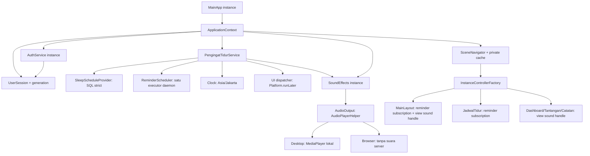

# Laporan P1B-2 — lifecycle pengingat/audio/callback dan logout mobile

Tanggal pemeriksaan: 31 Oktober 2026. Repository kerja: `/home/adhitya/Documents/projekpbo/BARU/SehatHarian2`.

## 1. Hasil dan batas bukti

**Implementasi lingkup P1B-2 selesai dan verifikasi terisolasi lulus. Validasi runtime desktop/web/mobile masih parsial, belum membuktikan isolasi dua browser atau audio perangkat.** Tidak melanjutkan P1B-3.

- Pengingat, worker, jadwal aktif, penanda kejadian, subscription, preferensi suara, dan handle audio sekarang milik satu ApplicationContext.
- Reset identitas membatalkan pekerjaan jadwal lama, menghapus target/subscription/penanda, menghentikan output lokal, lalu memuat jadwal identitas baru. Logout tetap anonim dan resource dapat dipakai kembali pada login berikutnya.
- Close terminal menutup worker/output dan melepas listener/cache milik instance itu. Pemanggilan berulang aman. Tidak menghentikan Platform, database, atau context lain.
- Callback UI dan hasil pembacaan lama ditolak memakai generation sesi, revisi pekerjaan/jadwal, dan status subscription. Jadwal kosong/gagal tidak memakai target sebelumnya atau datastore demo.
- Profil/logout berlabel dan mempunyai target tinggi minimum 44 px. Keduanya tetap ditampilkan pada mode compact; sidebar dapat digulir vertikal pada viewport pendek.
- **126 test dieksekusi, 126 lulus, tanpa skip/abort/failure**: 96 regresi sebelumnya, 28 test lifecycle baru, 2 kontrak XML/binding baru. Kedua modul serta seluruh 21 file source test berhasil dikompilasi langsung.
- Gradle terfilter masih gagal sebelum evaluasi task pada FileLockContentionHandler/wildcard IP. Tidak ada klaim build/test Gradle berhasil.

Acuan utama yang dibaca: `docs/LAPORAN_P1B_1.md`, source produksi/pemanggil/test terkait, dan konfigurasi modul. Tidak ditemukan AGENTS.md pada lokasi repository/ancestor yang diperiksa. `git status --short` gagal karena metadata Git tidak tersedia; tidak menjalankan init/reset. Baseline SHA-256 file dibuat sebelum edit dan dibandingkan kembali setelah pekerjaan.

Versi dipertahankan: toolchain Java 27, Gradle Wrapper 9.8.1, JavaFX 24.0.1, JPro/WebAPI 2026.3.0, Connector/J 9.3.0, jBCrypt 0.4, JUnit Jupiter 5.11.4/Platform 1.11.4. Tidak mengubah build, dependency, skema, seed, atau konfigurasi koneksi.

## 2. Masalah awal dan perubahan perilaku

| Kondisi awal terverifikasi statis | Perilaku sekarang |
|---|---|
| Pengingat singleton menyimpan satu target/listener dan worker global | Constructor injection; satu service/worker per context |
| Hari deduplikasi memakai tanggal pemeriksaan, berbeda di kedua sisi tengah malam | Identitas kejadian memakai tanggal **target** beserta waktunya |
| Callback membaca field listener yang dapat diganti setelah antre | Snapshot subscription, generation, revisi dan live flag diperiksa kembali saat eksekusi |
| Shutdown scheduler tidak menghapus callback yang sudah antre | Pembatalan ditambah pemeriksaan validitas; callback usang tidak memainkan audio maupun mengirim banner |
| Jadwal diambil dari riwayat yang dapat fallback demo; data kosong membiarkan target sebelumnya | Proyeksi SQL khusus tanpa fallback; target dikosongkan sebelum pembacaan dan saat gagal |
| AudioClip/cache dan java.util.prefs global, alarm dapat fallback AWT beep | Preferensi dalam sesi, backend audio per context, tidak ada AWT/server beep |
| Compact menyembunyikan profil/logout | Kedua kontrol tetap berlabel dan dapat dijangkau melalui sidebar vertikal |

Pemeriksaan tambahan pada bytecode JavaFX 24.0.1 menemukan `NativeMediaAudioClip.stop → NativeMediaAudioClipPlayer.stopPlayers(Locator)`, yang mengambil URI untuk operasi stop. Karena URI aset yang sama dipakai beberapa context, sekadar memindahkan cache AudioClip ke instance belum cukup sebagai jaminan penghentian terpisah. Implementasi akhir memakai **MediaPlayer** per aset/per context. Bytecode `MediaPlayer.stop` mengarah ke field `jfxPlayer` milik objek itu. Ini bukti inspeksi SDK, bukan reproduksi audio perangkat. Tidak memakai API internal SDK dalam source aplikasi.

## 3. Kepemilikan resource dan wiring nyata



Constructor produksi ApplicationContext memasang `SqlSleepScheduleProvider`, `ReminderScheduler.worker()`, Clock Jakarta, dispatcher JavaFX dan AudioPlayerHelper dengan deteksi `WebAPI.isBrowser()`. Constructor alternatif menerima port eksplisit untuk test. Controller menerima dependency bertipe melalui factory yang sudah ada; tidak mendapat global current context, ThreadLocal atau framework DI.

| Pemilik | Resource | Operasi lifecycle |
|---|---|---|
| ApplicationContext/navigator | sesi, service, cache, backend suara | `ApplicationContext.close → navigator.dispose` |
| PengingatTidurService | target, marker kejadian, pekerjaan terjadwal, subscription, listener identitas | `reset`, `reloadSchedule`, `close` |
| SoundEffects | flag suara sesi dan backend audio | reset pada perubahan identitas; stop saat mute; close terminal |
| AudioPlayerHelper | map MediaPlayer milik context | stop hanya player miliknya; close dispose dan kosongkan map |
| MainLayoutController | subscription banner, view sound handle, listener lebar layout | `close` melepas ketiganya; released/generation menolak callback lama |
| JadwalTidurController | subscription status pengingat | `close` melepas subscription; handler lama ditolak |
| Dashboard/Tantangan/Catatan | izin efek suara view dengan generation dan released flag | `close` mencabut izin pemutaran dari view itu |
| PrivatePageCache | LoadedView/root/controller instance | invalidasi/replace/close melepas controller AutoCloseable |

MediaPlayer adalah resource **context**, bukan setiap halaman. Handle view memberikan izin pemutaran, tidak membuat player global atau menyimpan identitas baru. Pergantian fitur biasa memakai cache dan tidak menutup pengingat sesi. Navigasi yang mengganti root aplikasi melepaskan shell/cache lama; pemuatan FXML yang gagal juga melepas controller yang sudah terbentuk. Navigator terminal menolak pemakaian ulang dan tidak dapat dipasangkan ulang ke Stage baru.

### Reset versus dispose

1. AuthService login/registrasi sah tetap menggunakan VerifiedAccount P1A. UserSession menaikkan generation dan mengirim notifikasi identitas.
2. SoundEffects mereset preferensi lokal dan menghentikan output miliknya. Pengingat mereset state, membatalkan task dan mencabut subscription lama.
3. Jika identitas baru sah, service mengantre pemuatan SQL dengan ID pengguna dan generation/epoch yang ditangkap saat permintaan dibuat.
4. Cache/shell lama dilepas oleh listener navigator. Shell baru menerima dependency context yang sama dan memasang subscription baru.
5. Logout menjalankan alur yang sama tanpa memuat jadwal baru, lalu navigator kembali ke halaman publik. Tidak mengeluarkan instance lain.
6. Close terminal menutup reminder/executor, menutup backend audio, logout lokal, melepas cache/listener/Stage. Mutasi Stage pada terminal cleanup dijalankan pada JavaFX thread; resource pengingat/output sudah ditutup sebelum antrean pelepasan Stage.

Worker dibuat sekali per context, thread daemon dimulai saat digunakan. Reset membatalkan task periodik tanpa membuat executor baru; dispose menutup executor. Query JDBC yang sedang berlangsung tidak dijamin berhenti seketika oleh interrupt; hasilnya tetap ditolak setelah generation/epoch berubah atau service ditutup. Timeout koneksi/socket berasal dari konfigurasi yang sudah ada, tidak diubah.

## 4. Penolakan callback dan kegagalan

- Pemeriksaan berlaku **sebelum membaca provider**, **setelah provider selesai**, **sebelum enqueue UI**, dan **saat UI dijalankan**.
- Task periodik membawa generation dan worker epoch. Task lama yang lolos cancel tidak dapat memeriksa target penggantinya.
- Revisi delivery membatalkan notifikasi yang sudah mengantre saat jadwal di-refresh atau toggle diubah.
- Subscription membawa generation dan live flag. Unsubscribe idempotent; unsubscribe view sesi lama tidak dapat menghentikan output sesi penggantinya. Listener yang dilepas oleh listener lain dalam delivery yang sama juga tidak dipanggil.
- Perubahan toggle saat SQL masih dimuat tidak dibuang/ditimpa hasil baca lama. Pemuatan tetap memasang jadwal dengan pilihan toggle terbaru sesi tersebut.
- RuntimeException satu pemeriksaan ditangani dengan pesan umum; tick berikutnya tetap tersedia. Dispatcher UI gagal tidak memicu fallback menjalankan UI pada worker. Kegagalan audio tidak menghilangkan banner.
- Gagal SQL ditandai “Jadwal SQL tidak tersedia”, tanpa detail koneksi/SQL. Kosong ditandai belum ada jadwal. Tidak ada fallback InMemoryDataStore pada jalur pengingat.

Pembacaan jadwal yang gagal tidak melakukan retry jaringan otomatis terus-menerus. Login berikutnya atau pemuatan ulang riwayat mengajukan pembacaan baru. Mekanisme reconnect/retry seluruh penyimpanan tetap pekerjaan terpisah.

## 5. Waktu, jadwal, dan preferensi

- Zona eksplisit **Asia/Jakarta (WIB, UTC+7)** pada Clock dan label pengingat. Tidak memakai zona lokal server secara implisit. Pemilihan zona pengguna lain belum ditambahkan.
- Semantik lama dipertahankan: jam dari baris tidur terbaru menjadi waktu pengingat berulang harian. Query tetap `WHERE pengguna_id = ? ORDER BY tanggal DESC, id DESC LIMIT 1`. Tidak menafsirkan baris tersebut sebagai bukti tidur aktual atau merancang ulang model rencana/aktual.
- Polling setiap 5 detik. Notifikasi persiapan saat selisih integer detik 570–630; alarm dimulai sekali saat selisih integer detik −10 sampai +10. Perhitungan Duration.getSeconds membulatkan ke satuan detik; bukan jaminan presisi milidetik.
- Kejadian diidentifikasi LocalDateTime target. Pemeriksaan 23:59:55 dan 00:00:05 untuk target 00:00 mengacu pada kejadian bertanggal yang sama. Refresh jadwal yang sama tidak mengulang kejadian yang sudah ditandai; reset identitas membersihkan marker.
- Ambang proyek ≥5 jam tidak diubah menjadi standar klinis universal. Algoritma tidur/evaluasi/skor tidak diubah.
- **Ambiguitas durasi dering tetap terbuka:** implementasi memulai satu playback dalam jendela alarm, bukan berbunyi terus selama seluruh rentang ±10 detik. Durasi bergantung aset/player. Polling, antrean UI, suspend proses, dan disconnect dapat menunda/melewatkan alarm; tidak ada jaminan alarm OS ketika aplikasi/instance ditutup.
- Flag suara sekarang hanya dalam sesi context dan kembali ke default saat identitas berubah. Preferensi OS java.util.prefs lama tidak dipakai karena dibagikan semua pengguna proses/server.
- Toggle pengingat dapat dimuat dari kolom yang sudah ada. Perubahan toggle dalam sesi tetap tidak ditambahkan persistensinya pada paket ini. Tidak ada skema/update toggle baru. Pengaturan saat refresh yang selesai mengikuti data SQL kecuali ada perubahan toggle saat pembacaan masih berjalan.

## 6. Desktop, browser JPro, dan disconnect

Bukti versi berasal dari jar yang tersedia, bukan dugaan nama hook. `javap` dan **sources jar resmi dependency** `one.jpro:jpro-webapi:2026.3.0` menunjukkan:

- `WebAPI.isBrowser()` dan `WebAPI.getWebAPI(Window)`.
- `addInstanceCloseListener(InstanceCloseListener)` serta remove pasangannya.
- `InstanceCloseListener.handle()` tanpa parameter.
- Javadoc sources WebAPI menyatakan listener dipanggil ketika session/instance ditutup, dan langsung dipanggil bila sudah ditutup.

MainApp memasang listener pada WebAPI untuk Stage miliknya setelah show. Hook memanggil cleanup yang sama dengan close desktop dan `Application.stop`; listener dilepas saat cleanup. Tidak ada listener disconnect sementara yang memanggil logout. Tidak mengubah kebijakan timeout/reconnect JPro atau menganggap websocket putus sama dengan terminal close.

API dan wiring terverifikasi statis/kompilasi; **pemanggilan hook oleh server, thread/lifecycle aktual, grace period disconnect, reconnect, dan dua browser independen belum diuji**. Uji tindak lanjut harus memakai runtime JPro dan fixture database aman, tanpa bootstrap ke data pengguna. Periksa disconnect singkat tanpa close, reconnect ke instance yang sama, lalu terminal close sesuai kebijakan server. Proses yang dibunuh paksa tidak menjamin callback lifecycle.

Audio browser belum diimplementasikan: adanya JavaFX media atau executeScript bukan bukti playback pada browser pemilik. Cabang browser AudioPlayerHelper tidak membuat Media/MediaPlayer dan tidak memakai AudioClip/AWT beep server. Kontrol suara menampilkan kapabilitas visual dan tooltip aksesibel bahwa audio browser belum tersedia. Alarm/banner visual tetap per context. Backend desktop menggunakan MediaPlayer yang sudah tersedia dalam dependency; keberhasilan bunyi/native backend belum diuji.

## 7. Profil/logout mobile

- Profil dipindahkan keluar dari baris nama/avatar yang diringkas, tetap dalam kartu akun.
- Profil dan logout tidak lagi di-hide/unmanage pada compact. Logout memakai label pendek “Keluar”, dengan accessibleText “Keluar dari akun ini”. Profil berlabel “Profil”; kedua tombol minHeight 44 px.
- Sidebar dibungkus ScrollPane fitToWidth dengan horizontal scrollbar NEVER. Lebar compact wadah 92 px memberikan ruang bagi label, padding dan scrollbar vertikal. CSS minimum isi sidebar dapat menyusut mengikuti viewport.
- Handler tetap `MainLayoutController.handleLogout → navigator instance → AuthService/session instance`. Controller yang released/berasal dari generation lama tidak dapat logout atau mengubah output sesi pengganti.
- Validasi XML/binding dan pemanggilan controller nyata tanpa rendering lulus. **Keterjangkauan visual pada 360/390/768/1280 px, keterbacaan, tinggi viewport pendek, sentuhan, keyboard, dan screen reader belum diuji.** Tidak menyatakan seluruh halaman bebas overflow. Form/chart/header lain tidak di-redesign.

## 8. Daftar file berubah

Semua path Java Backend berikut berawal `Backend2/src/main/java/com/sehatharian/`:

| File | Alasan |
|---|---|
| `model/UserSession.java` | generation volatile untuk publikasi ke worker; registrasi listener mengembalikan handle pelepasan |
| `service/PengingatTidurService.java` | hilangkan singleton, injeksi port, reset/close, dedup target bertanggal, guard callback |
| `service/ReminderScheduler.java` (baru) | port scheduling yang dipakai executor produksi dan scheduler manual test |
| `service/SleepScheduleProvider.java` (baru) | kontrak proyeksi jadwal tanpa fallback |
| `repository/SqlSleepScheduleProvider.java` (baru) | SELECT terbatas ID pengguna aktif, exception diteruskan |
| `util/AudioOutput.java` (baru) | port output terarah, kapabilitas backend, stop/close |
| `util/AudioPlayerHelper.java` | backend desktop per handle MediaPlayer; browser tanpa suara server |

Path Java Frontend berikut berawal `Frontend2/src/main/java/com/sehatharian/`:

| File | Alasan |
|---|---|
| `context/ApplicationContext.java` | pemilikan dan konstruksi reminder/output; port sintetis test; close terminal |
| `MainApp.java` | close desktop, Application.stop, hook terminal JPro yang tersedia dan pelepasan listener |
| `util/SceneNavigator.java` | factory memakai dependency context; release controller/root/cache dan terminal dispose |
| `util/InstanceControllerFactory.java` | injeksi reminder/sound kepada pemanggil aktual |
| `util/PrivatePageCache.java` | close resource saat invalidasi, replacement, terminal close; unsubscribe identitas |
| `util/SoundEffects.java` | preferensi/playback scope context, izin efek scope view, tidak ada cache/prefs global |
| `controller/MainLayoutController.java` | subscription banner, cleanup listener, guard released, compact profil/logout, kapabilitas audio |
| `controller/JadwalTidurController.java` | reminder yang diinjeksi; status/read SQL strict; hindari target dari fallback riwayat; cleanup subscription |
| `controller/DashboardController.java` | efek melalui view handle context dan close handle |
| `controller/TantanganController.java` | efek melalui view handle context dan close handle |
| `controller/CatatanKebiasaanController.java` | efek melalui view handle context dan close handle |

Resource: `Frontend2/src/main/resources/fxml/MainLayout.fxml` dan `css/sehat-theme.css` untuk akses akun compact/scroll vertikal. Test pada `Frontend2/src/test/java/com/sehatharian/`: `FrontendAuthFixture.java`, `InstanceContextTest.java` disesuaikan agar memakai port sintetis; `ReminderTestPorts.java`, `ReminderLifecycleTest.java`, `MainLayoutContractTest.java` ditambahkan. Dokumen baru: laporan ini.

Penghapusan API singleton/static pengingat/audio dan penambahan parameter constructor adalah perubahan internal yang disengaja. Seluruh pemanggil source/test dikompilasi; pencarian tidak menemukan lagi pemanggil lama `PengingatTidurService.getInstance`, `SoundEffects.play/isAktif/setAktif` static, atau `AudioPlayerHelper.mainkanNadaPengingat`. Tidak memelihara API fallback yang dapat memilih context global.

## 9. OOP untuk penjelasan akademik

- **Encapsulation:** target, marker, flag, subscription dan handle playback private; akses/reset/close melalui operasi yang menjaga invariant. Identitas tetap membutuhkan proof P1A dan snapshot profil.
- **Composition:** context menyusun sesi, autentikasi, pengingat, navigator dan output; satu context mempunyai resource sendiri tanpa static current-user/current-stage.
- **Dependency injection:** factory meneruskan reminder/sound nyata kepada controller. Clock, scheduler, provider dan output juga dipakai produksi, bukan interface yang hanya ada untuk test.
- **Polymorphism melalui interface:** service yang sama berjalan dengan SQL provider/executor/MediaPlayer backend pada produksi dan provider/scheduler/output sintetis pada test. AutoCloseable dipakai navigator/cache untuk melepas controller yang memang punya resource.
- Tidak membuat inheritance baru tanpa kebutuhan dan tidak mengklaim keempat pilar OOP telah dipenuhi hanya oleh paket ini. Abstract Pencatatan/algoritma fitur lain tidak dirombak.

Presentasi singkat: tunjukkan MainApp membuat dua composition root terpisah secara konsep; ikuti factory hingga constructor MainLayout/JadwalTidur; jelaskan generation sebagai penanda kepemilikan callback; demonstrasikan test logout A yang membiarkan B aktif; bedakan reset yang reusable dari close terminal. Nyatakan demo ini bukti objek satu proses, bukan bukti dua browser yang sudah terisolasi penuh.

## 10. Pengujian dan perintah aktual

| Pemeriksaan | Status | Bukti/batas |
|---|---|---|
| javac Backend2 `--release 27` | PASS | 44 file source utama |
| javac Frontend2 `--release 27` | PASS | 27 file source utama, classpath Backend2 |
| javac seluruh source test kedua modul | PASS | 21 file, termasuk test lama yang tidak dieksekusi |
| JUnit 9 kelas terpilih | PASS | 126/126, 17 container sukses, 0 skip/abort/failure |
| XML seluruh FXML + keberadaan source controller | PASS | 13 dokumen well-formed dan path controller ditemukan; bukan FXMLLoader.load |
| Kontrak XML MainLayout/factory/logout | PASS | 2 test XML dan test pemanggil controller/factory di suite terisolasi |
| Gradle test terfilter | FAIL sebelum task | FileLockContentionHandler/usable wildcard IP; 0 test Gradle berjalan |
| SQL database aktual | NOT TESTED | Tidak membuka koneksi nyata atau menjalankan bootstrap |
| Positive FXMLLoader/private halaman dengan toolkit | NOT TESTED | Startup/controller dapat mengakses repository fitur; runtime aman belum disiapkan |
| Rendering mobile 360/390/768/1280 | NOT TESTED | Tidak menyimpulkan hasil visual dari XML |
| Audio desktop/native nyata | NOT TESTED | Fake output dan cabang browser non-audio saja dieksekusi |
| Dua browser JPro, terminal close/reconnect aktual | NOT TESTED | API terverifikasi dari SDK; runtime/fixture aman diperlukan |

Perintah Gradle yang benar-benar dicoba sekali setelah meninjau konfigurasi/task:

```sh
GRADLE_USER_HOME=/tmp/sehatharian-p0/gradle-home ./gradlew --offline --no-daemon \
  :Backend2:test --tests com.sehatharian.AuthServiceTest \
  --tests com.sehatharian.AccountRepositoryTest --tests com.sehatharian.PasswordUtilTest \
  --tests com.sehatharian.PenggunaServiceTest \
  :Frontend2:test --tests com.sehatharian.UserSessionTest \
  --tests com.sehatharian.FrontendFlowValidationTest --tests com.sehatharian.InstanceContextTest \
  --tests com.sehatharian.ReminderLifecycleTest --tests com.sehatharian.MainLayoutContractTest
```

Pesan tersanitasi: `Gradle could not start your build → Could not create service of type FileLockContentionHandler → Could not determine a usable wildcard IP for this machine.` Exit 1. Tidak mengganti versi/konfigurasi untuk meloloskannya.

Alternatif aktual menggunakan cache dependency lokal yang sudah tersedia:

```sh
python3 /tmp/sehatharian-p1b2/verify.py
python3 /tmp/sehatharian-p1b2/run_tests.py
```

Script verifikasi memakai javac `--release 27 -encoding UTF-8` dengan delapan jar runtime versi di bagian 1, class Backend2 untuk Frontend2, dan delapan jar JUnit pendukung. Resource Frontend disalin ke **direktori sementara**, seluruh test dikompilasi, lalu JUnit Platform Launcher menjalankan hanya kelas terpilih dengan parallel disabled. Runner menggunakan BCrypt asli. Tidak memanggil MainApp/LocalDatabase/DatabaseBootstrap/Platform.startup, database/network, audio perangkat, atau blocking sleep dalam test baru. Percobaan runner awal salah memakai package test dan gagal discovery; package dikoreksi ke `com.sehatharian` sebelum eksekusi akhir di atas. Tidak dianggap sebagai kegagalan autentikasi/aplikasi.

Bukti lokal sementara: `/tmp/sehatharian-p1b2/{baseline.json,file-changes.json,compile-results.json,Backend2-compile.log,Frontend2-compile.log,test-compile.log,junit.log,gradle-filtered.log,xml.log,WebAPI.txt,NativeMediaAudioClip.txt,NativeMediaAudioClipPlayer.txt,MediaPlayer.txt}`. Artefak sementara bukan syarat menjalankan aplikasi; test regresi tersimpan di repository dan dapat dijalankan Gradle terfilter ketika lingkungan memungkinkan.

### Cakupan 28 test lifecycle baru

1. Dependency/jadwal/preferensi A tidak mengubah B.
2. Logout A tidak menghentikan output/worker/listener B.
3. Close A hanya dispose resource A; close berulang aman.
4. Callback UI sebelum logout diabaikan.
5. Callback sebelum pergantian identitas tidak mencapai subscription baru.
6. Hasil load A yang selesai setelah login B tidak memasang jadwal A.
7. Load usang ditolak sebelum provider dipanggil.
8. Login berulang tidak menggandakan worker atau mempertahankan listener lama.
9. Reset reusable; dispose tidak dapat restart service.
10. Jadwal kosong menghapus target lama tanpa demo.
11. Pembacaan gagal menghapus target dan memberi status tidak tersedia.
12. Kejadian tengah malam hanya sekali melintasi pergantian tanggal; hari berikutnya dapat berbunyi.
13. Jendela persiapan/alarm dan label zona eksplisit.
14. Exception satu pemeriksaan tidak mematikan tick berikutnya.
15. View dilepas tidak menerima banner/audio yang sudah antre; worker sesi tetap hidup.
16. Toggle membatalkan callback antre; task yang sudah dibatalkan tidak memakai jadwal baru.
17. Efek view menolak release/generation lama; mute hanya output pemiliknya.
18. Eviction cache menutup resource view tanpa mengubah worker context lain.
19. Factory produksi menyuntik reminder sendiri; dependency null ditolak; logout shell memakai context sendiri.
20. Backend browser menolak playback server tanpa menyentuh media/perangkat.
21. Toggle ketika load berjalan tidak menghilangkan jadwal atau menimpa pilihan pengguna.
22. Reload jadwal sama tidak mengulang alarm kejadian yang sama.
23. Close terminal menolak UI antre dan tick lama.
24. Identitas pengganti tidak mewarisi target/preferensi lama.
25. Shell released tidak logout/mengubah suara sesi pengganti.
26. Kegagalan audio tetap mengirim notifikasi visual.
27. Listener yang dilepas di tengah delivery tidak menerima callback berikutnya.
28. Unsubscribe subscription lama tidak menghentikan output sesi pengganti.

Regresi 96 test P1A/P1B-1 tetap lulus: email/BCrypt, tidak ada password universal/default identity, hash bermasalah ditolak, kegagalan akun tidak menjadi demo, registrasi menunggu kontrak committed, snapshot/refresh pemilik dan dua context/navigator terpisah.

## 11. Risiko tersisa dan P1B-3

| Prioritas | Risiko/bukti | Tindak lanjut dan cara membuktikan |
|---|---|---|
| P1 | Repository fitur selain pengingat masih mempunyai fallback InMemoryDataStore dan pola update/delete berdasarkan ID | P1B-3 audit ownership seluruh read/write, lalu tambahkan batas pengguna terverifikasi serta test lintas pengguna dengan storage sintetis |
| P1 | TidurService/riwayat UI masih dapat melaporkan simpan/riwayat dari fallback lama | Pisahkan hasil committed/temporer/gagal dan provenance; jangan menganggap SELECT pengingat strict memperbaiki seluruh penyimpanan |
| P1 | Event handler fitur lama dapat memegang record/controller lama; paket ini mencabut output dan cache, belum mengamankan setiap mutasi fitur | Guard generation/owner di boundary service/repository, uji stale handler tidak menulis milik sesi lain |
| P1 | DBConfig availability/cooldown dan datastore demo masih global | Audit pengaruh ketersediaan/fallback antar instance; pisahkan kegagalan SQL dari data demo eksplisit tanpa mengubah data nyata sembarangan |
| P1 | Hook close JPro terpasang tetapi terminal/transient/reconnect belum dibuktikan runtime | Dua browser independen dengan fixture aman; ukur worker/listener/output sebelum/sesudah close dan setelah gangguan singkat |
| P2 | Audio browser belum tersedia, desktop MediaPlayer belum diuji native | Eksperimen terpisah mekanisme browser resmi dan uji dua output desktop pada runtime aman; jangan aktifkan server beep |
| P2 | Rendering/touch/keyboard mobile belum diuji | Verifikasi profil/logout pada empat lebar, viewport pendek dan scroll vertikal; cek clipping header/chart sebagai pekerjaan UI terpisah |
| P2 | Animasi dekoratif pendek/helper layout di fitur lain belum mempunyai cleanup menyeluruh | Audit listener/Timeline/layout binding tersisa; scope paket ini pada reminder, output, subscription shell/tidur dan izin suara view |
| P2 | Toggle belum persisten melalui operasi baru; model rencana versus tidur aktual masih ambigu | Keputusan produk dan paket penyimpanan terpisah, bukan perubahan skema tersembunyi di lifecycle |

**Rekomendasi P1B-3:** mulai dari ownership dan hasil penyimpanan autentik pada service/repository aktivitas, hidrasi, kebiasaan makan, tidur, tantangan dan evaluasi; inventarisasi query ID tanpa pemilik, penulisan memori sebelum SQL, serta handler usang. Jadikan user ID dari sesi sah sebagai boundary, dengan pengujian dua pengguna dan kegagalan penyimpanan yang terisolasi. Tidak perlu menunggu pembuktian audio browser untuk memulai pengamanan ownership. Uji JPro/visual/audio mempunyai dependensi runtime terpisah.

## 12. Pemeriksaan perubahan akhir

Perbandingan hash dengan baseline sebelum edit menunjukkan perubahan hanya pada source/test/resource yang tercantum dan laporan ini: **18 file lama berubah, 8 file baru, 0 file dihapus**. Hash build/config/dependency/SQL/seed dan log runtime yang tercakup baseline tetap sama. Tidak ada reset file pengguna. Cache Gradle dan output javac/JUnit berada pada direktori lokal sementara yang diizinkan. Tidak menjalankan aplikasi/bootstrap, migrasi, seed, test suite fitur berisiko, atau query database pengguna.

Pernyataan ini adalah bukti tindakan dan file yang diperiksa, bukan audit server database aktual. Validasi runtime yang belum dilakukan tetap berstatus belum diuji; tidak ada klaim reconnect, audio browser, atau seluruh ownership sudah aman.
