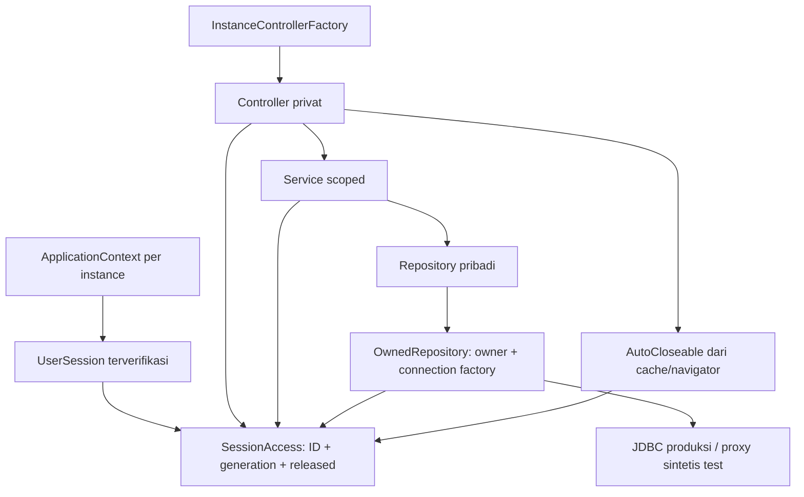

# Laporan P1B-3 — ownership data SehatHarian

Tanggal: 31 Oktober 2026. Acuan utama: `docs/LAPORAN_P1B_2.md` dan source/pemanggil/test aktual.

## 1. Hasil dan batas penerimaan

**Pengamanan ownership pada jalur produksi yang diinventarisasi sudah diimplementasikan dan diuji secara terisolasi. Penerimaan runtime masih parsial: JDBC server nyata, startup aplikasi, dan browser tidak dijalankan.** Tidak ada klaim bahwa pengujian pengganti menutup penerimaan tersebut.

- Identitas pemilik berasal dari UserSession terverifikasi P1A. Permintaan/view membawa SessionAccess yang mengikat identitas, generation dan masa hidup view; parameter pengguna_id hanya dapat mengonfirmasi owner yang sama.
- Service pribadi menolak anonim, pemilik lain, generation lama dan view released sebelum memanggil repository. Insert membentuk DTO memakai owner sah.
- Repository pribadi memerlukan scope. Query detail/list/range/join/agregat dibatasi owner; update/delete record memakai record ID **dan** owner. Pengguna mempunyai PK identitas sendiri, sehingga query profil/onboarding/password mengikat PK tersebut ke sesi.
- Nol affected row tidak dianggap sukses. Record pengguna lain dan record yang tidak ada memberi hasil mutasi yang sama: false atau kegagalan generik pada operasi simpan.
- Kegagalan SQL pribadi tidak dialihkan ke datastore demo. API pribadi datastore lama ditutup dari pemanggil publik; katalog global tetap dapat dibaca sesuai kebijakan.
- Evaluasi mengambil rentang tidur yang diminta dan memeriksa owner hasil adapter. Data kosong/gagal dibedakan dari kesimpulan kesehatan. Formula skor, ambang tidur dan aturan numerik pada catatan yang tersedia tidak diubah.
- **199 test terisolasi lulus, tanpa skip/abort/failure**; kedua modul dan seluruh source test dikompilasi langsung. Gradle terfilter gagal sebelum task karena hambatan lingkungan yang sama.

Tidak menjalankan MainApp, LocalDatabase, DatabaseBootstrap, SQL database pengguna, migrasi, seed, perangkat audio, atau server/browser JPro. Tidak mengubah dependency, versi Java, konfigurasi build, skema, maupun FXML/CSS.

Register kanonis: [PEKERJAAN_TERTUNDA.md](PEKERJAAN_TERTUNDA.md). Lampiran `docs/SehatHarian_Pekerjaan_Tertunda.md` ditemukan setelah pemeriksaan ulang atas arahan pengguna dan **dipertahankan tanpa perubahan**. Sebelumnya belum ada register kanonis. Seluruh **76 ID** lampiran dipertahankan, status/bukti OWN diperbarui berdasarkan pemeriksaan ini; dua temuan baru STORE-11/STORE-12 ditambahkan. Item runtime tidak ditutup. Klaim lain dalam lampiran tetap merupakan isi register asal, bukan hasil audit ulang Figma/layanan luar.

## 2. Matriks operasi dan sumber pemilik

Keterangan: R = detail/snapshot; L = list/range/join; A = agregat; I = insert; U = update; D = delete. Tanda “tidak ada” berarti API tersebut memang tidak tersedia, bukan fitur baru yang ditunda oleh implementasi ini. Nama class di tabel berada di package `com.sehatharian.service`, `repository` atau `model` sesuai jenisnya.

| Data | Operasi aktual dan jalur | Sumber pemilik/batas SQL | Test/bukti terkait |
|---|---|---|---|
| Autentikasi/registrasi | AuthService → AccountRepository/PenggunaRepository: findByEmail, existsByEmail, createPengguna | Lookup kredensial dan pembuatan akun memang mendahului login; tetap kontrak SQL-only/BCrypt/commit P1A. Tidak menjadi API pembacaan kesehatan tanpa autentikasi | AuthServiceTest, AccountRepositoryTest, PasswordUtilTest; regresi proof/snapshot |
| Profil | R snapshot: PenggunaService.getPenggunaAktif; R SQL: PenggunaRepository.getById(id, access); U: updateProfil → updatePengguna(dto, access). I hanya registrasi; L seluruh pengguna/D akun tidak tersedia | Snapshot terverifikasi/copy. Detail/UPDATE WHERE id = owner sesi. DTO ID berbeda ditolak sebelum membuka koneksi. Getter snapshot anonim mengembalikan null sesuai P1A, tidak membuka penyimpanan/default recovery | PenggunaServiceTest; OwnershipServiceTest.profileReadMissingOrUnavailableDoesNotRecoverDefaultUser, profileOnboardingAndPasswordWritesOnlyBindVerifiedAccountPrimaryKey |
| Onboarding | U: PenggunaService.simpanOnboarding → updateOnboarding(..., access) | Controller menerima service terikat view; PK pengguna berasal scope. Sesi baru diubah setelah repository melaporkan row diperbarui dan generation masih sah | PenggunaServiceTest; anonymousDeniedBeforeStorage; tamperedOwnerParametersAndProfileCannotChangeB; FrontendOwnershipTest |
| Password | U internal: PenggunaService.updatePassword → updatePassword(id, hash, access). Tidak ada alur reset password baru | Scope sah dan PK akun sendiri; tidak menerima owner asing. Tidak membuat setter identitas/sesi atau password universal | profileOnboardingAndPasswordWritesOnlyBindVerifiedAccountPrimaryKey; anonymous/tampered-owner tests; regresi P1A |
| Aktivitas | L getAktivitasHariIni/getByTanggal, getByRange; A getTotalDurasiAktivitas/getTotalDurasiHariIni; I tambahAktivitas/simpan; D hapusAktivitas/hapus. R-by-ID/U tidak tersedia | SessionAccess; I mengikat owner sah, L/A WHERE pengguna_id, D WHERE id AND pengguna_id | KebiasaanServiceTest; listsRangesAndAggregatesContainOnlyA; parameterized foreign/missing mutations; tampered-owner tests |
| Hidrasi | L getHidrasiHariIni/getByTanggal/getByRange; A getTotalHidrasiMl/getTotalMlHariIni; I tambahHidrasi/simpan; D hapusHidrasi/hapus. R-by-ID/U tidak tersedia | Sama; pemilik insert tidak diambil ulang dari DTO mutable ketika binding SQL | insert/foreign/no-row/failure tests; mutableDtoDuringConnectionOpeningCannotBindAnotherOwner |
| Makanan | L getMakanHariIni/getByTanggal; I tambahMakan/simpan; D hapusMakan/hapus. Agregasi UI memakai list owner tersebut; R-by-ID/U tidak tersedia | Scope sah; WHERE pengguna_id AND tanggal; delete ID+owner | KebiasaanServiceTest; listsRangesAndAggregatesContainOnlyA; foreignAndMissingRecordsAreIndistinguishableAndBReallyUnchanged |
| Tidur | R getJadwalTerbaru/getTerbaruByPengguna/getByTanggal; L getRiwayatTidur/getRiwayatByPengguna/getByRange; I/U catatJamTidur/simpan; D hapusCatatan/hapus | Scope sah. Simpan periode mencari record owner+tanggal lalu UPDATE id+owner; record ID eksplisit juga tetap dibatasi owner. INSERT mengikat owner sah. Tidak mengandalkan ON DUPLICATE KEY UPDATE pada struktur server yang belum diketahui | TidurServiceTest; dtoOwnerAndRecordIdCannotOverrideRepositoryScope; weeklyEvaluationUpdatesAOnlyAndAllSqlMutationsCarryOwner; historicalEvaluationUsesRequestedRangeDespiteManyNewerSleepRecords |
| Pengingat | R SqlSleepScheduleProvider.latest; U toggle sesi PengingatTidurService; U SQL yang sudah ada: TidurService.updatePengingat → setPengingatAktif(id, flag, owner) | Provider SQL sekarang menerima sesi context; scope ditangkap per pembacaan dan ID harus cocok. Reminder tetap memiliki guard generation/epoch P1B-2. Toggle SQL WHERE id AND pengguna_id; tidak menambah persistensi toggle UI | reminderSqlProjectionRejectsAnonymousAndForeignIdBeforeStorage; parameterized alarm mutation; ReminderLifecycleTest |
| Katalog tantangan | R getById; L getAll/getByFilter pada TantanganRepository; service getAllKatalogTantangan | Metadata global tanpa pengguna_id; repository katalog read-only tidak membutuhkan owner. Service penugasan dan halaman privat tetap memakai scope pengguna. Tidak ada I/U/D katalog atau admin baru | TantanganServiceTest; personalMemoryApisAreNotPublicAndCatalogRemainsGlobal |
| Riwayat tantangan | L getTantanganByTanggal/getByTanggal/getByRange + JOIN katalog; A/exists existsForDate; I pastikanTantanganHariIni/tambahTantanganKeHariIni → tambah; U selesai/lewati/reset → updateStatus; D hapusTantanganPadaTanggal → deleteByPenggunaAndTanggal | Profil masukan tidak dipercaya untuk personalisasi/owner: ID dikonfirmasi lalu metadata profil dari sesi. JOIN membatasi r.pengguna_id; status ID+owner; delete tanggal memakai owner+tanggal. SELECT sebelumnya bukan pengganti kondisi owner pada mutasi | TantanganServiceTest; listsRangesAndAggregatesContainOnlyA; foreign/missing mutation tests; staleCommandCannotUseBSessionOrTouchAnyStorage |
| Progres | R/A ProgresHarianService.getProgresHari → repository: COUNT tantangan, SUM hidrasi, SUM aktivitas, tidur per tanggal. Tidak ada tabel I/U/D progres pada source ini | Setiap subquery mengikat owner/tanggal, tanpa fallback agregat memori. hasRecordedData membedakan metrik kosong dari bukti kondisi kesehatan | ProgresHarianServiceTest; listsRangesAndAggregatesContainOnlyA; anonymous/tampered-owner tests |
| Grafik/konsistensi | L/A EvaluasiService.getKonsistensi7HariTerakhir: riwayat, aktivitas, hidrasi, tidur pada rentang | Semua input terikat owner; hasil adapter juga diperiksa owner. Tidur memakai BETWEEN tanggal mulai/akhir, bukan 14 record terbaru seluruh waktu. Slot kosong tetap ada untuk periode, dengan flag tidak tercatat | historicalEvaluationUsesRequestedRangeDespiteManyNewerSleepRecords; noEvidenceDoesNotProduceHealthAdviceOrEvaluationWrite; EvaluasiServiceTest |
| Evaluasi mingguan | R getEvaluasiTerbaru; L getDaftarEvaluasi; I/U buatEvaluasiMingguan → EvaluasiMingguanRepository.simpan. D tidak tersedia | Owner scope pada semua input/output dan periode rolling 7 hari yang sudah ada; save periode memilih record owner lalu UPDATE id+owner atau INSERT owner tersebut | weeklyEvaluationUpdatesAOnlyAndAllSqlMutationsCarryOwner; missingHabitEvidenceIsDescribedAsUnknownNotPoorHealth; FrontendFeatureFlowIntegrationTest |
| Rekomendasi katalog | L getAktivitasSesuaiWaktuLuang/getRekomendasiMenuDanWorkout/getAllRekomendasi → RekomendasiRepository.getFiltered/getAll | Hanya katalog global dan filter pilihan, bukan catatan pengguna lain. Read-only katalog boleh anonim pada batas backend; layar privat dan rekomendasi berbasis catatan tetap memakai scope. Metadata profil halaman berasal sesi terverifikasi | RekomendasiServiceTest; katalog anonim pada OwnershipServiceTest; FrontendOwnershipTest.RekomendasiController |

Operasi yang masih menerima penggunaId pada signature menganggapnya **klaim yang harus sama dengan SessionAccess.owner**, bukan pemberi hak akses. Ini mempertahankan pemanggil yang sesuai kontrak tanpa membiarkan akses lintas pemilik. Constructor no-arg layanan/repository pribadi dan overload mutasi tanpa owner/scope ditutup; seluruh source pemanggil/test diperbarui.

Tidak ada UPDATE umum untuk aktivitas/hidrasi/makanan, pembacaan seluruh pengguna, atau CRUD admin yang ditambahkan demi melengkapi tabel inventaris.

## 3. Desain dan alur otorisasi

### 3.1 Scope permintaan/view

`Backend2/src/main/java/com/sehatharian/model/SessionAccess.java` menyimpan referensi UserSession instance, user ID saat scope dibuat, generation dan flag released secara private. Tidak dapat dibuat dari angka ID saja.

- `owner()` menolak anonim, identitas/generation yang berubah, atau scope released.
- `owner(claimed)` mengonfirmasi klaim ID tanpa mengganti pemilik scope.
- `call(Operation)` memeriksa scope sebelum I/O dan sesudah operasi kembali.
- `row/rows` memeriksa pemilik hasil adapter dan validitas sebelum hasil dikembalikan.
- `apply` memeriksa scope sebelum menerapkan pembaruan; dipakai service profil/onboarding untuk state sesi.
- `requireSession` mencegah service profil meminjam scope context lain, termasuk ketika dua context login ke ID akun yang sama.
- `close` hanya mencabut scope itu; tidak logout/hentikan instance lain.

Controller privat membuat satu scope dari sesi yang diinjeksi dan meneruskannya ke layanan fitur. Layanan tersebut menyusun repository scoped, atau menerima repository pengganti pada constructor untuk test. Service profil milik context menyediakan `forView(access)` sehingga controller profil/onboarding memperoleh layanan terikat generation milik view, bukan layanan dinamis yang diam-diam berpindah pengguna. Getter profil context tetap kompatibel dengan P1A.

Semua controller privat fitur kini mempunyai cleanup scope melalui AutoCloseable yang benar-benar dipanggil mekanisme pelepasan cache/navigator P1B-2. Handler memeriksa scope sebelum membaca kontrol/form. Callback tombol yang menangkap record tetap menuju service scoped; listener detail evaluasi juga memeriksa owner/generation. MainLayout menjaga pembaruan sidebar terhadap generation/released dan owner profil.

### 3.2 SQL dan hasil mutasi

`OwnedRepository` adalah base kecil yang dipakai tujuh repository pribadi. Ia menyimpan scope dan factory koneksi, memeriksa scope ketika membuka koneksi, dan menutup koneksi yang baru dibuka bila scope ternyata kedaluwarsa. Service tidak membuka koneksi sendiri. Profil dan proyeksi pengingat memakai helper koneksi terotorisasi yang sama.

Contoh pola final:

```sql
DELETE FROM hidrasi WHERE id = ? AND pengguna_id = ?
UPDATE riwayat_tantangan SET status = ?, diselesaikan_pada = ?
WHERE id = ? AND pengguna_id = ?
SELECT ... FROM aktivitas
WHERE pengguna_id = ? AND tanggal BETWEEN ? AND ?
UPDATE pengguna SET ... WHERE id = ?
```

Parameter owner adalah identitas scope; untuk tabel pengguna, PK akun adalah owner itu sendiri. Insert pribadi mengikat SessionAccess.owner, bukan membaca pengguna_id DTO lagi sesudah proses membuka koneksi. Test sengaja mengubah DTO saat koneksi dibuka untuk membuktikan binding tidak beralih ke B.

Tidak ada preflight SELECT yang diikuti UPDATE/DELETE record tanpa owner. Simpan tidur/evaluasi mempertahankan kemampuan memperbarui periode pengguna sendiri menggunakan SELECT owner+periode kemudian UPDATE id+owner; record lain dengan periode sama tidak digabung/dihapus. Pola ini **bukan** transaksi/idempotensi serentak dan tidak mengasumsikan unique constraint aktual. Batasnya dicatat pada STORE-10/STORE-12.

Hasil no-row untuk ID milik B dan ID yang tidak ada tidak dibedakan di UI. Mutasi boolean mengembalikan false; save yang tidak menghasilkan row/key terkonfirmasi melempar SQLException umum. Controller tidak lagi menampilkan sukses/animasi penghapusan bila boolean false. Kontrak ini juga dapat menolak no-op update bila driver melaporkan nol row; tidak mengarang hasil sukses.

### 3.3 Batas perintah usang dan transaksi

Guard sebelum I/O, setelah hasil SQL, dan sebelum pembaruan UI mencegah perintah A berubah menjadi perintah B. ID owner SQL selalu tetap A. Pemuatan yang kembali setelah pergantian identitas tidak dipasang pada halaman B. Test memakai pergantian identitas dari hook JDBC proxy serta callback tertunda tanpa sleep.

**SQL yang sudah berjalan tidak otomatis dibatalkan.** Test `inFlightSqlMayFinishForAResultStillRejectedAndBNeverChanged` sengaja menyelesaikan UPDATE A, mengganti sesi ke B sebelum hasil kembali, lalu membuktikan: A dapat sudah berubah, hasil ditolak, B tetap identik. Tidak mengklaim rollback/commit receipt dari exception generation. Tindak lanjut hanya di register STORE-11/STORE-05/STORE-06.

### 3.4 Fallback, katalog, dan data kurang

Jalur pribadi sekarang SQL-only fail closed. Tidak ada write memori sebelum SQL, catch-success, default-account recovery atau fallback pribadi pada repository yang disentuh. Personal helper InMemoryDataStore menjadi private dan tidak dipakai jalur produksi; hanya enam API katalog/getInstance yang masih public. Data/teks contoh di initializer tidak dihapus, tetapi tidak dipakai untuk login, riwayat, progres, evaluasi atau jadwal SQL pengguna.

Katalog global TantanganRepository/RekomendasiRepository masih memakai mekanisme contoh yang sudah ada bila katalog SQL tidak tersedia. Katalog tersebut tidak memberikan akses ke data pribadi dan tidak menyebabkan operasi pribadi gagal diteruskan ke akun demo. Pemisahan/provenance demo lengkap tetap STORE-03/STORE-04.

Ringkasan konsistensi membawa flag catatan per kebiasaan. Tidak ada bukti selama seluruh periode → evaluasi tidak dibuat/disimpan. Tidur tidak tercatat → rata-rata nullable yang sudah didukung model, dengan teks belum dapat dinilai; bukan saran “Anda kurang tidur”. Ketiadaan hidrasi/aktivitas juga diberi alasan belum ada catatan. Grafik tidak menggambar titik kebiasaan yang tidak tercatat; label tidur/score kosong dan gagal baca menggunakan keadaan belum dinilai. Perubahan ini menjaga arti data, tidak mengubah bobot/target/formula pada catatan yang tersedia. Label/aturan lama lainnya tetap tercatat pada DATA-02/DATA-07/DATA-12; penerimaan visual tidak diklaim.

## 4. File berubah dan alasan

Path berikut relatif ke repository. Daftar lengkap per-file tersedia pada manifest pemeriksaan sementara bagian 6; pengelompokan ini mencakup seluruh file yang diubah oleh paket.

| Lokasi/file aktual | Alasan |
|---|---|
| `Backend2/src/main/java/com/sehatharian/model/SessionAccess.java` (baru) | Scope pemilik/generation/release, guard I/O/hasil/adapter/state |
| `Backend2/src/main/java/com/sehatharian/model/RingkasanKonsistensi.java`, `ProgresHarian.java` | Indikator data tercatat; bukan perubahan skor |
| `Backend2/src/main/java/com/sehatharian/repository/OwnedRepository.java` (baru) | Koneksi scoped dan cleanup koneksi usang yang dipakai repository |
| Repository `AktivitasRepository`, `HidrasiRepository`, `KebiasaanMakanRepository` | Scope wajib, owner query/mutasi/binding, SQL failure diteruskan, tanpa fallback pribadi |
| Repository `JadwalTidurRepository`, `EvaluasiMingguanRepository` | Owner pada reads/save/update/delete; save periode tanpa upsert lintas owner; rentang tidur eksplisit |
| Repository `RiwayatTantanganRepository`, `ProgresHarianRepository` | JOIN/count/range/status/delete/agregasi owner-scoped; tanpa catch-success atau fallback |
| Repository `PenggunaRepository`, `SqlSleepScheduleProvider` | Hapus default identity getter; profile/password/read dengan scope; provider pengingat terkait sesi context |
| Repository `InMemoryDataStore` | Tutup API pribadi publik yang tidak lagi dipakai normal; pertahankan API katalog |
| `Backend2/src/main/java/com/sehatharian/service/KebiasaanService.java`, `TidurService.java`, `TantanganService.java`, `ProgresHarianService.java`, `EvaluasiService.java` | Scope wajib, pemeriksaan sebelum repository dan sesudah hasil, DTO owner sah, validasi owner hasil adapter, evaluasi berbasis bukti |
| `Backend2/src/main/java/com/sehatharian/service/PenggunaService.java` | Layanan terikat view; scope profil/onboarding/password; pembaruan sesi sesudah hasil sah |
| `Frontend2/src/main/java/com/sehatharian/context/ApplicationContext.java` | Provider SQL pengingat dibuat dengan sesi milik context itu; port test tetap eksplisit |
| `Frontend2/src/main/java/com/sehatharian/util/InstanceControllerFactory.java` | Profil mendapat PenggunaService instance; tidak membuat repository langsung |
| Controller `DashboardController`, `CatatanKebiasaanController`, `JadwalTidurController`, `TantanganController` | Scope yang dipakai layanan, guard handler/callback dan cleanup; false mutasi tidak ditampilkan sukses |
| Controller `ProfilPengaturanController`, `OnboardingController` | Semua penulisan melalui service terikat view, tanpa write repository langsung |
| Controller `StatistikMingguanController`, `EvaluasiMingguanController`, `RekomendasiController`, `MainLayoutController` | Guard pemuatan/seleksi/hasil/cleanup; N/A dan gagal baca; sidebar tidak menerima identitas view lama |
| `Backend2/src/test/java/com/sehatharian/OwnedJdbc.java`, `OwnershipFixtures.java`, `OwnershipServiceTest.java` (baru) | JDBC proxy dengan tabel A/B yang dapat diperiksa, account/provider sintetis, test ownership positif/negatif |
| `Frontend2/src/test/java/com/sehatharian/FrontendOwnedJdbc.java`, `FrontendOwnershipFixtures.java`, `FrontendOwnershipTest.java` (baru) | Fixture mandiri modul Frontend dan pengujian factory/controller lama tanpa toolkit |
| Test Backend `AuthServiceTest`, `PenggunaServiceTest` | Penyesuaian override API yang ditutup, ID input valid milik fixture; assertions keamanan tetap dipertahankan |
| Test Backend `KebiasaanServiceTest`, `TidurServiceTest`, `TantanganServiceTest`, `EvaluasiServiceTest`, `ProgresHarianServiceTest`, `RekomendasiServiceTest` | Fixture konkret berisiko diganti SQL proxy/katalog sintetis, tanpa akun seed; assertions fitur tetap dijalankan |
| Test Frontend `FrontendAuthFixture`, `FrontendFeatureFlowIntegrationTest` | Kontrak repository scoped; feature-flow menggunakan fixture/proxy terisolasi, bukan akun default/database |
| `docs/PEKERJAAN_TERTUNDA.md`, laporan ini (baru) | Register kanonis berdasarkan ID dan bukti serah terima |

Semua nama repository di tabel berada di `Backend2/src/main/java/com/sehatharian/repository/`; semua controller berada di `Frontend2/src/main/java/com/sehatharian/controller/`. Tidak mengganti file MainApp, mekanisme audio/scheduler, source autentikasi/hash, atau navigator/cache P1B-2.

Fixture JDBC Backend dan Frontend sengaja berada pada test source masing-masing modul: dependency `project(':Backend2')` tidak mengekspor test source Backend ke test Frontend. Tidak menambah konfigurasi build/test-fixtures atau dependency baru untuk berbagi helper. Keduanya tidak masuk source produksi.

## 5. OOP untuk presentasi



- **Encapsulation:** pemilik/generation/released private dan tidak mempunyai setter ID. DTO tidak dapat meningkatkan hak. UserSession tetap menggunakan proof/copy P1A.
- **Composition:** view mempunyai scope; service menggunakan scope dan repository; context/session/navigator tidak kembali menjadi singleton.
- **Dependency injection dan polymorphism:** constructor layanan menerima repository pengganti; ConnectionFactory yang sama dipakai koneksi nyata dan proxy test. Factory controller tetap jalur produksi, bukan sekadar diagram.
- **Inheritance terbatas yang digunakan:** tujuh repository mewarisi OwnedRepository untuk perilaku owner/koneksi/cleanup yang sama. Tidak menambahkan superclass domain/inheritance kesehatan hanya untuk memenuhi daftar materi.
- **Interface yang benar-benar dipakai:** ConnectionFactory, AccountRepository, SleepScheduleProvider dan AutoCloseable; tidak memperkenalkan framework/antarmuka repository generik yang belum digunakan.

Urutan presentasi: tunjukkan controller menerima sesi instance; ikuti scope hingga service dan binding owner SQL; jalankan test A mencoba ID B dan perlihatkan snapshot B tetap sama; tunjukkan stale-handler dan batas SQL in-flight. Bedakan mekanisme ini dari role admin, transaksi atomik, dan pembuktian dua browser yang belum dilakukan.

## 6. Pengujian aktual

| Pemeriksaan | Status | Bukti/batas |
|---|---|---|
| Kompilasi langsung Backend2 JDK 27 | PASS | 46 file source utama |
| Kompilasi langsung Frontend2 JDK 27 | PASS | 27 file source utama dengan classpath Backend2 |
| Kompilasi seluruh source test | PASS | 27 file kedua modul, termasuk test toolkit yang tidak dijalankan |
| JUnit terpilih | PASS | 199/199, 29 container sukses, 0 skip/abort/failure |
| XML/FXML statis | PASS | 13 XML well formed, path source controller ditemukan; bukan FXMLLoader.load |
| Factory/controller tanpa toolkit | PASS | FrontendOwnershipTest + regresi instance/lifecycle; tanpa initialize FXML yang mengakses data |
| SQL query/binding/record A/B | PASS pada proxy | Repository SQL asli dieksekusi melalui proxy; bukan penerimaan vendor/engine JDBC nyata |
| Gradle test terfilter | FAIL sebelum task | FileLockContentionHandler / usable wildcard IP, exit 1; 0 test Gradle dieksekusi |
| JDBC server nyata dan metadata | NOT TESTED | RUN-02/RUN-04 tetap terbuka |
| Browser/JPro/desktop/rendering mobile | NOT TESTED | Tidak menjalankan startup atau bootstrap; RUN-05–RUN-08 tetap terbuka |
| Full suite/check/build | NOT TESTED | Hanya kelas terpilih aman; test toolkit tidak dijalankan |

Kelas yang dieksekusi (semuanya package `com.sehatharian`):

```text
AuthServiceTest                 AccountRepositoryTest
PasswordUtilTest                PenggunaServiceTest
UserSessionTest                 FrontendFlowValidationTest
InstanceContextTest             ReminderLifecycleTest
MainLayoutContractTest          OwnershipServiceTest
KebiasaanServiceTest            TidurServiceTest
TantanganServiceTest            EvaluasiServiceTest
ProgresHarianServiceTest         RekomendasiServiceTest
FrontendFeatureFlowIntegrationTest
FrontendOwnershipTest
```

126 regresi paket sebelumnya tetap lulus. Total 199 juga mencakup test ownership baru dan test fitur lama yang sebelumnya tidak aman dijalankan pada database pengguna, kini memakai fixture pengganti; selisih angka tersebut bukan seluruhnya test baru.

### Bukti yang diwajibkan

| Skenario | Bukti test aktual |
|---|---|
| Anonim tidak mencapai penyimpanan | anonymousDeniedBeforeStorage: 10 fitur, counter koneksi dan command tetap nol |
| A dapat membaca/mengubah A, B tidak berubah | foreignAndMissingRecordsAreIndistinguishableAndBReallyUnchanged: enam jenis mutasi, snapshot tabel B dibandingkan sebelum/sesudah; operasi A positif juga dibuktikan |
| Owner form/DTO tidak menjadi sumber hak | tamperedOwnerParametersAndProfileCannotChangeB; dtoOwnerAndRecordIdCannotOverrideRepositoryScope; serviceRejectsForeignInsertEvenWhenStorageAdapterHasNoOwnerChecks |
| Insert hanya A | insertsAssignAAndNeverCreateRowsForB; mutableDtoDuringConnectionOpeningCannotBindAnotherOwner |
| List/join/agregat/evaluasi tidak mencampur | listsRangesAndAggregatesContainOnlyA; weeklyEvaluationUpdatesAOnlyAndAllSqlMutationsCarryOwner; historicalEvaluationUsesRequestedRangeDespiteManyNewerSleepRecords |
| SQL mutation memuat owner dan binding yang benar | Proxy menjalankan kondisi SQL atas tabel A/B, merekam param; test mengecek owner pada mutasi periode dan PK profil/onboarding/password |
| Hilang/nol affected bukan sukses | foreign/missing, zeroAffectedRowsAndSqlFailureCannotBecomeSuccessOrFallback; profil gagal tidak memperbarui snapshot sesi |
| Stale command/result | staleCommandCannotUseBSessionOrTouchAnyStorage; oldReadResultRejectedBeforeItCanReachUi; staleConnectionIsClosedBeforeAnyStatementIsIssued |
| SQL selesai sebelum pergantian identitas | inFlightSqlMayFinishForAResultStillRejectedAndBNeverChanged secara eksplisit membuktikan A bisa sudah berubah, B tidak |
| Adapter/fallback tidak melewati owner | adapterReturningMixedOwnersIsRejectedRatherThanFedIntoEvaluation; personalMemoryApisAreNotPublicAndCatalogRemainsGlobal; SQL failure tests |
| Tidak menganggap kosong sebagai kesehatan buruk | noEvidenceDoesNotProduceHealthAdviceOrEvaluationWrite; missingHabitEvidenceIsDescribedAsUnknownNotPoorHealth |
| Profil/pengingat tetap terikat context | profileScopeCannotBeBorrowedFromAnotherContextWithSameUserId; reminderSqlProjectionRejectsAnonymousAndForeignIdBeforeStorage; regresi reminder |
| Handler nyata usang | FrontendOwnershipTest: sembilan controller dari factory, plus controller released dan callback hasil lama; ditolak sebelum kontrol FXML/storage, tabel profil B tetap sama |

### Perintah dan artefak

Perintah Gradle dicoba sekali, setelah task/config ditinjau; tidak menjalankan build/check/test keseluruhan:

```sh
GRADLE_USER_HOME=/tmp/sehatharian-p0/gradle-home ./gradlew --offline --no-daemon \
  :Backend2:test --tests com.sehatharian.OwnershipServiceTest \
  --tests com.sehatharian.AuthServiceTest --tests com.sehatharian.AccountRepositoryTest \
  --tests com.sehatharian.PasswordUtilTest --tests com.sehatharian.PenggunaServiceTest \
  :Frontend2:test --tests com.sehatharian.FrontendOwnershipTest \
  --tests com.sehatharian.InstanceContextTest --tests com.sehatharian.ReminderLifecycleTest \
  --tests com.sehatharian.MainLayoutContractTest
```

Hambatan tersanitasi: `Could not create service of type FileLockContentionHandler` → `Could not determine a usable wildcard IP for this machine.` Tidak mengubah versi/config atau meminta menjalankan database untuk menghindarinya.

Jalur alternatif yang benar-benar dijalankan:

```sh
python3 /tmp/sehatharian-p1b3/verify.py
python3 /tmp/sehatharian-p1b3/run_tests.py
```

`verify.py` menggunakan javac `--release 27 -encoding UTF-8`, jar dependency lokal versi yang tetap sama, class Backend untuk Frontend, resource Frontend disalin ke direktori sementara, lalu javac seluruh test. Runner JUnit Platform memakai 18 kelas di atas dengan parallel disabled. Fixture autentikasi memakai BCrypt nyata; fixture storage/callback/waktu memakai pengganti deterministik. Tidak ada blocking sleep, database/network, startup toolkit atau audio nyata dalam test ownership baru.

Pada proses pengembangan, kompilasi menemukan pemanggil API lama dan semuanya diperbarui. Satu putaran test menemukan ID katalog pada test legacy masih mengacu seed lama; fixture diganti ID sintetis yang tersedia tanpa mengubah expected behavior pencegahan duplikasi. Hasil akhir di tabel merupakan eksekusi sesudah koreksi, bukan hanya kompilasi.

Bukti lokal: `/tmp/sehatharian-p1b3/` berisi `baseline.json`, `user-added-files.json`, `file-changes.json`, `compile-results.json`, `Backend2-compile.log`, `Frontend2-compile.log`, `test-compile.log`, `junit.log`, `gradle-filtered.log`, `xml.log`, serta script verifikasi. Test permanen berada di source repository; direktori sementara bukan dependency aplikasi.

## 7. Register, kompatibilitas dan P1C

OWN-01–OWN-07 diperbarui dengan bukti inventaris/source/unit/proxy, tanpa menutup item runtime. DATA-03 mendapat bukti perbaikan rentang; DATA-02, STORE-01, STORE-03, RUN-09 tetap parsial sesuai register. STORE-11 dan STORE-12 mencatat temuan baru. Seluruh pekerjaan belum selesai dan pilihan tindak lanjut dipusatkan di [PEKERJAAN_TERTUNDA.md](PEKERJAAN_TERTUNDA.md), tidak disalin ulang sebagai daftar baru di laporan ini.

Dampak kompatibilitas yang disengaja:

1. Constructor layanan/repository pribadi membutuhkan scope, dan mutasi repository membutuhkan owner. API default identity dihapus; semua pemanggil yang ditemukan dan seluruh test source dikompilasi.
2. SQL gagal kini menghasilkan gagal terkontrol untuk fitur pribadi; aplikasi tidak lagi terlihat berhasil melalui data contoh. Ini bukan implementasi mode offline/demo baru.
3. Save tidur/evaluasi memperbarui record periode milik owner dengan kondisi id+owner atau melakukan INSERT. Tidak mengubah constraint/duplikasi historis, tidak menjanjikan atomic retry.
4. Evaluasi tanpa catatan tidak disimpan. Nilai tidur tidak diketahui memakai null model yang sudah tersedia; kompatibilitas skema aktual tetap memerlukan RUN-02, tanpa migrasi otomatis.
5. Perubahan scope/guard mempertahankan autentikasi, context/navigator, preferensi/pengingat/audio dan akses logout mobile paket sebelumnya. Tidak ada role/admin, algoritma kesehatan baru, redesign, token jaringan atau framework baru.

**Rekomendasi P1C:** prioritaskan STORE-01/STORE-02/STORE-05/STORE-11 untuk hasil committed/parsial/tak pasti dan pesan UI yang sesuai, kemudian STORE-03/STORE-04 untuk provenance/demo eksplisit, serta STORE-06/STORE-10/STORE-12 untuk retry/idempotensi dan cardinality berdasarkan metadata yang aman. Siapkan RUN-02/RUN-04 sebelum pembuktian JDBC nyata. Pengamanan source ownership ini tidak perlu menunggu media/browser, tetapi penerimaan browser tetap terpisah. Tidak melanjutkan P1C tanpa instruksi.

## 8. Pemeriksaan workspace akhir

Metadata Git tidak tersedia (`git status --short` exit 128); tidak melakukan git init/reset. Manifest hash dibuat sebelum edit dan dibandingkan sesudahnya. Di luar cache/build output yang diizinkan, perubahan milik paket: **40 file lama berubah, 10 file baru** (termasuk dua dokumen), **0 file dihapus**. Lampiran yang ditemukan selama pekerjaan adalah file tambahan pengguna dan dicatat terpisah, bukan diklaim sebagai file yang dibuat paket. Hash lampiran tersebut tetap sama setelah digabung ke register kanonis.

Hash konfigurasi build/dependency/SQL/seed/resource FXML/CSS dan log runtime yang tercakup baseline tidak berubah. Tidak menimpa perubahan pengguna atau merapikan data. Pernyataan tentang database dibatasi pada tindakan yang dilakukan dan proxy; tidak mengklaim kondisi server aktual telah diaudit.
