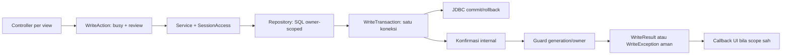

# Laporan P1C-1 — kepastian penyimpanan dan hasil parsial

Tanggal: 31 Oktober 2026. Acuan: instruksi repository yang tersedia, `docs/LAPORAN_P1B_3.md`, `docs/PEKERJAAN_TERTUNDA.md`, source dan pemanggil aktual. AGENTS.md tidak ditemukan pada repository/ancestor yang diperiksa. Metadata Git tidak tersedia; baseline hash dibuat sebelum edit, tanpa git init/reset.

## 1. Hasil dan batas bukti

**P1C-1 diimplementasikan dan lolos verifikasi source/unit/proxy. Penerimaan JDBC nyata serta UI/browser masih parsial, belum diuji.** Tidak melanjutkan P1C-2.

- Operasi tulis pribadi sekarang memakai transaksi eksplisit per operasi repository. Affected rows/generated key diperiksa **sebelum** commit; sukses baru dikembalikan setelah commit diakui.
- Kegagalan commit tidak disamakan dengan pasti tidak tersimpan. Rollback yang gagal/berperingatan juga tidak dianggap membuktikan perubahan sudah dibatalkan.
- Commit yang sudah diakui tetap diakui walaupun cleanup statement/koneksi atau pemulihan mode koneksi kemudian gagal.
- Tidur dan evaluasi adalah dua langkah terpisah: tidur yang tersimpan tidak diulang hanya karena evaluasi belum selesai. Hasil parsial membawa status masing-masing langkah.
- Form/snapshot berubah hanya pada jalur terkonfirmasi; hasil belum pasti mempertahankan isian dan menghentikan submit ulang pada view itu. Tidak menambah retry otomatis.
- Konfirmasi penyimpanan internal dipisahkan dari izin menyampaikan hasil. Generation lama dapat ditolak sesudah SQL terkonfirmasi untuk owner awal, tanpa memperbarui sesi/view pengguna pengganti.
- **235 test pada 21 kelas lulus**, 34 container sukses, tanpa skip/abort/failure. Backend/Frontend dan seluruh source test berhasil dikompilasi langsung.

Tidak menjalankan bootstrap, seed, migrasi, aplikasi, server JPro, perangkat audio, atau koneksi database pengguna. Tidak mengubah stack/dependency/build/schema/algoritma kesehatan. Tidak memerlukan aset visual baru. Semua pekerjaan tersisa dipusatkan pada [register kanonis](PEKERJAAN_TERTUNDA.md).

## 2. Audit kontrak sebelum perubahan

Bukti bagian ini adalah inspeksi source awal, bukan hasil eksekusi database nyata.

1. Selain registrasi, repository pribadi tidak membaca mode auto-commit dan tidak memanggil commit eksplisit. Jalur menilai berhasil dari executeUpdate/affected rows dan, untuk insert, generated key. Snapshot/form kemudian diperbarui oleh service/controller.
2. Registrasi sudah menggunakan setAutoCommit(false), generated key dan commit. Namun try-with-resources dapat melempar setelah commit berhasil; service lalu tidak menerima hasil terkonfirmasi dan controller dapat menampilkan gagal. SQLException commit juga belum mempunyai klasifikasi ketidakpastian.
3. UI tidur menjalankan catatJamTidur lalu buatEvaluasiMingguan dalam satu blok try. Kegagalan evaluasi masuk pesan “Gagal Menyimpan”, tanpa menjelaskan tidur yang sudah tersimpan.
4. pastikanTantanganHariIni dapat melakukan beberapa insert independen lalu membaca ulang. Kegagalan langkah kedua/ketiga atau pemuatan hasil tidak mempertahankan detail langkah yang sudah selesai.
5. Controller dapat membersihkan form, memutakhirkan snapshot, menampilkan sukses atau mengulangi alur pemuatan sebelum batas kepastian dibedakan. Refresh tantangan juga dapat menghasilkan penugasan, sehingga bukan pembacaan murni.
6. P1B-3 menolak hasil generation lama, tetapi penolakan itu sendiri belum menjelaskan apakah SQL yang sudah berjalan tersimpan.

Dasar JDBC: koneksi baru secara standar memakai auto-commit; ketika auto-commit dimatikan, commit harus dipanggil eksplisit. Mengubah mode ke auto-commit dapat menyelesaikan transaksi, dan transaksi perlu diselesaikan sebelum menutup koneksi. Implementasi ini memilih batas manual yang jelas, tanpa mengubah versi driver. Lihat [Javadoc Connection Java 27](https://docs.oracle.com/en/java/javase/27/docs/api/java.sql/java/sql/Connection.html). Klasifikasi kegagalan jaringan di bawah merupakan **keputusan konservatif implementasi**, bukan klaim perilaku server yang sudah diuji.

## 3. Matriks operasi dan batas konfirmasi final

Seluruh owner dan kondisi SQL P1B-3 dipertahankan. Factory koneksi harus menyerahkan **koneksi baru yang dimiliki operasi**, dengan mode awal auto-commit. Mode manual yang sudah aktif ditolak sebelum DML agar tidak mengambil alih transaksi lain.

| Operasi pribadi aktual | Repository/service dan cara eksekusi | Batas berhasil | Nol row/key dan operasi berantai |
|---|---|---|---|
| Profil | PenggunaService.updateProfil → PenggunaRepository.updatePengguna; UPDATE PK pengguna yang cocok scope | Execute positif → commit diakui → service memutakhirkan copy/snapshot → callback UI | Nol row melakukan rollback dan false; snapshot/form tidak berubah sebagai sukses |
| Onboarding | simpanOnboarding → updateOnboarding, owner dari scope | Commit diakui sebelum completeOnboarding dan navigasi | False menjadi kegagalan penyimpanan; tidak membentuk sesi baru |
| Password | updatePassword → repository owner-scoped | Commit diakui sebelum snapshot hash milik sesi diperbarui | Nol row false; exception/ketidakpastian tidak mengganti snapshot. Tidak menambah reset password atau UI password baru |
| Aktivitas | tambahAktivitas/simpan, hapusAktivitas/hapus | Insert: execute positif + key positif → commit. Delete: affected > 0 → commit | Key hilang/rusak sebelum commit di-rollback. Delete 0 bukan sukses; form dibersihkan hanya sesudah konfirmasi |
| Hidrasi | tambahHidrasi/simpan, hapusHidrasi/hapus; termasuk quick add | Sama, dengan owner binding dari SessionAccess | Quick/manual submit berbagi gate view; tidak fallback memori |
| Makanan | tambahMakan/simpan, hapusMakan/hapus | Sama | Pilihan/menu/keterangan tetap tersedia saat gagal/belum pasti |
| Tidur | catatJamTidur → simpan: SELECT owner+tanggal lalu UPDATE id+owner atau INSERT | Satu transaksi lokal untuk lookup/save; affected/key valid lalu commit | Nol update/key tidak diakui sukses. Cardinality/constraint/race serentak tidak diubah |
| Pengingat SQL | updatePengingat → setPengingatAktif(id, flag, owner) | Execute positif → commit | Toggle UI PengingatTidurService masih preferensi sesi seperti P1B-2; paket ini **tidak** menambah persistensi toggle UI |
| Riwayat tantangan | tambah, updateStatus, deleteByPenggunaAndTanggal | Masing-masing mutasi owner-scoped mempunyai transaksi/commit sendiri | False/no key bukan sukses. Penugasan beberapa tantangan menyimpan detail langkah dan dapat PARSIAL |
| Evaluasi | buatEvaluasiMingguan → EvaluasiMingguanRepository.simpan | Perhitungan/read owner-scoped terlebih dahulu; save periode/key dan commit diakui sebelum hasil dikembalikan | Data tak cukup tetap penolakan kelayakan, bukan sukses penyimpanan. Tidak mengulang tidur |
| Tidur → evaluasi | TidurService.catatDenganEvaluasi | Konfirmasi tidur dahulu; bila <5 jam, evaluasi dengan transaksi terpisah | Tidur berhasil + evaluasi gagal/belum pasti → PARSIAL, tidak meminta simpan ulang tidur |
| Registrasi P1A | AuthService.register → createPengguna | Key valid dan commit diakui sebelum VerifiedAccount/sesi baru | Cleanup sesudah commit tidak membatalkan konfirmasi. Commit belum pasti tidak melakukan auto-login; generation berubah menolak mengganti sesi baru |

Tidak ada operasi tulis pribadi pada ProgresHarianRepository atau katalog rekomendasi/tantangan global; operasi tersebut tidak dipaksa memakai API hasil tulis. Pembacaan biasa tetap memakai kontrak read/ownership sebelumnya. Refresh profil kini dapat membaca profil SQL sendiri untuk pemeriksaan keadaan terkini; hasil baca itu **bukan** bukti identitas suatu operasi tulis.

## 4. Kontrak hasil dan keputusan transaksi

### 4.1 Empat keadaan

`storage/WriteResult<T>` memuat Status, value opsional dan daftar Step hanya untuk alur berantai:

| Keadaan | Arti dan perilaku |
|---|---|
| BERHASIL | Tahap commit yang relevan telah diakui sesuai kontrak JDBC; boleh memperbarui snapshot/form bila scope masih sah |
| GAGAL | Diketahui operasi tidak menghasilkan penyimpanan yang diminta atau tidak berubah, misalnya sebelum DML atau rollback yang diakui tanpa peringatan dan belum pernah meminta commit |
| PARSIAL | Ada langkah terkonfirmasi; langkah lain belum selesai/gagal/belum pasti. Status tiap langkah dipertahankan |
| BELUM_PASTI | Konfirmasi commit hilang, rollback tidak terkonfirmasi/berperingatan, atau exception SQL dari batas lama tidak memberi cukup informasi untuk menyimpulkan tidak tersimpan |

Penolakan autentikasi/ownership/generation dan validasi tetap exception yang terpisah; WriteResult.attempt tidak mengubah SecurityException/IllegalArgumentException menjadi hasil simpan. Kelayakan data evaluasi tetap dapat menolak evaluasi langsung; pada alur tidur, evaluasi yang belum dapat dilakukan dicatat sebagai follow-up yang belum selesai setelah catatan utama terkonfirmasi.

`WriteException` adalah SQLException aman yang membawa hasil untuk API int/boolean/void yang masih berguna. Tidak perlu mengubah semua signature baca atau mengganti seluruh API service. Adapter UI/koordinator memakai WriteResult; exception SQL mentah tidak disisipkan ke pesan/receipt. SQLException tanpa informasi fase diperlakukan konservatif sebagai BELUM_PASTI, bukan selalu GAGAL.

### 4.2 WriteTransaction yang kecil

WriteTransaction hanya mengelola lifecycle **satu koneksi/satu operasi repository**. SQL, binding dan aturan bisnis tetap di repository/service. Tidak mempunyai registry transaksi global, nesting, ThreadLocal, transaksi lintas koneksi, retry, antrean atau integrasi framework.

Urutan produksi:

1. Scope/owner dicek sebelum membuka koneksi dan sebelum executeUpdate.
2. Mode awal dibaca; koneksi owned dalam auto-commit dialihkan ke manual.
3. SQL dieksekusi. Affected row/key diperiksa, belum berarti commit berhasil.
4. commit dipanggil; hanya setelah kembali normal konfirmasi internal disimpan.
5. Guard hasil memeriksa scope/generation. Konfirmasi internal tidak dihapus bila view/sesi tidak lagi boleh menerima hasil.
6. Statement/result set ditutup; mode dipulihkan bila transaksi sudah terselesaikan dengan kepastian yang sesuai; koneksi ditutup idempotent. Pemulihan false→true tidak dilakukan pada commit/rollback yang belum pasti.

Klasifikasi penting:

- Koneksi/prepare gagal sebelum DML: GAGAL, tanpa menebak keberhasilan.
- Execute/key gagal sebelum commit, rollback diakui tanpa warning: GAGAL.
- Commit sudah diminta lalu exception: BELUM_PASTI, **walau rollback berikutnya kembali normal**.
- Rollback gagal atau memiliki warning sesudah eksekusi: BELUM_PASTI.
- Commit telah diakui lalu cleanup gagal: hasil terkonfirmasi dipertahankan; tidak menjalankan ulang SQL.
- Nol affected row tidak dipaksakan berhasil. Makna tidak ada record/tidak berubah tidak dibedakan melalui pesan publik; perilaku found/changed rows driver aktual belum diuji.

DDL repository menyebut InnoDB, tetapi engine dan kemampuan transaksi server aktual belum diverifikasi. Hasil di atas bergantung pada implementasi driver/storage yang memenuhi kontrak transaksi; prasyarat ini dicatat pada STORE-13 dan RUN-02, bukan diasumsikan terbukti dari SQL repository.

### 4.3 Hasil parsial yang benar-benar dipakai

Tidur merupakan catatan berguna tersendiri; kegagalan evaluasi tidak membatalkan catatan tidur yang telah dikonfirmasi. Karena repository/connection berbeda dan evaluasi boleh dijalankan terpisah, dipilih orkestrasi dua transaksi dengan langkah `Catatan tidur` dan `Evaluasi mingguan`, bukan transaksi atomik buatan.

- Tidur GAGAL/BELUM_PASTI: evaluasi tidak dimulai.
- Tidur BERHASIL dan tidak membutuhkan evaluasi: selesai.
- Tidur/evaluasi sama-sama BERHASIL: pesan mengakui keduanya.
- Tidur BERHASIL, evaluasi GAGAL/BELUM_PASTI: PARSIAL, pesan menyebut tidur sudah tersimpan dan mengarahkan pemeriksaan halaman Evaluasi; submit catatan utama tidak diulang.

Penugasan tantangan juga mempunyai beberapa commit independen. Detail urutan langkah dipertahankan ketika insert berikutnya atau pembacaan hasil gagal. Penahan per sesi/tanggal menghentikan **pembuatan otomatis** berikutnya setelah parsial/belum pasti, termasuk lewat service/view lain dalam context itu. Pembacaan riwayat tetap boleh dilakukan. Ini tidak menggantikan idempotensi durable lintas sesi/proses.

### 4.4 Sesi lama

Jika sesi berubah ketika SQL berlangsung, operasi dapat tetap dikonfirmasi untuk owner awal. Repository menyimpan konfirmasi terlebih dahulu, kemudian pemeriksaan hasil menolak delivery scope lama. Tidak ada pengulangan dengan ID pengguna pengganti. Snapshot/profile/identity baru tetap utuh.

AuthService juga menangkap generation permintaan sebelum pekerjaan login/registrasi dan memeriksa sebelum menetapkan VerifiedAccount. Perubahan ini menutup kasus relevan ketika registrasi sudah commit tetapi sesi telah diganti selama I/O. Kontrak email/BCrypt dan auto-login hanya setelah akun committed tetap dipertahankan.

## 5. UI tanpa redesign

WriteAction benar-benar dipakai controller CatatanKebiasaan, Dashboard, Tidur, Tantangan, Evaluasi, Profil dan Onboarding. Ia mengunci satu permintaan view saat berjalan dan sampai pelepasan pada giliran event berikutnya, sehingga klik nested/yang sudah mengantre tidak membuat perintah kedua ketika gate masih aktif.

- Callback clear form, suara sukses, snapshot/navigasi dan refresh sesudah simpan hanya masuk jalur BERHASIL. Read/refresh tetap pembacaan biasa, tidak mengubah receipt yang sebelumnya belum pasti.
- GAGAL/BELUM_PASTI mempertahankan isian. PARSIAL/BELUM_PASTI mengunci submit view; kontrol input serta pembacaan/navigasi tetap tersedia setelah permintaan selesai.
- Class FXML `write-command` hanya penanda kontrol, tanpa style visual baru. Tombol mutasi dinamis juga mempertahankan status kunci saat dibuat ulang.
- Registrasi memakai penjaga submit view sendiri karena keberhasilan yang sah memang mengubah generation/sesi. View menerima sesi instance melalui factory; view lama tidak boleh menampilkan hasil ke sesi pengganti.
- Cleanup view/generation P1B-2/P1B-3 tetap berlaku. Callback release kontrol mengecek scope; view yang sudah ditutup tidak dipulihkan/diisi kembali.

Contoh pesan aktual:

- “Data berhasil disimpan.”
- “Data belum tersimpan atau tidak berubah. Isian tetap tersedia.”
- “Data mungkin telah tersimpan. Periksa data tersimpan atau riwayat sebelum mengulang; jangan langsung menyimpan ulang.”
- “Catatan tidur sudah tersimpan. Evaluasi belum selesai; buka halaman Evaluasi untuk tindak lanjut. Jangan simpan ulang catatan tidur ini.”

Renderer nyata, fokus/keyboard/sentuhan dan timing event browser belum diuji. Pengunci ini bukan jaminan idempotensi terhadap dua browser, sesi baru, restart atau replay jaringan; STORE-06/STORE-14 tetap terbuka.

## 6. File berubah dan alasan

Path Java Backend berada di `Backend2/src/main/java/com/sehatharian/`, Frontend di `Frontend2/src/main/java/com/sehatharian/`.

| File/lokasi aktual | Alasan |
|---|---|
| Backend `storage/WriteResult.java`, `WriteException.java` (baru) | Empat keadaan, detail langkah, pesan aman dan bridge API lama |
| Backend `storage/WriteTransaction.java` (baru) | Fase execute/commit/rollback/cleanup pada satu koneksi owned |
| Backend repository `AktivitasRepository`, `HidrasiRepository`, `KebiasaanMakanRepository` | Konfirmasi insert/delete, key positif sebelum commit, tanpa memutasi ID DTO sebelum konfirmasi |
| Backend repository `JadwalTidurRepository`, `EvaluasiMingguanRepository` | Lookup/save periode pada transaksi lokal, key/row lalu commit |
| Backend repository `RiwayatTantanganRepository` | Konfirmasi insert/status/delete riwayat |
| Backend repository `PenggunaRepository` | Konfirmasi profil/onboarding/password dan registrasi; sukses tidak hilang akibat cleanup |
| Backend service `TidurService` | Orkestrasi catatDenganEvaluasi dan status parsial |
| Backend service `TantanganService` | Detail langkah/partial serta penahan pembuatan otomatis setelah hasil belum selesai/pasti |
| Backend service `PenggunaService` | Snapshot password sesudah konfirmasi; pembacaan profil SQL sebagai review biasa |
| Backend service `AuthService` | Menolak penggantian sesi dari permintaan login/registrasi yang generation-nya berubah selama I/O |
| Backend model `SessionAccess`, `UserSession` | Penahan penugasan per tanggal milik sesi; scope tetap memeriksa owner sebelum akses |
| Frontend `util/WriteAction.java` (baru) | Gate submit, feedback empat keadaan, callback terkonfirmasi dan cleanup scope |
| Controller `CatatanKebiasaanController`, `DashboardController`, `JadwalTidurController`, `TantanganController`, `EvaluasiMingguanController`, `ProfilPengaturanController`, `OnboardingController` | Menggunakan gate/hasil aktual, mempertahankan form, partial, read-only review, mutasi nol row bukan sukses |
| Controller `CreateAccountController`, `util/InstanceControllerFactory` | Injeksi sesi untuk penjaga registrasi, unknown state, busy/released dan feedback tanpa melemahkan auto-login |
| Resource FXML `CatatanKebiasaanView`, `DashboardView`, `JadwalTidurView`, `TantanganView`, `EvaluasiMingguanView`, `ProfilPengaturanView`, `OnboardingView` | Tag `write-command` serta binding root onboarding; tanpa redesign/CSS baru |
| Backend test `OwnedJdbc`, Frontend test `FrontendOwnedJdbc` | Menyimulasikan pending/committed state, commit/rollback, ack hilang, cleanup, warning dan fault berurutan |
| Backend test `AccountRepositoryTest` | Fixture menerima protokol mode/cleanup JDBC yang kini eksplisit; assertions autentikasi/commit tetap dipertahankan |
| Backend test `WriteConfirmationTest` (baru) | Bukti storage/snapshot/partial/registration/stale result terhadap proxy |
| Frontend test `WriteActionTest`, `WriteViewContractTest` (baru) | Efek form/gate dengan antrean terkontrol, markup dan factory tanpa toolkit |
| `docs/PEKERJAAN_TERTUNDA.md`, laporan ini | Pembaruan ID/bukti dan serah terima |

Nama repository dalam tabel merujuk `repository/*.java`; controller ke `controller/*.java`; test ke `src/test/java/com/sehatharian/`. Daftar per-file lengkap terdapat di manifest sementara.

## 7. Pengujian aktual

| Pemeriksaan | Status | Hasil/batas |
|---|---|---|
| javac Backend2 `--release 27` | PASS | 49 source utama |
| javac Frontend2 `--release 27` | PASS | 28 source utama, classpath Backend2 |
| javac seluruh test source | PASS | 30 file kedua modul |
| JUnit terpilih | PASS | 235/235; 21 kelas; 34 container sukses; nol skip/abort/failure |
| Regresi P1A–P1B-3 | PASS | 199 test sebelumnya tetap termasuk dalam eksekusi |
| Test P1C-1 | PASS pada unit/proxy | 36 kasus tambahan, bukan pengujian MariaDB/driver nyata |
| XML/factory | PASS statis/unit | 13 FXML well formed; tag tombol/binding/factory diperiksa; tanpa positive FXMLLoader/toolkit |
| Gradle terfilter | FAIL sebelum task | FileLockContentionHandler / usable wildcard IP; nol test Gradle dieksekusi |
| JDBC server/database nyata | NOT TESTED | Tidak ada koneksi ke database pengguna atau DB uji yang belum dipastikan terisolasi |
| Desktop/JPro/browser/rendering | NOT TESTED | Tidak menjalankan aplikasi/bootstrap/audio maupun menyimpulkan rendering dari XML |

Test baru membuktikan perilaku berikut, bukan hanya keberadaan enum:

- `profileCommitPrecedesSnapshotUpdateAndDurableStateChange`: snapshot dan tabel committed belum berubah ketika callback beforeCommit dipanggil; berubah sesudah commit.
- `failedConnectionBeforeExecutionIsKnownFailure`, `executeFailureWithAcknowledgedRollbackLeavesNoStoredChange`: tidak ada sukses atau perubahan committed pada gagal/rollback.
- `missingCommitAcknowledgementCanMeanRowAlreadyStored`, `commitFailureCannotBeDeclaredFailedEvenIfSubsequentRollbackAcknowledged`: BELUM_PASTI dengan keadaan fisik proxy yang berbeda, tanpa retry.
- `rollbackAcknowledgementFailureIsNotCertainFailure`, `rollbackWarningDoesNotProveAllChangesWereUndone`: rollback belum terkonfirmasi tidak menjadi GAGAL pasti.
- `cleanupAfterConfirmedCommitDoesNotEraseSuccess` (statement/koneksi/restore): hasil tetap BERHASIL, satu commit, tidak rollback.
- `generatedKeyMustBeAvailableBeforeCommit` (hilang/invalid/gagal baca), `zeroAffectedRowsDoNotCommitOrUpdateSnapshot`: row/key mengikuti batas konfirmasi.
- `confirmedSleepAndFailedEvaluationArePartialNotFailedSleep`, `uncertainEvaluationRetainsConfirmedSleepAndMarksFollowupUnknown`, `uncertainSleepDoesNotStartEvaluationOrRetry`: hasil langkah dan larangan ulang catatan utama.
- `partialChallengeAssignmentIsNotAutomaticallyRepeatedAcrossViews`: satu assignment terkonfirmasi, langkah berikut gagal; view lain hanya membaca tanpa mengulang assignment.
- `changingIdentityDuringSqlStillCommitsForOriginalOwnerWithoutUpdatingReplacementSnapshot`: A dapat sudah tersimpan, B serta snapshot B tidak berubah.
- Tiga test registrasi menguji commit+cleanup, ack hilang, serta pergantian sesi selama commit. `lateLoginLookupCannotReplaceNewerSessionIdentity` menjaga hasil lookup usang.
- `passwordSnapshotIsUpdatedOnlyAfterConfirmedCommit`, `ordinaryProfileReadAfterUncertaintyIsNotAWriteReceiptOrRetry`: snapshot tepat waktu dan read tidak mengubah receipt lama.
- WriteActionTest menguji form hanya dibersihkan setelah konfirmasi, input tetap saat gagal/unknown, nested/queued double-click, partial tanpa ulang primary, serta view usang tidak menerima hasil atau release kontrol.
- WriteViewContractTest memeriksa tag tombol mutasi dan injeksi sesi/cleanup registrasi melalui factory aplikasi.

Fixture proxy memodelkan transaksi berurutan dengan data pending terpisah dari tabel committed. Ia tidak membuktikan isolation level, engine, kemampuan rollback, fault jaringan atau timing browser nyata. Test tidak memakai database, network, blocking sleep, bootstrap atau perangkat audio.

### Perintah yang dijalankan

```sh
python3 /tmp/sehatharian-p1c1/verify.py
python3 /tmp/sehatharian-p1c1/run_tests.py
```

Script pertama memakai dependency cache lokal yang sudah tersedia, javac release 27, menyalin resource Frontend ke direktori sementara, lalu mengompilasi semua test. Script kedua menjalankan JUnit Platform Launcher dengan parallel disabled: 18 kelas aman paket sebelumnya ditambah WriteConfirmationTest, WriteActionTest, WriteViewContractTest. Tidak menjalankan suite toolkit secara keseluruhan.

Satu percobaan Gradle yang benar-benar dijalankan:

```sh
GRADLE_USER_HOME=/tmp/sehatharian-p0/gradle-home ./gradlew --offline --no-daemon \
  :Backend2:test --tests com.sehatharian.WriteConfirmationTest \
  --tests com.sehatharian.AuthServiceTest --tests com.sehatharian.AccountRepositoryTest \
  --tests com.sehatharian.OwnershipServiceTest \
  :Frontend2:test --tests com.sehatharian.WriteActionTest \
  --tests com.sehatharian.InstanceContextTest --tests com.sehatharian.ReminderLifecycleTest \
  --tests com.sehatharian.FrontendOwnershipTest
```

Exit 1 sebelum task: `Could not create service of type FileLockContentionHandler` → `Could not determine a usable wildcard IP for this machine.` Tidak mengubah stack agar build terlihat lolos.

Bukti sementara: `/tmp/sehatharian-p1c1/` berisi baseline/hash perubahan, compile-results.json, log kompilasi main/test, junit.log, gradle-filtered.log, xml.log dan script verifikasi. Test permanen tersimpan di repository; folder sementara bukan dependency aplikasi.

## 8. OOP untuk presentasi



Encapsulation tampak pada fase transaksi, owner/generation dan gate submit yang private. Composition menghubungkan service, scope, repository dan konfirmasi tanpa singleton baru. ConnectionFactory dan Operation/Consumer merupakan dependency yang benar-benar dipakai produksi serta fixture; polymorphism mengganti JDBC nyata dengan proxy tanpa mengganti verifikasi BCrypt atau aturan bisnis. WriteResult immutable menjelaskan hasil, sedangkan AutoCloseable mengelola resource operasi/view. Tidak menambahkan inheritance domain atau mengklaim semua konsep OOP terpenuhi hanya karena ada enum.

Demonstrasi dosen yang aman: tampilkan beforeCommit yang masih menyimpan snapshot lama; jalankan fault commit-ack dan tunjukkan row proxy ada tetapi form tidak dibersihkan; tunjukkan tidur PARSIAL dan counter primary satu kali; lalu pergantian owner yang menolak delivery B. Jelaskan bahwa demonstrasi proxy bukan demo browser/database aktual.

## 9. Register, risiko dan paket selanjutnya

Seluruh **78 ID lama** register dipertahankan; total menjadi **80 ID** setelah STORE-13 dan STORE-14. STORE-01/STORE-02/STORE-05/STORE-11 diperbarui berdasarkan source/proxy, bukan ditutup sebagai verifikasi JDBC nyata. STORE-06/STORE-12 serta UI-04/RUN-09 memperjelas batas bukti baru. Rincian sisa pekerjaan hanya pada [PEKERJAAN_TERTUNDA.md](PEKERJAAN_TERTUNDA.md).

Rekomendasi berikutnya:

1. **P1C-2:** STORE-03/STORE-04 serta STORE-13 — provenance hasil baca, batas demo eksplisit dan persiapan verifikasi engine/driver pada database uji aman; pertahankan pesan empat keadaan.
2. **P1C-3:** STORE-06/STORE-10/STORE-12/STORE-14 — cardinality, receipt/penanda operasi, review/unlock dan idempotensi lintas view/sesi/proses. Jangan menambah constraint tanpa metadata/anomali aktual.

Tidak ada retry otomatis, antrean offline, distributed transaction, migrasi atau layanan berbayar pada paket ini. Menunggu instruksi sebelum P1C-2.

## 10. Pemeriksaan perubahan akhir

Manifest menunjukkan **33 file lama berubah, 8 file baru, 0 file dihapus**, terbatas pada source/test/resource terkait serta register/laporan. Tidak menimpa pekerjaan pengguna atau log runtime. Hash build/dependency/schema/seed/config koneksi, aset dan log runtime yang tercakup baseline tetap sama. Resource FXML berubah hanya untuk penanda tombol/root binding yang disebutkan; CSS tidak berubah.

Pernyataan database dibatasi pada tindakan yang dijalankan dan skenario proxy. Tidak mengklaim kondisi atau data server pengguna sudah diperiksa.
