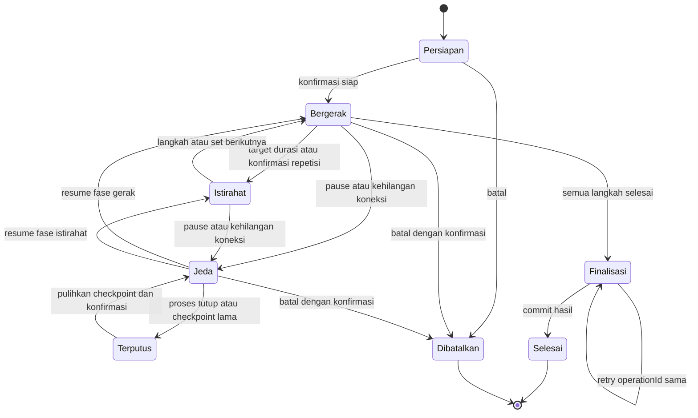
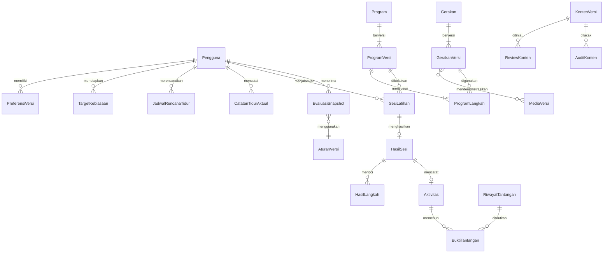

# Rancangan perombakan SehatHarian — Tahap A

Tanggal pemeriksaan: 30 Oktober 2026. Status: rancangan untuk ditinjau; bukan persetujuan implementasi. Seluruh nama kelas, tabel, dan halaman berlabel **usulan** belum diimplementasikan. Dokumen ini satu-satunya artefak proyek yang dibuat pada Tahap A.

## 1. Ringkasan dan batas bukti

SehatHarian mempunyai fondasi aplikasi desktop JavaFX dua modul yang dapat dikembangkan bertahap. Pertahankan Java, JavaFX/FXML/CSS, Gradle, JDBC dan database MariaDB/MySQL. JPro sudah menjadi dependency, tetapi keberadaan dependency tidak membuktikan kesiapan website multiuser atau mobile. Prioritas pertama adalah autentikasi yang ketat, isolasi sesi, kepastian penyimpanan, dan keseragaman perhitungan. Setelah itu bangun pengelolaan konten admin, pengalaman rutinitas harian, dan latihan berpemandu.

**Wajib:** semua kebiasaan tetap terlihat dan berguna; rekomendasi ditelusuri ke aturan dan data; otorisasi di service/repository; riwayat tidak berubah saat katalog diedit; tidak ada penyimpanan sementara yang dilabeli permanen. **Usulan:** rilis desktop dahulu, web/mobile melalui JPro setelah pembuktian teknis. **Perlu dibuktikan:** isolasi dua browser, media pada perangkat nyata, lifecycle reconnect, dan aksesibilitas JPro.

### 1.1 Cara pemeriksaan dan hasil aktual

| Jenis bukti | Hasil Tahap A | Batas interpretasi |
| --- | --- | --- |
| Instruksi repository | Pencarian `AGENTS.md` pada proyek, pohon `projekpbo`, dan pemeriksaan direktori induk sampai `/` tidak menemukan file tersebut | Tidak ada instruksi repository tambahan yang terbaca |
| Source | Inventaris Java, Gradle, SQL, controller, FXML, CSS, utilitas, aset dan test diperiksa secara statis | Bukan hasil eksekusi fitur |
| PRD | `docs/prd_extracted.txt`, versi tertulis 1.1, menetapkan desktop JavaFX dan F-01–F-09 | Dokumen ekstraksi; proposal/PDF asli tidak ditemukan dalam inventaris |
| XML | Parser XML Python berhasil membaca 13 FXML | Hanya well-formed XML; bukan bukti FXMLLoader, handler, CSS atau rendering berhasil |
| Database | Percobaan koneksi client untuk `SELECT 1` gagal sebelum query karena pembuatan socket diblokir lingkungan | Tidak mengetahui versi server aktif, skema aktual, isi data, indeks, grants atau jumlah duplikasi |
| Build/JUnit/UI | Tidak dijalankan pada tahap ini | Startup menjalankan bootstrap SQL; beberapa test menulis data. Tidak ada klaim lulus baru |
| Laporan lama | README dan BACA_DULU memuat klaim pengujian terdahulu; tidak ditemukan laporan audit terpisah atau XML hasil test dalam inventaris saat pemeriksaan | Klaim historis tidak menjadi hasil verifikasi saat ini |
| Perubahan | Rancangan terpisah saja; tidak menyalakan database, menjalankan aplikasi, SQL, seed, migrasi atau generator aset | Source dan data tetap baseline yang diperiksa |

Keberadaan `.runtime/database` tidak membuktikan database aktif atau kesamaan skema dengan DDL repository. Pemeriksaan skema aktual dan data pra-migrasi menjadi gerbang pekerjaan berikutnya, dengan akses baca-saja dahulu.

### 1.2 Struktur, versi dan entry point yang terverifikasi

| Area | Fakta source |
| --- | --- |
| Root | `settings.gradle` mencantumkan `Backend2` dan `Frontend2`; root `build.gradle` menyediakan repository dependency |
| Backend2 | Plugin `java-library`; 39 file Java utama: config, model, repository, service, util; 8 kelas test |
| Frontend2 | Plugin `application`, `java`, `jpro-gradle-plugin`; bergantung pada `project(':Backend2')`; 24 file Java utama, 13 FXML, 2 CSS, 5 kelas test |
| Java | Kedua `build.gradle`: `JavaLanguageVersion.of(27)`. Dokumen PRD yang sekarang tersedia juga menyebut 27. Perubahan versi sebelumnya adalah riwayat percakapan; baseline source kini 27 |
| Gradle | Wrapper menunjuk 9.8.1; konfigurasi run memakai direktori root proyek |
| UI/runtime | JavaFX 24.0.1, native classifier dipilih menurut OS/arsitektur; FXML, JavaFX CSS, Charts |
| Web | Plugin dan WebAPI JPro 2026.3.0; konfigurasi `jpro {}` hanya komentar port default. Tidak ditemukan penggunaan WebAPI dalam Java aplikasi |
| Data/auth/test | Connector/J 9.3.0; BCrypt `jbcrypt` 0.4; JUnit BOM 5.11.4/Jupiter, platform launcher |
| Entry point | `application.mainClass = com.sehatharian.AppLauncher`; launcher memanggil `MainApp.main`; `MainApp extends Application` dan membangun JavaFX Stage |
| Startup | `MainApp.main`: `LocalDatabase.startIfNeeded()` → `DatabaseBootstrap.initialize()` → `launch(args)`. Ini dapat menulis database, sehingga tidak dijalankan saat audit |
| JVM args | Run dan test memakai `--enable-preview`; run juga `--enable-native-access=ALL-UNNAMED`. Compiler tidak secara eksplisit diberi `--enable-preview`; kebutuhan fitur preview source belum dibuktikan |
| Script | `jalankan-linux-macos.sh`, `JALANKAN_WINDOWS.bat`, `SehatHarian.desktop`, `scripts/database.sh`, `scripts/with-database.sh` |

`MainApp` tetap kelas aplikasi JavaFX yang benar; jangan mengubahnya menjadi klaim bahwa konfigurasi Gradle langsung menunjuk MainApp. Jangan mengasumsikan React, Spring, aplikasi Android native, atau API terpisah sudah tersedia.

### 1.3 Inventaris fitur dan celah implementasi

| Kelompok/file aktual | Implementasi yang terbaca | Implikasi rancangan |
| --- | --- | --- |
| `model/` | Pengguna, Tantangan, RiwayatTantangan, Rekomendasi, JadwalTidur, Aktivitas, Hidrasi, KebiasaanMakan, EvaluasiMingguan; DTO ProgresHarian/RingkasanKonsistensi; UserSession | Field umumnya private dengan setter publik. Belum ada abstract Pencatatan, interface penyaringan atau interface repository |
| `AuthService`, `PasswordUtil` | Registrasi memakai BCrypt; login mempunyai toleransi dua password demo setelah pemeriksaan hash gagal; hash kosong menerima password minimal empat karakter | Bypass autentikasi merupakan penghambat rilis multiuser/admin. Tidak mencantumkan string bypass di dokumen ini |
| `UserSession`, `PenggunaService` | Singleton global, setter identitas/login publik, nilai identitas demo awal; `getPenggunaAktif` bisa memilih pengguna default | Identitas harus berasal dari autentikasi, tidak dari fallback atau input controller |
| `PenggunaRepository` | `getDefaultPengguna` mengambil akun ID terendah; beberapa lookup jatuh ke datastore memori; update profil/password tersedia | Jangan memakai akun pertama sebagai identitas pemilik. Lookup tidak ditemukan berbeda dari database gagal |
| `TantanganService` | Memilih hingga tiga kandidat; waktu minimal seleksi dipaksa 15 menit; jika kandidat kosong memakai semua katalog; status diubah berdasar ID | Melanggar filter/waktu ketat pada kasus tertentu; pemeriksaan ownership dan pemilihan deterministik diperlukan |
| `RekomendasiService/Repository` | Filter tipe, usia, kesibukan, durasi. Durasi invalid bisa memakai default 30 menit; sebagian filter durasi juga dilakukan controller | Pusatkan validasi/kelayakan di service; jangan mengarang waktu luang saat tidak diketahui |
| `KebiasaanService` | Aktivitas, hidrasi, makan: tambah, baca harian/rentang tertentu, hapus; validasi rentang dasar | Belum ada status kelengkapan data, target berversi atau provenance demo/persisten |
| `TidurService` | LocalTime lintas tengah malam; pembulatan jam dua desimal; ambang 5 jam; simpan mengizinkan durasi 0,5–20 jam | Rencana dan aktual masih satu model; interval eksplisit dan aturan ambang berbasis menit diperlukan |
| `JadwalTidurController` | Saat simpan durasi <5 memanggil evaluasi; memuat jadwal terbaru dan mengatur scheduler; toggle utama hanya mengubah scheduler | Integrasi F-07/F-05 ada di UI, belum kontrak service; toggle utama belum dipersistenkan lewat `updatePengingat` |
| `PengingatTidurService` | Singleton, polling lima detik, LocalDate/LocalTime sistem; notifikasi dalam 570–630 detik sebelum target; alarm satu kali per tanggal pada ±10 detik | Belum lifecycle per akun, zona waktu eksplisit, reset deduplikasi setelah edit, atau alarm sepanjang 20 detik |
| `MainLayoutController`, `SceneNavigator` | Stage statis; cache view/controller; logout membersihkan UserSession dan pindah landing | Logout tidak memanggil pembersihan scheduler/listener; shared state berisiko di JPro |
| `EvaluasiService` | Tujuh hari berakhir tanggal acuan, rata-rata skor dibagi tujuh; tidur dibaca maksimal 14 record; rekomendasi string berdasarkan ambang tetap | Data tidak tercatat bisa menjadi skor nol/saran kurang tidur. Nutrisi tidak masuk perhitungan evaluasi |
| `ProgresHarian*` | Target default hidrasi 2000 ml dan aktivitas 30 menit; skor bobot tantangan 40%, hidrasi 25%, aktivitas 20%, tidur 15% | Evaluasi memakai pembagi aktivitas 20 menit; hasil antarlayar dapat berbeda. Formula belum tunggal |
| Repository JDBC | PreparedStatement banyak digunakan; beberapa update/delete hanya `WHERE id = ?`; penulisan sering mengubah memori dahulu, lalu JDBC dan menangkap SQLException | Tidak ada jaminan ownership/commit; ID memori dan JDBC dapat berbeda, fallback dapat menyamarkan kegagalan |
| `InMemoryDataStore` | Singleton dengan katalog, akun dan riwayat contoh yang dibentuk saat konstruktor, termasuk data enam hari sebelumnya | Bukan cache netral; tidak boleh menjadi pengganti diam-diam data pengguna nyata |
| Halaman | Landing, login, registrasi, onboarding, shell, dashboard, tantangan, rekomendasi, catatan, tidur, statistik, evaluasi, profil | Belum ada admin, gerakan/program/sesi, media latihan atau workflow penerbitan |
| UI responsif | Dashboard mengubah layout pada lebar tertentu, sidebar dapat ringkas, AuthLayoutHelper menyembunyikan hero; LayoutGuard memaksa minimum lebar preferensi pada beberapa kontrol | Sudah ada adaptasi, tetapi tidak membuktikan bebas overflow. Form tidur minWidth 380 dan auth minWidth 480 perlu ditinjau pada mobile |
| CSS/utilitas | `styles.css` dan override `sehat-theme.css`; hijau/putih tersedia, masih ada gradient/shadow; focus color transparan; AnimationHelper memakai transisi JavaFX meskipun namanya menyebut GSAP | Konsolidasi token bertahap; pulihkan fokus terlihat; jangan mengklaim library JavaScript GSAP dipakai |
| Aset | 13 PNG, 5 JPG, 4 WAV di resource; termasuk ilustrasi kebiasaan, organ, logo, foto dokter/rumah sakit; satu kolase PNG di root | Inventaris nama/ukuran, bukan audit hak penggunaan/anatomi. Tidak ada video latihan dalam inventaris resource; provenance belum tercatat |

### 1.4 Database dan penyimpanan: DDL repository, bukan skema server

Konfigurasi file menunjuk `127.0.0.1:13306/sehatharian_db`, zona JDBC `Asia/Jakarta`, SSL nonaktif untuk lokal. Identitas dan rahasia koneksi sengaja tidak disalin. Environment `DB_HOST`, `DB_PORT`, `DB_NAME`, `DB_USER`, `DB_PASSWORD` mengesampingkan file. Komentar DatabaseConfig tentang file eksternal tidak berarti loader eksternal sudah ada: yang terbaca adalah resource classpath dan environment. Cache ketersediaan koneksi lima detik bukan health check semua tabel.

DDL `Backend2/sql/schema.sql`: sembilan tabel domain, UTF8MB4, InnoDB; email unik; FK catatan ke pengguna, riwayat ke tantangan, dengan cascade delete. Belum ada tabel role, gerakan, program, media atau sesi. Indeks `(pengguna_id,tanggal)` pada catatan/riwayat bukan unique constraint. `JadwalTidurRepository.simpan` memakai ON DUPLICATE KEY UPDATE, tetapi DDL tidak menetapkan keunikan pengguna/tanggal; jangan menganggap upsert mencegah dua catatan hari yang sama. `getByTanggal` memakai LIMIT 1 tanpa kebijakan pemilihan episode.

Seed berisi ID tetap, katalog, akun contoh dan catatan contoh; beberapa ON DUPLICATE KEY UPDATE dapat memperbarui data. `DatabaseBootstrap` menjalankan DDL, membuat `app_setup`, memakai GET_LOCK, dan seed pada pemeriksaan tiga tabel kosong; seed+marker memakai transaksi, DDL terpisah. Menghasilkan hash BCrypt akun contoh saat bootstrap. Ini mekanisme inisialisasi, **bukan migrasi skema berversi** dan bukan bukti rollback DDL. LocalDatabase memakai proses shell untuk server lokal pada Linux/macOS dan shutdown hook; Windows dilewati. Jangan jalankan lifecycle server lokal per browser pada JPro: server DB harus dikelola di tingkat proses/deployment.

### 1.5 Test yang tersedia dan gap

Backend: 34 metode `@Test` dalam AuthServiceTest (11), EvaluasiServiceTest (3), KebiasaanServiceTest (3), PenggunaServiceTest (4), ProgresHarianServiceTest (3), RekomendasiServiceTest (2), TantanganServiceTest (3), TidurServiceTest (5).

Frontend: UserSessionTest (6), FrontendFlowValidationTest (7), FrontendFeatureFlowIntegrationTest (6), LandingPageLayoutTest (1), serta satu `@ParameterizedTest` AllFxmlViewsLoadTest dengan 13 path. Secara inventaris berarti 33 kasus frontend dan 67 gabungan bila semua penemuan test normal; **bukan 67 test lulus**. Klaim README backend 79 total/45 frontend dan angka lain tidak konsisten dengan inventaris ini. Test validasi frontend sebagian menguji ekspresi lokal, bukan aksi controller. Test service/integrasi bisa memakai database nyata atau fallback, dan mengubah akun/catatan; FXML initialize juga dapat menulis tantangan. Tidak ada bukti test role, isolasi dua pengguna JPro, timer, media, idempotensi retry, atau migrasi.

## 2. Lingkup produk dan keterlacakan

Tujuan: membantu individu menjalankan **Rutinitas Sehat Hari Ini**, dengan tidur, hidrasi, nutrisi, aktivitas, tantangan dan perkembangan mingguan sama-sama mudah diakses. Latihan berpemandu menjadi jalur aktivitas baru, bukan pengganti fitur lain. Komunitas/keluarga tetap di luar lingkup.

| ID | Kondisi dasar | Kebutuhan perombakan wajib | Paket / bukti penerimaan |
| --- | --- | --- | --- |
| F-01 Tantangan | Seleksi/status ada | Kelayakan ketat, variasi lintas kebiasaan, arti status, ownership | P2/P5; filter kosong tetap kosong dan lintas akun ditolak |
| F-02 Rekomendasi aktivitas | Katalog+durasi | Alasan saran, data minimal, batas waktu mencakup persiapan/istirahat | P2/P6; profil berubah mengevaluasi ulang |
| F-03 Pelacak | Aktivitas/hidrasi/makan/tidur | Status persistensi nyata, validasi lengkap, edit/koreksi, tanggal/asal | P1/P5; restart membaca hasil commit yang sama |
| F-04 Grafik | Agregasi tujuh hari | Formula tunggal, denominator/coverage/nutrisi, unknown berbeda nol | P6; fixture hitung manual cocok semua layar |
| F-05 Evaluasi | Mingguan/string saran | Snapshot berversi, pemicu tidur_kurang, data cukup dan CTA | P5/P6; tanpa tidur tidak mengklaim kurang tidur |
| F-06 Filter | Usia/kesibukan/menu/workout | Preferensi, pantangan dan metadata; hard exclusion tidak dilonggarkan | P2/P4; katalog kosong tidak mengabaikan pantangan |
| F-07 Tidur | Durasi+ambang | Rencana vs aktual, lintas tanggal/zona, threshold ≥300 menit, koreksi | P5; 299 menit memicu dan 300 tidak |
| F-08 Pengingat | Scheduler internal | Persistensi toggle, login restore, logout cancel, batas proses mati | P1/P5; akun B tidak menerima alarm A |
| F-09 Riwayat | Status bertanggal | Event/perubahan berversi, hubungan sumber sesi, anti-duplikasi | P5/P7; retry tidak menambah hasil kedua |
| N-01 Admin/user | Belum ada role | Role/capability service, ownership dan audit konten | P1/P3; direct service call user tidak bisa publish |
| N-02 Konten | SQL/static resource | Gerakan/program/menu/edukasi/beranda dengan workflow | P3/P4; hanya published version terlihat user |
| N-03 Latihan | Belum ada | Program → persiapan → gerak → istirahat → ringkasan | P7; state machine dan recovery teruji |
| N-04 Media orisinal | Belum ada pipeline | Provenance/izin/review/version; ilustrasi orisinal | P4; aset tanpa izin/review tak bisa terbit |
| N-05 Mobile/a11y | Adaptasi sebagian | Navigasi ringkas, tanpa overflow utama, fokus/teks/gerak | P8; matriks ukuran dan aksesibilitas lulus |
| N-06 Web JPro | Dependency tersedia | Gate isolasi/session/media/deployment, tanpa stack baru | P0/P9; dua browser, dua akun, reconnect tidak bocor |
| N-07 Rekomendasi terukur | Aturan tersebar | Rule version, evidence, eligibility, stale/unknown | P2/P6; penjelasan dan replay hasil dapat ditelusuri |

### 2.1 Platform: pilihan dan pembuktian

Desktop tetap jalur kompatibel. Website/mobile berarti akses browser ke aplikasi JavaFX melalui JPro, bukan aplikasi native atau jaminan offline. Dokumentasi resmi JPro menjelaskan rendering aplikasi JavaFX di browser, WebAPI, pengaturan lifecycle instance, peringatan state static lintas instance, serta kebutuhan integrasi JPro Media untuk MediaPlayer; beberapa fitur seperti dialog dan WebView memiliki keterbatasan. Karena itu, kompatibilitas desktop tidak dianggap otomatis identik di web. [Dokumentasi resmi JPro](https://github.com/JPro-one/JPro-Documentation).

**Rencana pembuktian P0/P9, belum dilakukan:** gunakan checkout/fixture uji terisolasi setelah izin coding; pertahankan versi dependency baseline. Catat task/config JPro yang benar-benar tersedia; verifikasi jalur startup apakah memanggil main atau langsung Application.start. Dua browser dan dua tab: A dan B login berbeda, baca/tulis, logout A, reconnect B; periksa userId, view cache, scheduler, hasil timer. Uji media ilustrasi yang izinnya sudah jelas pada Chrome/Firefox desktop dan Chrome Android/Safari iOS, sentuhan, rotasi, keyboard, suara setelah aksi pengguna, throttling, tab tersembunyi, offline, reconnect dan close-instance timeout. Catat latensi, CPU/memori/node count serta kebocoran setelah penutupan. Tidak memproduksi media baru untuk Tahap A.

Gerbang: tidak ada data/aksi lintas sesi; DB tidak diluncurkan/dimatikan per browser; input media/timer terverifikasi; tidak ada query blocking UI; tidak ada klaim alarm ketika browser/proses mati. Bila gagal, rilis desktop dahulu dan revisi lingkup browser. Alternatif stack/API baru memerlukan keputusan terpisah. Biaya/lisensi hosting JPro dan distribusi media belum diaudit; jangan memasang layanan.

## 3. Hak akses, autentikasi dan sesi

### 3.1 Matriks otorisasi yang diusulkan

`SENDIRI` berarti principal terautentikasi dari SessionContext, tidak menerima pemilik dari form. `KONTEN` tidak mencakup catatan pribadi. Default deny untuk capability yang tidak disebut.

| Operasi | Anonim | User | Admin |
| --- | --- | --- | --- |
| Landing dan edukasi published | Baca publik yang disetujui | Baca | Baca |
| Registrasi/login/logout | Registrasi USER/login | Logout sendiri | Logout sendiri |
| Profil/preferensi/password | Tidak | SENDIRI | SENDIRI, tanpa edit role dari profil |
| Catatan tidur/air/makan/aktivitas | Tidak | CRUD SENDIRI | Tidak untuk akun lain; hanya SENDIRI jika memakai fitur pribadi |
| Sesi latihan/hasil/tantangan/pengingat | Tidak | SENDIRI | Tidak untuk akun lain |
| Progres/evaluasi pribadi | Tidak | Baca/buat ulang SENDIRI | Tidak untuk akun lain |
| Draft gerakan/program/menu/edukasi/katalog | Tidak | Tidak | KONTEN: buat/edit/ajukan review |
| Review/publish/archive konten | Tidak | Tidak | Capability penerbit, audit dan review wajib |
| Upload/ubah metadata media | Tidak | Tidak | KONTEN dengan validasi file dan hak penggunaan |
| Konfigurasi beranda | Baca published | Baca published | Hanya blok yang disediakan schema aplikasi |
| Audit konten | Tidak | Tidak | Baca sesuai capability; tanpa catatan kesehatan |
| Mengangkat role / membuat admin | Tidak | Tidak | Bukan fitur edit profil; bootstrap/operator tepercaya terpisah |
| Source/build/deploy/DDL/kredensial DB | Tidak | Tidak | Tidak melalui aplikasi |
| Ekspor kesehatan massal | Tidak | Tidak | Tidak pada versi pertama |

Admin bukan superuser database. Bila kelak diperlukan dukungan membaca catatan pribadi: keputusan produk terpisah tentang tujuan, persetujuan, ruang lingkup, masa akses dan audit. Tidak masuk default role admin. Admin yang memakai kebiasaan pribadinya tunduk pada ownership yang sama dengan user.

### 3.2 Pemeriksaan sistem dan batas kepercayaan

Service menerima SessionContext immutable (principalId, role/capabilities, sessionId, generation), memverifikasi autentikasi/capability setiap aksi. Repository catatan memakai `(id, pengguna_id)` dan menolak operasi tanpa pemilik; pemeriksaan di UI hanya membantu UX. Registrasi selalu USER; DTO tidak mempunyai field role/capability yang dapat ditulis user. Perubahan role hanya alur operator tepercaya, diaudit dan menginvalidasi sesi terdampak. Review/publish mengecek state+versi draft yang direview, bukan sekadar tombol.

**Batas desktop:** kredensial JDBC berada pada proses lokal; role service tidak melindungi dari pemilik komputer yang sengaja memodifikasi program atau mengakses DB memakai kredensial tersebut. Untuk distribusi multiuser yang tidak saling percaya, JPro menempatkan service/DB pada server terkontrol; jangan mengirim kredensial DB ke browser. Tidak memperkenalkan API terpisah dalam rancangan ini. Mode lokal adalah batas kepercayaan instalasi pengguna, bukan bukti keamanan layanan publik.

### 3.3 Alur akun

1. Login: verifikasi BCrypt saja, pesan kegagalan generik, pembatasan percobaan untuk deployment web; hash kosong/rusak memerlukan pemulihan tepercaya, bukan toleransi password. Keputusan reset password/email belum tersedia; versi pertama tidak menampilkan aksi pemulihan palsu.
2. Bangun SessionContext baru setelah autentikasi berhasil; muat preferensi dan jadwal pemilik, lalu restore reminder. Tidak mengambil pengguna pertama atau identitas demo. Identitas/hash tidak diteruskan dalam DTO UI.
3. Navigasi memerlukan guard, tetapi semua command service tetap memeriksa izin. Callback async membawa generation; hasil dari akun lama diabaikan setelah logout/login lain.
4. Logout/timeout: tawarkan simpan/pause sesi aktif; batalkan scheduler akun, timer, audio/media, pending task dan listener; kosongkan cache view/controller/DTO, preferensi sementara dan draft sensitif; invalidasi SessionContext; navigasi ke landing. Pending write yang status commit belum diketahui direkonsiliasi dengan operationId, tidak diasumsikan batal.
5. Login B wajib context baru; logout satu browser tidak menghentikan database atau aplikasi pengguna lain. Kebijakan logout semua perangkat menjadi keputusan lanjutan.
6. Demo menjadi mode eksplisit dengan konteks/store terpisah dan label selalu terlihat; tidak fallback ke akun demo ketika DB/error autentikasi. Rekomendasi awal: mode nyata menolak write saat DB tidak tersedia dan mempertahankan form lokal berlabel belum tersimpan.

## 4. Sitemap, alur dan rancangan halaman

### 4.1 Sitemap

```text
Publik
├─ Landing → Masuk / Daftar
├─ Edukasi published (opsional publik; default setelah login)
└─ Bantuan, privasi, batas penggunaan
User
├─ Hari Ini: Rutinitas Sehat Hari Ini
├─ Catat: Hidrasi / Nutrisi / Aktivitas / Tidur aktual
├─ Latihan: Katalog → Detail/persiapan → Pemutar sesi → Ringkasan
├─ Progres: Grafik → Evaluasi → Riwayat detail
└─ Lainnya: Tantangan / Rekomendasi / Edukasi / Tidur & pengingat / Profil
Admin (shell terpisah setelah otorisasi)
├─ Ringkasan konten
├─ Gerakan → Editor → Preview
├─ Program → Penyusun urutan → Preview
├─ Media → Upload/metadata → Hasil review
├─ Kategori / Kesulitan / Alat / Metadata kelayakan
├─ Menu / Tantangan / Edukasi / Konten rekomendasi
├─ Beranda: blok yang diizinkan
├─ Review & Penerbitan / Arsip
└─ Audit perubahan konten
```

Desktop memakai sidebar berlabel dan area konten; mobile memakai lima tujuan bawah **Hari Ini, Catat, Latihan, Progres, Lainnya**. Lainnya membuka daftar tujuan, bukan deretan ikon tanpa label. Tantangan dan tidur mempunyai pintasan di Hari Ini; rekomendasi mempunyai pintasan dari setiap kebiasaan. Shell admin memakai kelompok Konten, Review, Pengaturan dan tautan kembali ke area pribadi. User tidak melihat navigasi admin; direct navigation tetap diperiksa.

Alur utama: daftar → onboarding minimal → Hari Ini → catat/latihan → receipt penyimpanan → progres. Tidur: atur rencana → simpan toggle → catat aktual → bila <300 menit terbitkan pemicu tidur_kurang → evaluasi dan CTA perbaikan rencana. Latihan: pilih → persiapan → konfirmasi siap → fase gerak/istirahat → ringkasan → simpan hasil → satu aktivitas sumber sesi → opsional satu relasi penyelesaian tantangan. Admin: draft → review → perbaiki bila ditolak → publish versi → archive tanpa menghapus versi historis.

### 4.2 Sistem visual, responsif dan aksesibilitas

Usulan token awal: hijau utama `#157A48`, teks gelap `#17342A`, permukaan putih, latar `#F6FAF7`, border netral, warna error dengan ikon+teks. Kontras setiap pasangan harus diukur sebelum dianggap memenuhi target aksesibilitas; jangan mengandalkan nama warna. Skala spacing 4/8/12/16/24/32, radius kartu 12, satu keluarga font yang tersedia lokal, teks isi awal 16 dan heading 20/24/32; ukuran mengikuti platform dan preferensi user. Fokus keyboard terlihat, label persisten, tooltip pelengkap, ikon berteks/accessibleName, error terkait field, urutan fokus sama dengan urutan visual.

Usulan breakpoint berdasarkan **lebar konten**, bukan jenis perangkat: <600 satu kolom, 600–959 maksimal dua kolom bila kontrol cukup lebar, ≥960 sidebar dan grid. Implementasi lewat layout JavaFX dan width binding; jangan mengasumsikan media query CSS browser bekerja pada FXML. Tabel berubah menjadi daftar kartu pada mobile; grafik memiliki rangkuman angka/tabel vertikal. Target sentuh minimal 44×44 unit layout untuk dibuktikan pada browser/perangkat; jarak antaraksi ≥8. Tidak memaksa minimum lebar preferensi pada semua tombol seperti LayoutGuard sekarang; wrap teks dan susun vertikal untuk label panjang.

Semua halaman utama harus bebas scroll horizontal pada lebar 360, 390 dan 430; uji juga 320 sebagai stress case, 768 dan 1280. Keyboard virtual tidak menutup submit; bottom navigation/fixed action memperhitungkan safe area dan landscape. Pembesaran teks/zoom 200% tidak menghilangkan aksi. Tab/Shift+Tab, Enter/Space dan escape pada dialog bekerja; perubahan status diumumkan secara wajar, timer tidak dibacakan tiap detik. Grafik tidak hanya mengandalkan warna; media mempunyai instruksi teks dan poster statis. Pengaturan pengurangan gerak menonaktifkan transisi dekoratif dan mengganti demo loop dengan gambar langkah; timer tetap terlihat. Tidak ada glassmorphism/glow; gradient dekoratif dihilangkan bertahap, shadow tipis hanya bila membantu hierarki.

### 4.3 Kontrak state umum untuk setiap halaman

Berlaku pada **setiap** baris katalog halaman di bawah, termasuk halaman admin: loading menampilkan skeleton/progress dengan label dan mencegah submit ganda; kosong menampilkan penjelasan dan CTA yang diizinkan; gagal membedakan validasi, tidak berizin, tidak tersedia, konflik versi, dan hasil commit belum diketahui; berhasil hanya setelah receipt commit atau pembacaan sukses, dengan waktu pembaruan. Data lama boleh terlihat dengan label kedaluwarsa. Tidak menghapus input ketika error. Navigasi/konteks fokus dipulihkan setelah dialog. State halaman boleh berbeda dari state komponen: satu kartu gagal tidak boleh membuat semua kebiasaan tampak kosong. Aksesibilitas global §4.2 berlaku pada semua halaman; tambahan spesifik tercantum per halaman.

### 4.4 Halaman user/publik — rancangan per halaman

Semua halaman baru merupakan **usulan**; pemetaan FXML lama di kolom pertama adalah titik perubahan potensial, bukan instruksi penggantian sekarang.

| Halaman / pemetaan aktual | Tujuan, data utama dan sumber | Tindakan utama | Loading / kosong / gagal / berhasil khusus | Desktop → mobile; a11y tambahan |
| --- | --- | --- | --- | --- |
| Landing / LandingPageView | Jelaskan kebiasaan dan batas produk; published HomeContent+edukasi, bukan angka pengguna | Masuk, daftar, lihat contoh berlabel demo, bantuan | Load konten; kosong memakai copy bawaan berversi; gagal tawarkan login; sukses konten published | Hero singkat+pratinjau → satu kolom; heading berurutan, foto tidak menyiratkan dukungan klinis |
| Masuk / LoginView | Autentikasi; AuthService, tanpa hash di UI | Masuk, tampilkan/sembunyikan sandi, kembali | Kirim progres; field kosong diberi error; kredensial/DB gagal berbeda tanpa bocor identitas; sukses arah role/onboarding | Form+panel konteks → form penuh; label dan tombol lihat sandi dapat keyboard |
| Daftar / CreateAccountView | Akun USER; nama/email/password, kebijakan privasi berversi | Buat akun, setuju ketentuan | Cegah double submit; belum isi tidak bisa kirim; konflik email generik; sukses setelah commit | Dua kolom → form; ringkasan error fokus, password manager/autofill diuji |
| Onboarding / OnboardingView | Data relevan: waktu menit, konteks aktivitas, golongan usia bila memilih personalisasi, preferensi opsional | Simpan, kembali, lewati field opsional | Draft belum lengkap; simpan gagal tetap field; sukses baca ulang preferensi | Stepper berlabel → satu pertanyaan kelompok per layar; progres teks; tidak diam-diam memetakan remaja ke dewasa |
| Shell / MainLayout | Navigasi, identitas sesi benar, indikator offline/persistensi | Pindah fitur, logout | Resolusi sesi; belum login arah masuk; timeout hapus state; sukses restore hanya data akun | Sidebar → lima nav bawah; fokus pindah ke judul; banner tidak menutup konten |
| Hari Ini / DashboardView | Rutinitas hari ini+zona/tanggal: tidur aktual/rencana, air, makan, gerak, tantangan, coverage mingguan; SummaryService usulan | +air, catat makan/gerak/tidur, mulai program, lanjut evaluasi | Per kartu loading; belum catat bukan gagal; gagal komponen beri retry; sukses refresh komponen terkait | Header+grid seimbang → kartu prioritas vertikal: aksi catat, tidur/air, nutrisi/gerak, tantangan, mingguan; angka dibaca bersama unit |
| Hidrasi / bagian CatatanKebiasaanView | Total ml tercatat, target+asal, daftar transaksi; Hidrasi/TargetKebiasaan | +250/+500 ml, input lain, koreksi/hapus dengan konfirmasi | Loading total; target belum diset berbeda catatan kosong; write gagal tidak menambah angka committed; sukses receipt+undo terkontrol | Form+daftar → quick add di atas, daftar kartu; nilai dan satuan selalu berlabel |
| Nutrisi / bagian CatatanKebiasaanView | Catatan waktu makan/menu, menu eligible, preferensi; KebiasaanMakan/KontenMenu | Catat, koreksi, pilih ide menu, atur pantangan | Menu kosong berbeda catatan kosong; alergi tidak diketahui membatasi saran; gagal tetap draft; sukses catatan bertanggal | Panel catat+menu → tab Catatan/Ide menu; label bahan/ketidakpastian bukan ikon saja |
| Aktivitas / bagian CatatanKebiasaanView | Durasi aktual manual dan sumber sesi, target+provenance; Aktivitas/HasilSesi | Catat manual, lihat sumber, buka latihan | Catatan kosong; konflik duplikasi minta pilih; gagal tidak mengklaim tersimpan; sukses satu sumber aktif | Tabel+filter → kartu; durasi aktif dan istirahat dibedakan dengan teks |
| Tidur & pengingat / JadwalTidurView | Dua bagian Rencana dan Aktual, zona, status reminder, riwayat; JadwalRencana/CatatanTidur | Atur rencana/toggle, catat aktual, tes suara, koreksi | Restore loading; belum ada rencana bukan tidur 0; gagal toggle rollback UI; sukses tampil commit dan next occurrence | Form terpisah+riwayat → segmen Rencana/Aktual; input tanggal mulai/akhir; alternatif teks untuk alarm |
| Tantangan / TantanganView | Disarankan/selesai/dilewati lintas kebiasaan; RiwayatTantangan+katalog versi | Pilih, selesai, lewati dengan alasan opsional, undo | Seleksi loading; tidak ada kandidat tampil alasan; konflik status refresh; sukses cap waktu | Grid+filter → filter ringkas/list; status ikon+teks, tidak hanya hijau |
| Rekomendasi / RekomendasiView | Ide terfilter, alasan, data dipakai dan kurang, RuleResult | Ubah konteks, lihat alasan, buka tindakan relevan | Aturan loading; hasil tidak cukup/terfilter kosong eksplisit; gagal tidak pakai semua katalog; sukses versi aturan+tombol lanjut | Filter samping → drawer/filter sheet berlabel; pilihan aktif selalu terlihat |
| Katalog latihan / baru | Program published eligible, waktu total, alat, level+syarat; ProgramVersion | Filter, detail, lanjut sesi tertunda | Loading; kosong tidak longgarkan filter; gagal retry; sukses hasil dengan alasan | Grid → kartu satu kolom; waktu/alat tidak hanya badge warna |
| Detail & persiapan / baru | Urutan, durasi/repetisi, istirahat, media, syarat, keterbatasan; snapshot ProgramVersion | Cek persiapan, preview, konfirmasi siap, mulai | Prefetch media; tak layak/metadata kurang memblokir mulai; media gagal beri poster yang telah direview; sukses tombol siap eksplisit | Detail+urutan → urutan bertumpuk; tidak autoplay latihan; instruksi teks setara |
| Pemutar sesi / baru | Gerakan kini/berikut, fase, timer/repetisi dan status simpan; SesiLatihan | Pause/resume, konfirmasi repetisi, next, lewati, batalkan | Persiapan/media loading; kehilangan koneksi auto-pause konservatif; gagal simpan tunjuk status; sukses checkpoint | Media+instruksi samping → media proporsional, timer dan kontrol tetap mudah diraih; keyboard dan pengurangan gerak |
| Ringkasan & riwayat sesi / baru | Aktual aktif/rest/pause, repetisi self-report, langkah skip, outcome; HasilSesi | Simpan/rekonsiliasi, lihat aktivitas tertaut, kembali | Pending finalisasi bukan sukses; sesi belum selesai jelas parsial; gagal retry operationId sama; sukses satu hasil | Detail+daftar langkah → ringkasan dan expandable langkah; hasil tidak memberi penilaian klinis |
| Grafik / StatistikMingguanView | Tujuh tanggal eksplisit, tiap kebiasaan, coverage, denominator, versi target; ProgresQuery | Pilih periode, lihat hari, buka catatan | Loading; no observations sebagai celah/unknown; gagal label data lama; sukses formula tersedia | Grafik+tabel → satu grafik per segmen dan ringkasan teks; pattern/marker dan tabel alternatif |
| Evaluasi / EvaluasiMingguanView | Pemicu, periode, fakta tercatat, keterbatasan, rekomendasi+CTA; EvaluasiSnapshot | Buat/refresh, lihat versi, buka tidur/air/makan/aktivitas | Sedang dihitung; belum cukup data beri permintaan relevan; gagal evaluasi tidak membatalkan catatan asal; sukses snapshot timestamp | Ringkasan+riwayat → rekomendasi berurutan dan satu CTA per kartu; tanpa grade menghukum data kosong |
| Profil/pengaturan / ProfilPengaturanView | Identitas, preferensi, zona, target dengan dasar, suara/reduced motion; Pengguna/Preference | Simpan profil, ubah password, logout | Load; opsional belum diisi; konflik versi tampil perbedaan; sukses baca ulang | Kelompok form → satu kolom; backend connection URL dipindah ke diagnostik operator, bukan informasi utama user |
| Edukasi/detail / baru | Konten published, penulis/reviewer/sumber/tanggal dan batas informasi | Baca, kembali, tindakan kebiasaan relevan | Load artikel; kosong beri daftar lain; gagal retry; sukses versi tercatat | Daftar+artikel → teks tunggal lebar nyaman; heading/teks alternatif, tidak memaksa video |
| Bantuan/privasi / baru atau dialog lama | Batas alarm, penyimpanan, rekomendasi, dukungan nyata; teks berversi | Lihat panduan, salin diagnostik yang disanitasi | Muat lokal; bagian belum tersedia diberi label; link gagal tetap teks; sukses tidak menciptakan klaim layanan | Artikel/FAQ → accordion dapat keyboard; kontak hanya yang benar-benar tersedia |

### 4.5 Halaman admin — rancangan per halaman

Semua sumber di bawah adalah entitas/layanan **usulan**; tidak ada FXML admin pada baseline. Seluruh layar memakai guard AdminContentService dan audit action; kegagalan role menutup akses, bukan mengosongkan daftar seolah data tidak ada.

| Halaman | Tujuan / sumber / tindakan utama | Loading, kosong, gagal, berhasil | Desktop → mobile dan aksesibilitas |
| --- | --- | --- | --- |
| Ringkasan konten | Hitungan draft/review/published/media bermasalah; ContentQuery; buka antrean | Hitungan loading; belum ada konten CTA buat; query gagal retry; sukses waktu pembaruan | Ringkasan+antrean → kartu vertikal; tidak menampilkan statistik kesehatan pengguna |
| Daftar/editor gerakan | Instruksi, otot/bagian tubuh, alat, syarat, varian, mode; GerakanVersion; buat/edit/preview | Draft baru kosong; validasi per field; konflik optimistic version minta bandingkan; sukses draft tersimpan | Daftar+form → pencarian/list dan editor layar penuh; nomor langkah jelas |
| Daftar/penyusun program | Urutan gerakan, set, durasi/repetisi, persiapan/rest; ProgramVersion/ProgramStep; susun/preview | Referensi loading; program tanpa langkah belum publish; versi gerakan hilang/arsip ditandai; sukses versi draft | Editor dua panel → langkah accordion; urutan dapat tombol naik/turun, bukan drag saja |
| Perpustakaan/detail media | Poster/loop, format, sumber, izin, reviewer, checksum; MediaAsset/Review; unggah/karantina/ajukan | Upload progress; kosong CTA; file invalid/pindai gagal tetap karantina; sukses metadata belum berarti published | Grid+metadata → kartu+form; preview dapat dihentikan dan teks alternatif wajib |
| Taksonomi | Kategori, level, alat dan syarat, penggunaan konten; TaxonomyService; tambah/nonaktifkan | Loading; kosong daftar panduan; konflik nama/referensi tampil error; sukses label baru | Tabel → kartu; kode stabil tidak diedit sembarang; tidak hapus label yang direferensikan |
| Menu | Bahan, porsi bila tersedia, pantangan, metadata gizi bersumber; KontenMenuVersion; draft/review | Loading; menu baru tanpa bahan belum publish untuk filter; sumber gizi kurang tidak direka; sukses versi tersimpan | Editor bertab → field berkelompok; unit wajib, daftar bahan terbaca |
| Tantangan | Tujuan perilaku, kategori, waktu, kelayakan, cara verifikasi; TantanganVersion; draft/review | Loading; kosong buat; kriteria ambigu cegah publish; sukses preview user | Daftar/editor → list/form; setiap status dan syarat dalam teks |
| Edukasi | Judul/isi/sumber/review/keterbaruan; EdukasiVersion; edit/preview | Loading; draft kosong; sumber/review hilang blok publish; sukses versi draft | Editor+preview → mode bergantian; format isi dibatasi, tanpa source/JS bebas |
| Konten rekomendasi | Konten, ruleId approved, eligibility dan alasan; RecommendationContentVersion; tautkan/preview skenario | Loading rules; tak ada rule eligible tampil kosong; admin tidak bisa menulis kode aturan bebas; sukses link versi | Form+simulator → form lalu hasil; alasan terstruktur terbaca |
| Pengaturan beranda | Judul/urutan blok/tautan published/ilustrasi; HomeContentVersion; preview/publish via review | Loading; default aman; link draft/luar izin ditolak; sukses preview bertanggal | Preview lebar+sempit → preview mobile; tidak dapat menyembunyikan seluruh akses kebiasaan inti |
| Review/penerbitan/arsip | Diff versi, checklist hak/teknik/anatomi/aturan, reviewer; ContentReview; approve/reject/publish/archive | Loading antrean; kosong artinya tak ada tugas; versi berubah membatalkan approval; sukses audit+status | Antrean+diff → diff per bagian; keputusan/komentar dapat keyboard |
| Audit konten | Aktor, aksi, entity/version, waktu, alasan; AuditEvent; filter/baca | Loading; belum ada aksi; tidak berizin/query gagal terpisah; sukses daftar immutable | Tabel → kronologi; hindari hash/password/konten kesehatan pada payload |

## 5. Model latihan, media dan lifecycle

### 5.1 Pemisahan domain

| Konsep usulan | Isi/invariant | Hubungan |
| --- | --- | --- |
| Gerakan | Identitas stabil dan versi instruksi, mode yang didukung, syarat, alternatif, media reviewed | Satu gerakan banyak GerakanVersion; bukan hasil pengguna |
| Program | Identitas dan versi urutan langkah; tujuan, eligibility, alat, perkiraan waktu total | ProgramVersion mempunyai ProgramStep yang menunjuk GerakanVersion tertentu |
| ProgramStep | order, set, mode DURATION atau REPETITION, target detik atau jumlah, restDetik, transisi/persiapan | Target mode wajib tepat satu; nilai positif; perkiraan waktu repetisi diberi label estimasi |
| SesiLatihan | Pemilik, ProgramVersion/snapshot, state, step/set, elapsed aktif/pause/rest, checkpointVersion | Satu mulai menghasilkan satu sessionId; bukan satu sesi setiap tekan resume |
| HasilSesi | Outcome, aktual detik/repetisi per langkah, sumber self-report/timer, skipped, timestamps, ruleVersion | Satu finalisasi logis per sessionId; hasil tidak disimpulkan dari video selesai |
| KaitanAktivitas | Hubungan HasilSesi → Aktivitas, operationId/sumber | Durasi aktif saja masuk menit aktivitas; jangan menambah istirahat/pause |
| KaitanTantangan | HasilSesi/aktivitas → RiwayatTantangan jika aturan terpenuhi | Hanya mengubah status, tidak membuat aktivitas kedua |

Program membekukan referensi versi dan snapshot judul/instruksi/target saat sesi dimulai. Edit program membuat versi baru; sesi berjalan/selesai tetap memakai versi lama. Archive menghentikan pemilihan baru, bukan menghilangkan riwayat. Penarikan keselamatan media/program dapat memblokir mulai/resume versi lama, dengan alasan dan tanpa menghapus hasil; perlu kebijakan reviewer.

### 5.2 State machine dan keputusan tepi



Durasi: countdown persiapan opsional setelah Siap; target fase terpisah dari panjang loop media. Repetisi: user menekan Selesai set dan mengonfirmasi jumlah aktual; tidak ada klaim penghitungan pose otomatis. Next sebelum target meminta konfirmasi dan menandai langkah dilewati/parsial, tidak otomatis completed. Skip rest dicatat terpisah, tidak mengarang aktivitas. Jika semua langkah dilewati, outcome tidak dianggap program selesai penuh. Batal menyimpan outcome aborted dan aktual yang sudah dikonfirmasi bila user memilih menyimpan parsial; tidak menyelesaikan tantangan otomatis. Detail terminasi istirahat terakhir tidak menambah waktu gerak.

Navigasi keluar menampilkan pilihan pause dan keluar / lanjut / batal sesi. Menutup proses atau tab tidak boleh bergantung pada dialog unload: checkpoint terakhir dipakai saat kembali, berstatus interrupted. Resume memerlukan user siap, media tersedia dan eligibility yang masih valid; tidak melompat melewati gerakan selama offline. Ringkasan membedakan completed, partial, aborted, interrupted, dan pending-save.

### 5.3 Sumber waktu dan koneksi

Usulan kontrak `TimeSource`: waktu interval selama satu proses berasal dari selisih monotonic, bukan jumlah callback UI. `System.nanoTime()` sesuai untuk selisih waktu pada JVM yang sama; nilainya bukan timestamp kalender dan tidak dibawa lintas restart. [Java SE 27 System](https://docs.oracle.com/en/java/javase/27/docs/api/java.base/java/lang/System.html#nanoTime()). Simpan UTC Instant, ZoneId, elapsedDetik dan checkpointVersion; jangan mencoba merekonstruksi gerak aktual dari selisih jam dinding setelah crash.

Desktop: UI tick hanya menggambar sisa waktu dari state dan clock; clock OS berubah tidak menambah/mengurangi elapsed. Saat minimized secara normal, usulan lanjut berjalan dengan status terlihat saat kembali; saat suspend/resume yang menimbulkan jeda tak teramati, auto-pause konservatif pada checkpoint terakhir dan minta konfirmasi. Harus diuji dengan time source yang dapat diinjeksi.

JPro: state machine di service instance sesi; heartbeat/ack dari browser hanya untuk liveness, bukan bukti tubuh bergerak. Usulan versi pertama auto-pause ketika visibility hidden atau heartbeat hilang >5 detik, dengan checkpoint elapsed terakhir yang dikonfirmasi. Nilai 5 detik adalah kebijakan produk sementara untuk dibuktikan, bukan SLA jaringan. Jika pesan hidden terlambat, recovery tetap konservatif, tanpa auto-skip atau auto-complete. Tab browser dapat membatasi timer latar belakang, sehingga callback JavaScript bukan sumber hitung mundur. [MDN Page Visibility](https://developer.mozilla.org/en-US/docs/Web/API/Page_Visibility_API).

Checkpoint: pada setiap transisi fase, pause, repetisi, dan interval usulan lima detik selama gerak. Tulis command dengan revision/sequence dan operationId; request duplikat mengembalikan hasil sebelumnya, request urutan lama ditolak. Saat DB putus, pause dan tampilkan pending checkpoint, jangan menandai simpan permanen. Reconnect membaca versi server sebelum resume; setelah restart tidak auto-run timer. Timer/media/audio dibersihkan pada logout; media loop tidak menjadi clock.

### 5.4 Workflow dan pemeriksaan media

Preferensi: karakter ilustrasi orisinal, proporsi konsisten, latar sederhana, bukan rekaman manusia asli. AI boleh membantu produksi kelak; **Tahap A tidak membuat atau mengedit media**. Aset RepDB tidak boleh diunduh/diunggah ke AI sebagai input/referensi tanpa izin sesuai penggunaan. Ketersediaan publik bukan bukti izin AI atau distribusi ulang; keputusan izin dipisahkan dari keputusan format.

Workflow: draft → ditinjau → diterbitkan → diarsipkan. Ditolak kembali draft dengan alasan. Simpan pencipta/penanggung jawab, asal/source identifier, URL sumber bila ada, bukti izin dan cakupannya, alat/model/versi/prompt ringkas bila AI, tanggal produksi, checksum, MIME sebenarnya, dimensi, fps, durasi, ukuran, versi, alt text, instruksi teks, reviewer, tanggal dan hasil checklist. Rahasia prompt/provider tidak diperlukan. Media karantina tidak dapat direferensikan konten published.

Review wajib sebelum terbit: teknik latihan oleh peninjau kompeten yang ditetapkan, anatomi/sendi/arah gerak, urutan dan tempo, titik tumpu, konsistensi karakter, transisi awal/akhir, loop tanpa lompatan, keterbacaan tampilan kecil, hak penggunaan, serta pengujian playback. Metadata cedera/pantangan yang tidak dapat dipastikan berarti kelayakan unknown, bukan aman. Editor tidak otomatis menjadi reviewer kompeten; bila tim kecil, setidaknya catat review eksplisit dengan status self-review dan minta keputusan apakah boleh terbit.

Usulan format pembuktian: video loop pendek dengan poster dan urutan gambar langkah sebagai fallback; MP4/H.264 kandidat, bukan keputusan kompatibilitas final. Animasi JavaFX/sprite dapat dibandingkan hanya di spike. Belum memilih Lottie/WebM/GIF sebagai standar tanpa pengujian desktop/JPro, ukuran, CPU, loop/pause dan lisensi. Simpan file di media directory privat yang dikonfigurasi atau storage yang disetujui; DB menyimpan metadata/referensi. Upload memeriksa ukuran/dimensi/MIME, path traversal, ekstensi allowlist dan checksum; larang HTML/script/URL arbitrary. Preview dan unduh mengikuti izin. Penghapusan fisik hanya setelah retensi/referensi/hak dicabut ditinjau; poster lama tetap tersedia bagi riwayat jika izin mengizinkan.

## 6. Validasi dan rekomendasi berbasis data — wajib lintas fitur

### 6.1 Kontrak data dan aturan

Setiap hasil membawa `dataOrigin` (REAL/DEMO), `storageState` (COMMITTED/PENDING/TEMPORARY), periode, ZoneId, waktu observasi, waktu pembaruan, coverage, ruleId/version, alasan dan data yang kurang. Read yang gagal bukan empty dataset. Input backend wajib memvalidasi format, range, enum, ownership, tanggal dan referensi versi; UI mengulang validasi demi kenyamanan. Hindari memuat tanggal lahir lengkap/berat/diagnosis bila golongan usia atau pilihan user sudah mencukupi kebutuhan. Unknown, tidak berlaku, tidak tercatat dan nilai nol yang dikonfirmasi merupakan keadaan terpisah.

Usulan freshness untuk diputuskan: konteks waktu/alat/kesiapan dikonfirmasi tiap mulai latihan; preferensi/pantangan tetap berlaku sampai diubah, tetapi konfirmasi ulang setelah 90 hari sebelum saran personal; target berlaku menurut effective date dan diminta review setelah 90 hari; review konten/aturan due setiap 180 hari atau segera bila ada perubahan sumber. Setelah due, label perlu ditinjau; konten dengan isu keselamatan/hak langsung ditarik. Angka ini kebijakan operasional awal, bukan fakta medis. Catatan historis tidak menjadi invalid hanya karena tua: relevansi mengikuti periode evaluasi. Sesi baru harus memakai versi profil/katalog terbaru yang masih eligible.

Sumber aturan rilis awal: PRD untuk ambang tidur/status/filter, target perilaku yang dipilih pengguna, metadata katalog yang telah direview, dan spesifikasi formula yang disepakati. Tidak menggunakan AI model sebagai syarat. Belum ada sumber klinis operasional yang diaudit pada repo; klaim diagnosis, kalori terbakar, pemenuhan gizi atau target medis tidak ditambahkan. Saran kesehatan baru hanya dapat diaktifkan setelah sumber/reviewer/eligibility disetujui. Tidak menyimpulkan aman berdasarkan label pemula/usia saja.

### 6.2 Matriks A — data, validasi dan kelayakan

Semua baris berlaku baik desktop maupun JPro; nilai batas dari source ditandai **legacy**, bukan standar kesehatan.

| ID / fitur | Data, sumber, unit, periode dan kebaruan | Validasi input dan backend | Kelayakan / pengecualian |
| --- | --- | --- | --- |
| V1 Profil/onboarding | Golongan usia/kesibukan, menit luang dari user; versi profil+effectiveAt; pantangan hanya jika relevan; konfirmasi 90 hari | Enum eksplisit; menit positif; legacy waktu 1–480 diverifikasi; nama/email dibatasi panjang kolom; tanggal lahir opsional tidak masa depan; tidak memetakan pilihan tidak dikenal ke dewasa | Rekomendasi personal memerlukan field relevan; remaja di onboarding saat ini tidak sesuai enum PRD: jangan diam-diam menggolongkan |
| V2 Rencana tidur/pengingat | Jam rencana, hari berlaku, zona IANA, toggle, revision dari user; jadwal berlaku ke depan | Jam/tanggal/zona valid; konflik jadwal dipilih eksplisit; toggle hanya sukses setelah commit; scheduler hanya pemilik aktif | Tidak menilai tidur aktual dari rencana. Alarm membutuhkan proses/instance aktif dan kemampuan audio; tanpa jadwal tidak scheduling |
| V3 Tidur aktual | Waktu mulai/akhir+tanggal+zona, menit/Instant dari user; masuk tanggal bangun; episode utama terkonfirmasi | Akhir setelah awal, null ditolak; sama jam tidak otomatis 24 jam; overlap/duplikasi ditinjau; legacy 30–1200 menit sebagai batas input sementara; hitung menit sebelum pembulatan tampilan | ≥300 menit memenuhi ambang proyek; <300 memicu tidur_kurang; rencana/draft/demo tidak memicu evaluasi nyata; jangan menganggap episode nap sebagai tidur utama |
| V4 Hidrasi | Volume ml per event, tanggal/waktu user, jumlah tercatat harian; target ml+asal+versi | Angka finite/integer, >0; legacy 10–5000 ml per input adalah batas teknis sementara; batasi panjang catatan; guard ownership; retry idempotent | Target belum diset → jumlah saja. Pembatasan cairan yang dinyatakan user menghalangi saran penambahan otomatis; tidak menebak kebutuhan dari usia saja |
| V5 Nutrisi/menu | Menu/waktu makan, bahan dan porsi jika tersedia, preferensi/pantangan user, metadata sumber gizi katalog | Empat enum waktu makan; menu nonblank ≤150 karakter sesuai DDL; bahan/porsi bersatuan; sumber angka gizi wajib; unit tidak bercampur | Exclude alergen/pantangan secara ketat; metadata bahan tak lengkap berarti kelayakan belum dapat dipastikan. Satu menu bukan bukti kebutuhan sehari terpenuhi |
| V6 Aktivitas manual | Jenis, durasi aktual menit/detik, waktu dan source manual; target perilaku effective date | Nonblank ≤100 karakter, durasi >0; legacy 1–720 menit ditinjau; tidak menjumlah waktu overlap tanpa konfirmasi; hanya tanggal aktual yang diakui | Aktivitas rencana tidak masuk aktual; sumber sesi tidak dapat diduplikasi sebagai manual tanpa peringatan/koreksi tautan |
| V7 Program/persiapan | ProgramVersion, gerakan, durasi/repetisi, total waktu, alat, ruang/kesiapan dan pembatasan relevan; konfirmasi setiap sesi | Durasi/repetisi sesuai mode; rest/persiapan nonnegatif; semua referensi published/reviewed; estimasi total termasuk rest/persiapan | Hard exclusions dahulu, kemudian ranking; waktu cukup; alat tersedia; metadata eligibility lengkap. Unknown risiko → tidak memberi klaim cocok, arah pilihan nonpersonal atau informasi tambahan |
| V8 Sesi/hasil | sessionId, phase, elapsed aktif/rest/pause, repetisi self-report, checkpoint dan outcome; real time | State transition/sequence sah; elapsed tidak negatif; revision cocok; tidak melebihi batas langkah tanpa koreksi; finalisasi sekali per operationId | Media selesai bukan sesi selesai; skipped tidak memenuhi target; partial tidak otomatis memenuhi tantangan; resume memeriksa penarikan versi |
| V9 Tantangan/riwayat | Profil+menit hari ini, assignment tanggal lokal, target snapshot, status dan completion evidence | Status hanya tiga enum PRD; ownership; transition valid+audit undo; existence check dan atomic write diperlukan untuk race | Variasi tidur/air/makan/gerak; total waktu aktivitas terjadwal diperhitungkan; kosong tidak jatuh ke getAll; dilewati bukan selesai |
| V10 Grafik/progres | Catatan committed nyata per hari dan target effective date; tanggal akhir−6 sampai tanggal akhir, zona user | Satu formula pusat; range eksplisit, handling null/unknown; coverage per kebiasaan; actual sleep satu episode utama yang disepakati | Data tidak ada tidak dinilai gagal; target tak ada tidak dibuat denominator; demo/timezone lain dipisah |
| V11 Evaluasi/rekomendasi | Snapshot observasi periode, coverage, trigger/sourceEventId, rules dan profil versi | Tidak membaca 14 record terbaru sebagai pengganti query rentang; satu event diproses idempotent; alasan memuat fakta/ketidakpastian | Rekomendasi hanya bila evidence cukup untuk aturan tersebut; tanpa tidur tidak ada tidur_kurang; edit data invalidasi saran; katalog kosong tetap jujur |
| V12 Konten/media/beranda | Metadata sumber, hak, versi, reviewer, status, tanggal review; CMS usulan | Capability, state/version, sanitasi isi dan file, judul panjang, referensi valid; HomeContent schema allowlist | Hanya published; izin unknown/review gagal melarang terbit; admin tidak dapat melepas hard filter dengan copy beranda |
| V13 Autentikasi/sesi | Kredensial dari form, hash server, principal/role/sessionGeneration dari trusted auth | BCrypt-only; email normalized, unique race handled; tanpa akun default; role input ditolak; failed DB tidak menjadi akun demo | Belum login → deny; user milik A tidak dapat akses B; admin content tidak menjadi admin kesehatan |

### 6.3 Matriks B — aturan, data bermasalah, alasan dan skenario uji

| ID | Sumber aturan yang diusulkan | Jika kurang/invalid/konflik/kedaluwarsa | Alasan yang terlihat user | Skenario pengujian wajib |
| --- | --- | --- | --- | --- |
| V1 | Enum PRD+aturan produk berversi | Tanya hanya field relevan; simpan opsional sebagai unknown; profil berubah invalidate recommendation cache | “Lengkapi waktu yang tersedia agar durasi dapat disaring” | REMAJA/null/enum asing; 0/480/481 menit; edit profil membuat hasil dievaluasi ulang |
| V2 | F-08+kebijakan occurrence | Tidak jadwalkan tanpa zona/target; edit cancel occurrence lama; stale konfirmasi rencana; kegagalan write tidak menyalakan state baru | “Pengingat aktif pada … zona … selama aplikasi berjalan” | 23:55→00:05, toggle restart, login A→B, edit jam setelah notifikasi, audio tidak tersedia |
| V3 | F-07 ≥5 jam, label ambang proyek | Konflik rencana/aktual tidak digabung; unknown tidak memicu; koreksi menarik rekomendasi lama | “Catatan tidur aktual … menit di bawah ambang proyek 300 menit” | 299/300/301 menit; 22→06; jam sama; timestamp DST bila zona mendukung; koreksi 299→420 |
| V4 | Target perilaku user, default lama bukan preskripsi | Target unknown: tak ada %; jumlah belum dicatat diberi label, bukan diagnosis; pantangan lama tetap exclude sambil konfirmasi | “Tercatat 750 ml dari target pilihan Anda …; catatan hari ini belum lengkap” | 0/negatif/5001; liter→ml; +250 dua kali dengan operationId sama; hari kosong; pembatasan cairan |
| V5 | Preferensi user+katalog reviewed; gizi hanya sumber tercatat | Bahan unknown tidak dipromosikan aman; hasil kosong tidak menampilkan menu terlarang; catatan lama tetap historis | “Dipilih karena tanpa bahan … menurut metadata; informasi gizi belum tersedia” | Alergen tersembunyi/unknown, menu nonblank terlalu panjang, unit porsi, semua kandidat terfilter, satu catatan tidak menjadi 100% nutrisi |
| V6 | Target aktivitas user+aturan pencatatan | Durasi konflik sumber minta koreksi; DB gagal tampil pending; tidak mengisi hari kosong dengan 0 aktual | “Tercatat … menit gerak; … berasal dari sesi …” | Null tanggal, durasi 0/721, overlap manual/sesi, edit sumber dan rollback transaksi |
| V7 | Eligibility approved+profil terkini | Pemula bukan auto eligible; field penting unknown minta info/menolak personalisasi; expired review tidak dianggap valid tanpa kebijakan reviewer | “Program ini memakai alat … dan estimasi total … sesuai waktu yang Anda pilih” | Alat tidak ada, waktu total >luang walau gerak cukup, pembatasan bertentangan, katalog kosong, program ditarik |
| V8 | State machine dan snapshot program | Auto-pause saat tidak teramati; tak mengisi elapsed offline sebagai aktual; retry receipt sama | “Sesi dijeda saat koneksi terputus; lanjut dari checkpoint …” | Clock jump, pause/resume, tick terlambat, next dini, video pendek/panjang, crash, dua finalisasi paralel |
| V9 | F-01/F-09+eligibility+rotasi | Kurang data minta konteks; status dilewati tetap tercatat tanpa penilaian moral; profil baru dapat mengganti saran belum dimulai dengan audit | “Disarankan karena durasi … dan konteks …; Anda dapat melewati” | Hard filter kosong, race assignment, selesai→undo, tanggal lalu/berikut, variasi nutrisi/tidur tetap ada |
| V10 | Formula §6.4+target effective date | Unknown menjadi gap; numerator dan denominator transparan; data campuran origin tidak dihitung sebagai nyata | “3 dari 4 hari teramati; pencatatan tersedia pada 4 dari 7 hari” | 0/7 observed, true zero, target berubah tengah minggu, dua episode, fixture nilai sama di dashboard/grafik/evaluasi |
| V11 | Rule registry approved+data coverage | Evidence tidak cukup → pertanyaan/CTA catat; expired profile membatasi saran; partial read gagal menghentikan klaim agregat lengkap | “Saran berdasar … catatan pada periode …; … belum tercatat” | Tidak ada tidur; tidur kurang satu hari; DB sebagian gagal; late edit; duplicate event; rule retired |
| V12 | Workflow+hak penggunaan+review produk | Draft tetap privat; revoked/expired license ditarik; konflik edit mewajibkan re-review | Admin: “Belum dapat diterbitkan: izin/review … belum lengkap” | MIME palsu/path traversal, akses direct file draft, publish revisi belum reviewed, archive versi yang sedang dipakai |
| V13 | Security policy dan ownership | Tidak valid → deny; DB error → unavailable, bukan salah password/demo; hash kosong→pemulihan tepercaya | “Tidak dapat masuk” atau “Layanan penyimpanan belum tersedia”, tanpa detail rahasia | Bypass lama untuk akun lain harus gagal; spoof userId/role; delete catatan B; logout callback A; dua JPro instance |

**Evaluasi ulang:** perubahan profil/preferensi/target, koreksi/tambah/hapus catatan, perubahan status tantangan, publikasi/penarikan konten, dan perubahan rule memicu invalidasi hasil terkait. Cache key mencakup principal, periode, profileRevision, dataRevision, ruleVersion dan catalogVersion. Hasil lama tetap sebagai snapshot historis berlabel “dibuat berdasarkan data saat …”; versi baru tidak menimpa jejak alasan lama. Tidak ada saran personal dari origin DEMO untuk akun nyata.

### 6.4 Formula, periode dan data kosong

Usulan versi pertama menampilkan indikator terpisah, **tanpa skor kesehatan komposit baru** sampai bobot disepakati. Grafik konsistensi bukan diagnosis. Dashboard, statistik dan evaluasi membaca satu ProgresQueryService, bukan mengulang rumus di controller/repository.

- Periode utama tujuh hari inklusif berakhir tanggal dipilih; tampil tanggal awal/akhir dan zona. Evaluasi boleh diberi nama mingguan tetapi jangan menampilkan “minggu kalender” bila rentangnya rolling. Minggu kalender Senin–Minggu adalah pilihan lain pada keputusan D4.
- Tidur: durasi episode utama aktual berdasarkan interval; tanggal observasi = tanggal bangun dalam zona user. Persentase ambang proyek = jumlah hari episode utama ≥300 menit / jumlah hari dengan episode utama valid. Tampilkan juga coverage hari tidur valid /7. Tanpa tidur valid: N/A, bukan 0% atau rekomendasi kurang tidur. Nap dilihat terpisah sampai aturan agregasinya dipilih.
- Hidrasi: total ml committed tercatat per tanggal; progres input `min(totalMl/targetMl,1)` bila target positif aktif. Label “tercatat”, bukan kesimpulan kondisi tubuh. Pencapaian final harian hanya saat user menyatakan pencatatan hari lengkap; jika tidak, tampil provisional dan coverage. Target berubah mulai effective date, tidak mengubah denominator historis.
- Aktivitas: jumlah detik aktif dari manual+hasil sesi yang tidak terduplikasi, lalu konversi menit untuk tampilan. Rasio ke target personal aktif, bila ada. Tidak memakai dua target tetap 20/30 menit. Coverage dan kelengkapan harian sama prinsipnya dengan hidrasi; istirahat/pause bukan aktivitas.
- Nutrisi: indikator pencatatan dan preferensi menu, bukan kecukupan nutrisi. Jika user memilih sasaran pencatatan waktu makan, jumlah slot tercatat / slot yang dipilih menjadi **konsistensi pencatatan**, tanpa menyimpulkan kualitas diet. Tanpa target slot, tampil jumlah catatan dan coverage.
- Tantangan: selesai / assignment yang dipilih/diaktifkan pada hari tersebut; dilewati tetap bagian assignment dengan status eksplisit. Tidak ada assignment → N/A. Saran katalog yang belum diambil tidak otomatis menjadi kewajiban. Bedakan keberhasilan tantangan dari indikator kebiasaan; jangan menjumlah keduanya sebagai menit/cairan ekstra.
- Hari tanpa observasi tidak ikut denominator performa; angka coverage tetap /7 sehingga performa tinggi dari satu hari tidak tampak setara dengan tujuh hari lengkap. Nilai nol hanya sah bila user mengonfirmasi nol/kelengkapan, bukan SQL COALESCE yang menghapus makna missing.
- Bila skor legacy tetap perlu untuk kompatibilitas, label `legacy-v1`, target/bobotnya dibekukan dan ditampilkan terpisah; jangan menyambungkan tren legacy dengan formula baru tanpa penanda perubahan. Perubahan formula tidak menulis ulang snapshot lama.

### 6.5 Detail tidur dan integrasi F-07 → F-05

Rencana berulang adalah objek berbeda dari aktual. Rencana menyimpan jam lokal, hari berlaku, ZoneId, reminderEnabled, revision, effectiveAt; aktual menyimpan interval Instant plus zona asal, sumber manual, tanggal bangun, episodeType dan status konfirmasi. Data legacy `jadwal_tidur` tidak otomatis diasumsikan aktual: perlu klasifikasi/konfirmasi saat migrasi.

Setelah commit catatan aktual utama <300 menit, TidurService mengirim event `tidur_kurang` dengan pengguna, sourceRecordId/revision, actualMinutes, tanggal bangun, zona dan operationId. EvaluasiService membaca rentang terkait, membuat snapshot trigger=tidur_kurang dan CTA “Tinjau rencana tidur”/“Periksa catatan”. Evaluasi gagal tidak membatalkan catatan yang sudah tersimpan; tampil “catatan tersimpan, evaluasi belum tersedia” dan retry event yang sama. Koreksi ≥300 menit mencabut relevansi pemicu lama dan menghasilkan versi evaluasi baru; histori event tetap tersimpan. Tidak mengatakan ambang ≥5 jam merupakan standar klinis universal atau bukti pemulihan optimal.

Pengingat dihitung ke occurrence berikut dengan zona user, bukan string WIB tetap. Usulan satu occurrence per jenis dan revision: kunci pemilik+rencanaRevision+targetInstant+jenis. Replan/toggle off membatalkan occurrence lama; dedup reset sesuai revision, bukan tanggal global. Restore saat login, bukan menunggu halaman tidur dibuka. Logout/hapus rencana membatalkan listener/audio/tugas pemilik. Persistensi toggle wajib sebelum UI menyatakan aktif; failure rollback tampilan.

Notifikasi 10 menit sebelum target direncanakan tepat pada target−600 detik; tolerance keterlambatan harus disepakati, dan missed occurrence tidak dibunyikan berulang saat login. Ambiguitas alarm ±10 detik tetap terbuka: **rekomendasi awal satu kali mulai dalam jendela**, bukan bunyi terus sepanjang jendela. Jika dipilih bunyi 20 detik, diperlukan kontrol stop dan definisi durasi saat aplikasi baru aktif di tengah jendela. Scheduler internal tidak menjamin alarm saat proses ditutup, OS tidur, tab terputus atau suara diblokir; integrasi OS/push di luar V1.

## 7. Model data konseptual, kompatibilitas dan migrasi

**Seluruh model berikut adalah usulan, bukan skema aktual server atau SQL siap dijalankan.** Utamakan perluasan aditif dan adapter terhadap tabel lama sebelum penggantian. Tidak menambah constraint atau mengubah data pada Tahap A.



Relasi HasilSesi→Aktivitas di atas mengasumsikan V1 satu ringkasan aktivitas per sesi. Jika kategori gerakan harus dipisah menjadi banyak aktivitas, ubah keputusan cardinality dan aturan deduplikasi sebelum constraint dibuat. KontenVersi adalah konsep workflow lintas katalog; bukan keharusan satu tabel polymorphic tanpa FK.

### 7.1 Pemetaan entitas dan invariant

| Baseline → kebutuhan usulan | Alasan/relasi, satuan dan invariant | Riwayat, kompatibilitas dan pra-migrasi | Rollback / duplikasi |
| --- | --- | --- | --- |
| `pengguna` → Pengguna+RoleBinding+PreferensiVersi | Tambah role dari trusted provisioning; preferensi effectiveAt, zona IANA; capability di service | Semua akun lama USER sampai operator menentukan admin; audit enum usia termasuk pilihan remaja; cek email case/collation/normalisasi; jangan salin hash ke DTO/audit | Tidak rollback ke app dengan bypass setelah admin diaktifkan; mapping ID tetap; konflik email diselesaikan manual sebelum constraint baru |
| Target hardcoded → TargetKebiasaan | Pengguna, kebiasaan, nilai/unit, asal USER/APP_PROPOSAL/REVIEWED, mulai/akhir, revision | Legacy 2000 ml dan 20/30 menit tidak otomatis dianggap target user; konfirmasi. Tidak overlap periode target aktif untuk satu kebiasaan kecuali aturan jelas | Versi target lama tetap; perubahan prospective; konflik periode diperiksa, tidak dihapus otomatis |
| `jadwal_tidur` → JadwalRencanaTidur + CatatanTidurAktual | Pisahkan rencana/toggle dari interval aktual; banyak episode bisa ada, satu utama terkonfirmasi per tanggal bangun sesuai keputusan | Cek row ganda, durasi berbeda hitungan, jam sama, tanggal ambigu, toggle terbaru dan zona; legacy diberi provenance/needs_confirmation, bukan mengarang Instant | Backup dan tabel mapping legacyId→newId; adapter lama read-only bila semantik tak cocok; tidak langsung unique pengguna/tanggal karena nap/multiple episode |
| `aktivitas` → Aktivitas dengan sourceType/sourceId/revision | Catatan manual atau hasil sesi; detik aktif internal, menit legacy via adapter; ownership | Cek durasi nol/negatif/batas, overlap, tanggal kosong, ID memori vs DB; aktivitas manual tetap valid setelah fitur latihan ada | Dedupe berdasarkan identitas sumber, bukan jenis+tanggal yang dapat sah berulang; koreksi menyimpan jejak, rollback read path ke legacy hanya jika data baru masih terbaca |
| `hidrasi` → Hidrasi event+operationId | ml konsisten, waktu asli+tanggal zona, owner, committedAt, revision | Cek range dan konversi liter, replay quick add, banyak event sah per hari; histori tidak digabung tanpa bukti | Tidak unique pengguna/tanggal; idempotency scoped pemilik+operationId; undo menghasilkan koreksi/void berjejak |
| `kebiasaan_makan` → KebiasaanMakan + menu reference opsional | Nama bebas tetap sah; slot enum, optional MenuVersion/porsi; tidak memaksa menu katalog | Cek alias pagi/siang/snack yang model toleransi tetapi DDL enum berbeda; panjang/menu kosong; gizi unknown | Banyak camilan sah; tidak unique slot/hari tanpa keputusan; koreksi bukan normalisasi diam-diam |
| `tantangan` → Tantangan+TantanganVersi | Tambah kategori lintas kebiasaan, eligibility, target dan evidence policy | Snapshot katalog lama agar judul/target riwayat tidak berubah; cek katalog kosong/filter dan durasi | Archive bukannya delete; hindari cascade menghapus riwayat; jangan ubah FK/delete policy tanpa audit data |
| `riwayat_tantangan` → Assignment+RiwayatStatus+BuktiTantangan | Tanggal lokal, snapshot target, status PRD; sumber completion optional | Cek ganda pengguna/tantangan/tanggal; manual completion vs evidence; timestamps tidak konsisten. Tentukan apakah satu assignment/versi/hari sebelum keunikan | Retry status idempotent; update versi; undo mengaudit; satu sesi boleh memenuhi beberapa tantangan hanya jika aturan eksplisit, tidak menambah aktivitas |
| `rekomendasi` → Katalog tipe lama+MenuVersion+link ProgramVersion+RuleContent | Pisahkan konten dari aturan executable; metadata bahan/alat/eligibility | Tipe aktivitas/menu/workout tetap ada melalui adapter; jangan mengubah workout lama menjadi program interaktif tanpa penyusunan/review | Katalog lama tetap read compatible; versi sumber membekukan penjelasan; tidak fallback semua saat migrasi parsial |
| `evaluasi_mingguan` → EvaluasiSnapshot + RekomendasiResult | PeriodStart/end, trigger, evidence/dataRevision, ruleVersion, coverage, actions | Simpan hasil lama sebagai legacy; tidak menganggap mean=0 berarti tidak tidur; cek evaluasi ganda periode dan tanggal acuan hilang | Snapshot append-only, tunjuk versi current; eventId/revision mencegah duplikasi; tidak unique user/minggu bila trigger dan revisi memang banyak |
| DTO `ProgresHarian`, `RingkasanKonsistensi` → Observation/MetricSummary | Tambah present/complete/unknown, numerator/denominator/unit/coverage | Tidak perlu tabel grafik. Query range tunggal, tidak limit 14 records untuk tidur | Perubahan formula berversi; cache dapat dibangun ulang; fixture mencegah regresi dashboard/evaluasi |
| Belum ada → Gerakan/Program/Versi/Langkah | Target detik atau repetisi tepat satu; urutan unik dalam versi, reference reviewed | Tidak mengonversi deskripsi workout menjadi instruksi otomatis. Tidak menganggap katalog memenuhi review anatomi | Draft dapat dibatalkan; published immutable, versi baru untuk edit; jangan hapus referensi sesi |
| Belum ada → MediaAsset/MediaVersi/Review | Source/rights, checksum, format/duration/alt, approved reviewer | Audit aset lama sebelum digunakan ulang; hak tidak diketahui tetap restricted | Physical file cleanup hanya setelah FK/reference/retensi; checksum bukan bukti izin; rollback referensi versi bukan overwrite file |
| Belum ada → Sesi/Hasil/HasilLangkah/CommandReceipt | Owner/sessionId/operationId/sequence/revision, checkpoint, outcome; satu finalisasi logis | Bedakan rencana dengan actual; hasil detik vs legacy menit dibulatkan hanya presentasi | Receipt unik secara bisnis setelah preflight; retry hasil sama, dua finalisasi konflik; hasil snapshot tetap |
| Belum ada → Edukasi/HomeContent/Review/Audit | Konten allowlist dan version; audit aktor/aksi/time/alasan tanpa data kesehatan | Beranda memakai default berversi jika konten belum ada; schema editor tidak memberi akses source | Restore published version; rollback tak mengaktifkan konten revoked; audit append-only |
| `app_setup` → SchemaHistory/Bootstrap policy | Initialization vs migrasi terkontrol; runtime app tidak mengedit schema saat browsing | Tabel marker dari bootstrap, tidak ada di schema.sql; verifikasi aktual sebelum inferensi versi | Backup+restore diuji; role DB runtime least privilege setelah provisioning, tooling migrasi hanya setelah keputusan |

### 7.2 Gerbang migrasi yang harus dilalui kelak

1. **Inventaris baca-saja:** engine/version, SHOW CREATE/metadata tabel+FK/index/collation, grants yang disanitasi, ukuran, daftar anomaly terhitung tanpa menyalin kesehatan pribadi ke laporan. Cocokkan dengan DDL repository, catat drift.
2. **Profil data:** null, enum, range, pemilik tidak ditemukan, email konflik, duplicate natural key kandidat, tidur jam sama/lintas tanggal, evaluasi berulang, ID dan referensi hasil fallback. Tidak merge atau delete otomatis.
3. **Aturan bisnis:** pilih definisi episode utama, assignment harian, finalisasi sesi, target effective date, kebijakan edit/void. Baru tentukan kandidat unique constraint. Hidrasi/aktivitas/makan berulang bukan otomatis duplikat.
4. **Backup/restore:** snapshot DB+media+config tanpa mengekspos rahasia, rehearsal pada salinan terisolasi, verifikasi restore dan mapping ID; catat versi aplikasi yang kompatibel.
5. **Expand:** tabel/kolom nullable atau default bermakna, adapter dan feature flag, pengisian bertahap dengan provenance. Hindari dual-write memori+JDBC sekarang sebagai pola migrasi.
6. **Rekonsiliasi:** hitung jumlah sebelum/sesudah, sum ml/detik, relasi dan owner, fixture rentang tanggal; klasifikasi data ambigu memerlukan konfirmasi pemilik, tidak estimasi otomatis.
7. **Cutover terbatas:** satu sumber kebenaran JDBC, command idempotent, pemantauan sanitized. Contract/drop kolom lama hanya di paket terpisah setelah masa kompatibilitas disepakati.
8. **Rollback:** matikan fitur, kembali reader lama yang terbukti kompatibel atau restore backup dengan penanganan write setelah snapshot. Tidak menjanjikan down migration tanpa kehilangan data baru. DDL tidak dianggap ikut rollback transaksi DML; published content/data user tidak dihapus untuk membuat rollback tampak sukses.

## 8. Rancangan OOP dan kontrak integrasi

### 8.1 Arah dependensi dalam dua modul yang sama

```text
Frontend2 FXML / Controller / ViewModel
          ↓ command/query + SessionContext + DTO
Backend2 Service + Authorization + Validation + Rules
          ↓ repository interfaces / UnitOfWork / TimeSource
Backend2 JDBC adapters → database
          └ Demo adapters hanya pada mode demo eksplisit
```

Tidak ada kebutuhan server API baru untuk kontrak internal ini. Dependency controller ke `PenggunaRepository` langsung dipindah bertahap ke service saat paket terkait dikerjakan. Backend saat ini mengimpor JavaFX di pengingat/audio; usulan memisahkan port ReminderOutput agar aturan dan unit test tidak perlu toolkit JavaFX, tanpa mengganti framework.

| Prinsip wajib | Fakta awal | Rancangan konkret dan cara memastikan benar-benar digunakan |
| --- | --- | --- |
| Encapsulation | Field private tetapi setter bebas; UserSession dapat mengubah login/id | Domain memakai factory/command tervalidasi, ID/owner immutable sesudah pembuatan; DTO read-only untuk view; perubahan role/sesi tidak melalui setter UI |
| Abstract `Pencatatan` | Tidak ditemukan | Usulan abstract base berisi id, ownerId, tanggal/zona, origin, revision dan kontrak validasi umum; Aktivitas, Hidrasi, KebiasaanMakan extends Pencatatan. Unit masing-masing tetap detik/ml/slot, tidak satu angka generik. Adapter menjaga constructor/mapping lama selama transisi |
| Interface penyaringan | Filter kini SQL dan controller | `Penyaring<T>`/`KriteriaKelayakan<T>` dengan `evaluate(item, context)` menghasilkan Eligible/Ineligible/Unknown+reason. Implementasi waktu, usia/konteks, alat, pantangan; dipanggil RekomendasiService/TantanganService/LatihanService. Query SQL mempersempit kandidat, rule service tetap authoritative; shared contract test JDBC/demo |
| Interface repository | Service membuat concrete repository | Port `PenggunaRepositoryPort`, `PencatatanRepository<T>`, `ProgramRepositoryPort`, `SesiRepositoryPort`, `EvaluasiRepositoryPort`; JDBC concrete adapters dan test doubles mengimplementasikan. Constructor service menerima interface; composition root memasang adapter. Hindari generic repository yang menghapus query bermakna |
| State dan lifecycle | Singleton UserSession/Pengingat/SceneNavigator | ApplicationContext/SessionContext per aplikasi/instance JPro; navigator+cache+reminder+timer milik context; close/logout mempunyai dispose. Shared immutable katalog/cache boleh global hanya tanpa principal state |
| Aturan dan query | Formula ganda di repo/service/controller | `ProgresQueryService` tunggal + `RuleRegistry`; repository mengembalikan observasi tanpa mengarang completion; DTO mencakup coverage. View tidak memfilter eligibility sendiri |

**Contoh kontrak usulan, bukan kode implementasi:** `CatatHidrasi(context, command{operationId, observedAt, amountMl}) → WriteReceipt{id, revision, COMMITTED, committedAt}`; `UbahStatusTantangan(context, id, expectedRevision, status, evidenceRef)`; `FinalisasiSesi(context, sessionId, expectedRevision, operationId) → SessionResultReceipt`; `Evaluasi(context, period, trigger, dataRevision) → snapshot+recommendations`. Owner berasal dari context; payload tidak dapat memilih owner lain.

### 8.2 Integrasi dan kegagalan sebagian

| Integrasi | Kontrak/transaction boundary | Failure, retry dan anti-duplikasi |
| --- | --- | --- |
| Registrasi → pengguna → sesi | Insert USER dengan email normalized; commit dahulu, baru buat sesi | Unique email race jadi conflict; commit unknown dicari via operationId, jangan membuat user lagi; error DB tidak beralih ke memori |
| Catatan → progres → rekomendasi | Catatan commit lalu event invalidasi revision; query menghitung ulang dari source yang sama | Cache gagal tidak membatalkan catatan; UI tampil receipt committed + ringkasan sedang diperbarui |
| Tidur → evaluasi | Commit catatan + event pending dalam satu UnitOfWork jika memakai outbox internal | Worker service proses event dengan sourceRecordId/revision/ruleVersion; retry bounded; event status persisten. Tidak memperkenalkan message broker/API |
| Sesi → hasil → aktivitas | Finalisasi hasil dan aktivitas sourceSession dalam satu transaksi JDBC | Timeout setelah commit mengembalikan receipt lewat lookup; satu session source mencegah penambahan aktivitas kedua |
| Aktivitas/sesi → tantangan | Bukti source ditautkan dan status assignment owner diperiksa | Jika DB sama, atomic transaction bila aturan lengkap. Jika asynchronous, status “hasil tersimpan, tantangan menunggu pembaruan”; retry event+assignment, bukan insert aktivitas lagi |
| Admin → media → publish | File karantina+metadata draft dahulu; publish hanya sesudah file ready dan review revision yang sama | Upload gagal meninggalkan draft, bukan konten published rusak. Orphan cleanup terjadwal dengan reference check; publish retry state/version idempotent |
| Login → reminder restore | Muat jadwal owner committed setelah session dibuat; register output context | Jadwal gagal tidak login sebagai pengguna lain; tampil reminder belum dipulihkan+retry. Logout dispose seluruh output |
| Navigasi → query async | Executor/JavaFX Task, DTO kembali ke FX thread hanya bila sessionGeneration cocok | Cancel tidak membuktikan write batal; discard hasil akun lama; query timeout menampilkan stale/error bukan list demo |

Failure model usulan: ValidationError, Unauthenticated, Forbidden, NotFound, VersionConflict, StorageUnavailable, CommitUnknown, ContentIneligible. Service tidak mengembalikan `true` pada semua SQLException. Retry otomatis hanya untuk operasi idempotent dan gangguan transient yang diklasifikasi; usulan maksimal tiga percobaan dengan backoff 0,5/1/2 detik, lalu aksi Coba lagi. Jangan retry izin/validasi/konflik secara buta. Query read-only dapat diulang, tetapi kegagalan parsial agregasi tidak dianggap data lengkap. Circuit breaker/pool baru hanya bila kebutuhan terukur, bukan refactor otomatis.

## 9. Acceptance criteria dan strategi pengujian

Semua di bagian ini **rencana test**, kecuali hasil parser XML pada §1.1. Pengujian hanya pada database fixture terisolasi dengan nama/kredensial berbeda dan guard yang menolak koneksi database penggunaan biasa. Mode JDBC dan demo diuji terpisah, tanpa fallback yang membuat test JDBC tetap hijau saat server mati. Test JavaFX yang menjalankan initialize tetap dianggap dapat mengubah fixture.

| ID | Acceptance criteria yang dapat diperiksa | Strategi/fixture |
| --- | --- | --- |
| AC-01 Build/platform | Build JDK 27 dan desktop entry point berjalan di OS target; kegagalan DB informatif, tidak menghapus data | Clean/cache build pada lingkungan uji; run smoke dengan server fixture, proses stop/restart; catat versi nyata |
| AC-02 Auth/role | Semua password bypass lama ditolak untuk akun dengan hash berbeda; registrasi tidak bisa ADMIN; anonymous/user ditolak service admin | Unit fake repository + JDBC integration; coba DTO role, direct service call dan navigasi |
| AC-03 Ownership | A tidak dapat membaca/mengubah/menghapus catatan/hasil/reminder B; admin content juga ditolak | Dua principal, ID ditebak, repository WHERE owner test; audit penolakan tersanitasi |
| AC-04 Logout/JPro | Logout A membersihkan view/timer/audio/listener; B tidak berubah; callback lama tidak tampil | Deterministic sessionGeneration test dan dua browser bersamaan, reconnect, timeout |
| AC-05 Penyimpanan | Sukses hanya setelah commit; kegagalan restart tidak berubah menjadi data demo; operationId replay tidak menduplikasi | Putus koneksi sebelum/selama/sesudah commit; baca ulang; serial/parallel retry |
| AC-06 Tidur | 299 menit memicu tidur_kurang, 300 tidak; rencana tidak menjadi aktual; koreksi merevisi saran | Clock/ZoneId fixture; 22:00–06:00, tanggal bangun, jam sama, overlap, nap, DST |
| AC-07 Pengingat | Toggle bertahan restart/login; edit membatalkan target lama; alarm sekali sesuai keputusan ±10; saat mati tidak dijanjikan alarm | Fake clock/output tanpa sleep; jadwal 00:05, login/logout/suspend; manual OS smoke |
| AC-08 Hidrasi/nutrisi | ml konsisten; target unknown tanpa persen; tidak ada diagnosis; pantangan ketat dan unknown bahan ditangani | Boundary legacy, satuan liter/ml; 0 catatan vs confirmed zero; semua menu excluded |
| AC-09 Tantangan/filter | Seleksi menaati waktu/usia/konteks/pantangan; tidak getAll fallback; status dan riwayat owner benar | Table-driven eligibility, katalog kosong, assignment race, undo dan lintas kebiasaan |
| AC-10 Grafik/evaluasi | Fixture sama menghasilkan angka sama di tiga layar; no data=N/A+coverage; nutrisi tetap terlihat | Manual calculation fixtures 0/1/7 hari, target berubah, duplicate activity source; snapshot replay ruleVersion |
| AC-11 Latihan | Mulai hanya setelah siap; durasi/repetisi terpisah; pause/rest/skip/batal/crash benar | State-machine transition tests, monotonic fake clock, clock jump, delayed tick, duplicate finalisasi |
| AC-12 Media/konten | Draft tidak dapat diakses user; publish tanpa izin/review ditolak; versi lama tidak berubah setelah edit | Role/state table tests, MIME/path traversal, revoked media, program snapshot integration |
| AC-13 Mobile/a11y | Tidak ada horizontal overflow utama pada 360/390/430; aksi tidak tertutup keyboard; fokus terlihat; reduced motion bekerja | UI screenshot+pengukuran bounds, keyboard traversal, teks 200%, touch nyata, screen reader desktop/browser bila tersedia |
| AC-14 Migrasi/rollback | Rehearsal mempertahankan owner/ID/jumlah dan agregat; rollback teruji tanpa kehilangan diam-diam | Salinan data dianonimkan, preflight report, backup restore, schema drift/duplicate scenarios |
| AC-15 Responsivitas | Database/media lambat tidak memblokir input FX; loading/error per komponen | Fault injection query lambat; target awal feedback aksi <200 ms dan loading terlihat; performa final ditetapkan setelah baseline perangkat |

Urutan test: aturan domain/authorization → repository contract → transaksi dan fault injection JDBC → service end-to-end fixture → FXMLLoader/JavaFX layout → dua browser JPro dan perangkat mobile → rehearsal migrasi. Pastikan test baru bukan hanya menyalin implementasi: gunakan expected outcomes dari aturan bisnis dan perhitungan manual. Report wajib membedakan passed/failed/skipped/not-run, OS/JDK/DB/versi dependency, fixture, waktu dan keterbatasan. Jangan mengambil hitungan README sebagai hasil test.

## 10. Roadmap paket implementasi, dependensi dan risiko

Paket berikut adalah rencana kerja setelah persetujuan Tahap A dan instruksi coding terpisah. Tidak ada prompt implementasi atau pekerjaan Tahap B yang dijalankan. Penamaan file baru belum ditentukan; daftar di bawah menyebut file/modul **yang benar-benar ada** sebagai lokasi dampak potensial. Setiap paket harus menghasilkan perubahan kecil yang dapat ditinjau, hasil test aktual dan catatan kompatibilitas. Persetujuan paket tidak otomatis mengizinkan migrasi pada database penggunaan sehari-hari.

### 10.1 Urutan dan gerbang

```text
P0 Bukti platform + preflight data
 └─ P1 Autentikasi, sesi, ownership, kepastian penyimpanan
     └─ P2 Domain/OOP, validasi, eligibility dan kontrak data
         ├─ P3 Fondasi konten/admin → P4 Katalog dan pipeline media
         ├─ P5 Kebiasaan, tidur, pengingat dan tantangan
         └─ P6 Grafik/evaluasi (memerlukan kontrak observasi P5)
P2 + P4 + P5 → P7 Sesi latihan dan hasil terintegrasi
P3/P5/P6/P7 → P8 Penyempurnaan halaman/mobile/a11y
P0 + P1 + P7 + P8 → P9 Gate web JPro dan rilis
```

Spesifikasi visual dan kontrak aksesibilitas P8 menjadi pedoman sejak paket pertama yang mengubah UI, bukan alasan menunda aksesibilitas hingga akhir. P0 boleh menguji kelayakan JPro pada fixture terpisah tanpa menjadikan web sebagai target rilis yang sudah disetujui. Pembagian paket bukan estimasi durasi; estimasi baru layak setelah akses database nyata, keputusan platform dan kapasitas reviewer diketahui.

### 10.2 Isi setiap paket

**P0 — Baseline yang dapat direproduksi dan pembuktian teknis**

- Tujuan: memastikan versi/runtime, perilaku startup, perbedaan skema aktual dengan SQL, risiko data, dan kelayakan JPro sebelum keputusan arsitektur final.
- File/modul potensial: `settings.gradle`, root `build.gradle`, `Backend2/build.gradle`, `Frontend2/build.gradle`, `gradle/wrapper/gradle-wrapper.properties` sebagai baseline baca; `Backend2/sql/schema.sql`, `seed.sql`, `config/DatabaseBootstrap.java`, `LocalDatabase.java`, script `scripts/` serta test yang tersedia. Spike dan fixture dibuat terpisah setelah instruksi, tidak mengganti aplikasi.
- Prasyarat: akses DB baca-saja yang sesuai; lokasi fixture aman; keputusan D1 tentang prioritas platform dan D2 tentang penggunaan data/demo.
- Definition of done: manifest versi dan entry point, laporan drift/anomali tersanitasi, daftar test aman/tidak aman, rehearsal backup/restore pada salinan, hasil spike JPro dengan bukti lulus/gagal dan keputusan lanjut. Keterbatasan tetap dicatat bila lingkungan belum memungkinkan.
- Pengujian: smoke build/run dengan fixture, uji dua browser, media berizin yang sudah tersedia, suspend/reconnect; tidak memakai data pribadi sebagai fixture default.
- Batas perubahan: tidak mengubah aturan bisnis, tidak menjalankan seed/migrasi pada DB pengguna, tidak mengganti framework atau memasang layanan. Bukti yang belum diperoleh bukan tiket untuk menebak skema.

**P1 — Tutup celah autentikasi, sesi dan penyimpanan**

- Tujuan: login BCrypt ketat, hilangkan pemilihan pengguna default untuk alur nyata, ownership, lifecycle logout, dan receipt commit yang jujur. Fondasi role harus mendahului UI admin.
- File/modul potensial: `Backend2/.../service/AuthService.java`, `PenggunaService.java`, `model/UserSession.java`, `util/PasswordUtil.java`, `repository/PenggunaRepository.java`, repository catatan/riwayat yang update/delete dengan ID, `repository/InMemoryDataStore.java`, `config/DatabaseConfig.java`; `Frontend2/.../controller/LoginController.java`, `CreateAccountController.java`, `MainLayoutController.java`, `util/SceneNavigator.java`, `MainApp.java` dan test auth/sesi.
- Prasyarat: P0; D2 mode demo/persistensi; D3 penyediaan admin; rencana pemulihan hash legacy; preflight sebelum penambahan role/receipt.
- Definition of done: tidak ada bypass password atau default account pada mode nyata; context per akun/instance; service menolak cross-owner dan escalation; logout membersihkan async/reminder/cache; mode demo terpisah; write tidak mengaku committed saat JDBC gagal.
- Pengujian: AC-02–05, wrong-password termasuk string bypass legacy pada akun dengan password lain, hash kosong/rusak, spoof ID/role, JDBC timeout, login A/logout/login B, dua context dalam JVM yang sama.
- Batas perubahan: tidak menambah fitur latihan/CMS, tidak menyebarkan admin credential atau mengizinkan admin membaca kesehatan massal; schema role hanya melalui migrasi terpisah yang sudah ditinjau, bukan runtime DDL otomatis tanpa gate.

**P2 — Kontrak domain/OOP, validasi dan eligibility**

- Tujuan: bangun abstract Pencatatan, interface penyaringan yang digunakan service, interface repository, DTO observasi dan rule result yang dapat ditelusuri.
- File/modul potensial: `Backend2/.../model/Aktivitas.java`, `Hidrasi.java`, `KebiasaanMakan.java`, `Pengguna.java`, `ProgresHarian.java`, `RingkasanKonsistensi.java`; `service/KebiasaanService.java`, `RekomendasiService.java`, `TantanganService.java`, `util/ValidationUtil.java`, seluruh repository terkait dan service test; controller `RekomendasiController.java` untuk mengurangi filter bisnis di UI.
- Prasyarat: P1; D4/D5/D6 untuk metrik, waktu dan target; batas input dan eligibility catalog disepakati; kompatibilitas constructor/mapping lama ditetapkan.
- Definition of done: service menerima interface melalui constructor; subclass Pencatatan benar-benar dipakai; hard filter tidak diabaikan saat kosong; Unknown/NotFound/Unavailable berbeda; actor/period/unit/origin/storageState hadir pada kontrak yang relevan; tidak ada formula baru diam-diam.
- Pengujian: contract test JDBC/demo, boundary dan enum invalid, waktu kurang dari 15 menit, filter kosong, ownership, missing vs zero, snapshot mapping lama.
- Batas perubahan: refactoring hanya jalur domain terkait paket, bukan mengganti seluruh struktur/stack; tidak membuat API server, tidak mengubah histori atau menjalankan migrasi tanpa preflight.

**P3 — Role admin dan fondasi pengelolaan konten**

- Tujuan: shell admin, capability, workflow draft/review/publish/archive, audit dan optimistic version untuk konten.
- File/modul potensial: `Backend2/.../model/Pengguna.java`, `service/AuthService.java`, `repository/PenggunaRepository.java` untuk integrasi identitas; domain/service/repository baru di Backend2; `Frontend2/.../util/SceneNavigator.java`, `controller/MainLayoutController.java`, `fxml/MainLayout.fxml`, CSS, halaman admin baru; `Backend2/sql/schema.sql` hanya sesudah rancangan migrasi disetujui.
- Prasyarat: P1/P2, D3 provisioning admin, D10 reviewer, policy content vs data pribadi; skema aktual sudah diketahui dan backup restore siap.
- Definition of done: user/anonymous ditolak pada direct service call; semua aksi konten punya audit; draft tidak dapat dibaca user lewat ID/media path; publish hanya revision yang approved; admin tidak mengakses source/deploy/DDL dari UI.
- Pengujian: matrix capability dan state transition, stale update, role berubah saat sesi aktif, direct navigation, audit tanpa informasi sensitif.
- Batas perubahan: tidak menyediakan editor Java/SQL/script bebas, tidak mengubah catatan kesehatan, tidak membuat fitur pengangkatan diri menjadi admin. Pengelolaan akun massal bukan bagian paket ini.

**P4 — Gerakan, program, katalog lain dan pipeline media**

- Tujuan: konten latihan berversi serta menu/tantangan/edukasi/rekomendasi/beranda yang dapat dikelola melalui workflow.
- File/modul potensial: `Backend2/.../model/Tantangan.java`, `Rekomendasi.java`, `repository/TantanganRepository.java`, `RekomendasiRepository.java`, service terkait; domain konten/media baru dalam Backend2; `Frontend2/.../controller/LandingPageController.java`, `RekomendasiController.java`, `TantanganController.java`, FXML terkait dan editor admin baru; `src/main/resources/images` sebagai inventaris aset lama, bukan tempat overwrite media bersejarah.
- Prasyarat: P3; D9 format/storage/izin; D10 reviewer kompeten; aturan eligibility dan taksonomi disetujui; bukti playback P0 tersedia untuk format yang dipilih.
- Definition of done: gerakan vs program terpisah, program mereferensi versi, waktu total jelas; media mempunyai provenance/rights/review; menu mempunyai metadata bahan untuk filter; beranda hanya allowlist blok; archive tidak merusak riwayat.
- Pengujian: AC-12, konten revoked, program versi lama, edit setelah review, upload invalid/terputus, reference check dan semua katalog terfilter.
- Batas perubahan: produksi animasi hanya bila diminta pada paket produksi terpisah; tidak memakai RepDB untuk AI tanpa izin; tidak mengubah konten menjadi klaim klinis atau mengharuskan layanan storage berbayar.

**P5 — Kebiasaan inti, tidur/pengingat dan tantangan yang konsisten**

- Tujuan: pertahankan dan perbaiki tidur, hidrasi, nutrisi, aktivitas manual serta tantangan; integrasi tidur_kurang dari service, bukan hanya controller.
- File/modul potensial: `Backend2/.../model/JadwalTidur.java`, service `TidurService.java`, `PengingatTidurService.java`, `KebiasaanService.java`, `TantanganService.java`, repository catatan/riwayat; `Frontend2/.../controller/JadwalTidurController.java`, `CatatanKebiasaanController.java`, `TantanganController.java`, `DashboardController.java`, FXML terkait, `MainLayoutController.java` untuk restore/dispose output.
- Prasyarat: P1/P2; D5 pemetaan tidur/zone, D6 target, D7 alarm, D8 assignment; migrasi rencana/aktual direhearsal; konten lama tetap dapat dibaca lewat adapter.
- Definition of done: rencana/aktual tidak tercampur, toggle committed+restore, logout cancel, catatan unknown vs nol, koreksi dan receipt jelas; status tantangan terdefinisi; tidak getAll fallback; semua kebiasaan tetap punya aksi utama.
- Pengujian: AC-06–09, fake clock, menit boundary, midnight, multi-episode, retry quick add, edit/hapus yang menginvalidasi saran, assignment paralel dan lintas owner.
- Batas perubahan: tidak menambah integrasi OS alarm saat aplikasi tertutup, tidak menormalisasi data tidur lama dengan asumsi, tidak mengubah ambang proyek lima jam menjadi klaim klinis.

**P6 — Progres, evaluasi dan rekomendasi yang dapat ditelusuri**

- Tujuan: satu formula/query, coverage dan denominator, evaluasi snapshot dengan trigger dan CTA untuk setiap kebiasaan.
- File/modul potensial: `Backend2/.../service/ProgresHarianService.java`, `EvaluasiService.java`, `RekomendasiService.java`, `repository/ProgresHarianRepository.java`, `EvaluasiMingguanRepository.java`, DTO progres/evaluasi; `Frontend2/.../controller/DashboardController.java`, `StatistikMingguanController.java`, `EvaluasiMingguanController.java`, FXML terkait dan test progres/evaluasi.
- Prasyarat: P2 dan kontrak observasi P5; D4 formula/periode dan D11 policy sumber/target rekomendasi; fixture hitung manual disetujui; dataRevision/target effective date tersedia.
- Definition of done: angka dashboard/grafik/evaluasi konsisten; no data=N/A+coverage; nutrisi terlihat tanpa klaim kecukupan; rekomendasi membawa ruleVersion/evidence/limitations; event tidur_kurang idempotent; snapshot lama dapat dibaca sebagai legacy.
- Pengujian: AC-10, fixture tujuh tanggal dengan missing/confirmed-zero, satu hari observed, target berubah, late edit, partial DB failure, duplicate event dan replay rule lama.
- Batas perubahan: tidak menyembunyikan kebiasaan selain olahraga, tidak menulis ulang skor historis tanpa persetujuan, tidak menambah model AI atau diagnosis.

**P7 — Pelaksanaan latihan, timer, hasil dan integrasi aktivitas**

- Tujuan: menjalankan ProgramVersion menjadi sesi/state machine, checkpoint, finalisasi dan ringkasan, tanpa pencatatan ganda.
- File/modul potensial: domain/service/repository latihan baru di Backend2; integrasi `repository/AktivitasRepository.java`, `RiwayatTantanganRepository.java`, service `KebiasaanService.java`, `TantanganService.java`, `ProgresHarianService.java`; halaman latihan baru di Frontend2 dan integrasi `controller/MainLayoutController.java`, `DashboardController.java`, `util/SceneNavigator.java`, `MainApp.java` lifecycle.
- Prasyarat: P2/P4/P5; eligibility, format media teruji, D12 outcome parsial dan sesi paralel, kontrak idempotency/transaction finalisasi; sumber waktu dapat diinjeksi.
- Definition of done: konfirmasi siap; durasi/repetisi terpisah; pause/rest/skip/batal/recovery sesuai state machine; clock monotonic; satu hasil committed dan satu aktivitas sumber; tautan tantangan tidak menambah aktivitas; snapshot lama tak berubah saat program diedit.
- Pengujian: AC-11 dan AC-05/12; tick terlambat, clock jump, sleep/resume OS, offline, media gagal, double-click/dua tab finalisasi, logout tengah sesi, program safety-recall.
- Batas perubahan: tidak menambah pose recognition atau estimasi kalori; tidak mencatat waktu offline tak teramati sebagai aktivitas; tidak mengklaim timer browser/background selalu berjalan andal.

**P8 — Rutinitas Hari Ini, keseragaman visual dan mobile/a11y**

- Tujuan: mewujudkan sitemap/halaman §4, lima nav mobile dan kedudukan seimbang semua kebiasaan.
- File/modul potensial: seluruh `Frontend2/src/main/resources/fxml`, `css/styles.css`, `sehat-theme.css`, controller terkait; util `LayoutGuard.java`, `AuthLayoutHelper.java`, `AnimationHelper.java`, `IconFactory.java`, `Illustrations.java`, `SoundEffects.java`; test layout/FXML dan halaman latihan/admin baru.
- Prasyarat: kontrak data/otorisasi fitur tersedia; token visual/CTA/state disetujui; fixture loading/empty/error/success dan preferensi reduced motion siap.
- Definition of done: setiap halaman pada katalog punya state dan aksi nyata, bebas overflow utama, fokus/label jelas; tabel responsif; warna hijau/putih konsisten; data demo tak menyerupai progres nyata; tidak ada menu atau aksi penting yang hilang di layar sempit.
- Pengujian: AC-13/15, XML/FXMLLoader berbeda cakupannya, screenshots+bound checks, touch/keyboard, 200% text, screen reader dan dua layout orientation pada OS/browser target.
- Batas perubahan: tidak membuat ulang aplikasi dengan stack baru; konsolidasi CSS bertahap tanpa mengubah aturan bisnis; tidak membuat aset latihan atau mengklaim audit hak foto selesai dari nama file.

**P9 — Kesiapan JPro, hardening operasional dan rilis**

- Tujuan: membuktikan target web/mobile yang dipilih dan menyiapkan rilis platform yang benar-benar lolos, termasuk dokumentasi batas kemampuan.
- File/modul potensial: `Frontend2/build.gradle`, konfigurasi JPro yang kelak disetujui, `MainApp.java`, `AppLauncher.java`, navigator/context dan reminder/media adapters; `Backend2/.../config/LocalDatabase.java`, `DatabaseBootstrap.java`, `DatabaseConfig.java` untuk memisahkan lifecycle deployment dari pengguna; peluncur serta README/BACA_DULU.
- Prasyarat: D1 target deployment; P0/P1/P7/P8; AC keamanan/integritas lolos; lisensi/hosting/storage disetujui tanpa pembelian otomatis; backup/restore dan schema version tersedia.
- Definition of done: dua akun/browser terisolasi, reconnect/close-instance terukur, media dan timer lolos perangkat target; database disediakan sekali di tingkat deployment; tidak ada rahasia client/log; migrasi bukan akibat halaman dibuka; runbook start/stop/restore serta hasil aktual diterbitkan. Bila JPro gagal gate, rilis desktop saja dengan batas tertulis.
- Pengujian: end-to-end JPro/desktop, load sederhana pada concurrency yang ditetapkan, leak setelah logout/close, TLS/origin/config terkontrol untuk deployment web, recovery backup dan rollback rehearsal.
- Batas perubahan: tidak memperkenalkan API/framework baru, tidak deploy atau membeli layanan tanpa instruksi; tidak menjanjikan Android native/PWA offline/alarm OS pada V1.

### 10.3 Risiko dan mitigasi

| Prioritas / risiko | Dampak | Mitigasi / gerbang |
| --- | --- | --- |
| Kritis: bypass auth dan akun default | Akun/role dapat dipakai di luar identitas yang sah | P1 mendahului admin dan rilis multiuser; negative tests wajib |
| Kritis: singleton/Stage/listener global | Data, reminder, navigasi antarbrowser dapat tercampur | Context per instance; dua browser satu JVM; tidak cukup hanya lock singleton |
| Kritis: fallback memori+ID berbeda | Sukses palsu, data hilang, akses salah atau duplikasi | JDBC source of truth; demo eksplisit; WriteReceipt dan operationId |
| Tinggi: skema aktual tak diketahui | Migrasi/constraint menghilangkan data atau gagal | P0 read-only drift report, preflight, salinan rehearsal, backup restore |
| Tinggi: tidur rencana/aktual ambigu | Evaluasi dan reminder keliru | Data classification+confirmation, interval/zona eksplisit, tanpa backfill tebak |
| Tinggi: formula berbeda/missing nol | Progres menyesatkan dan saran tak berdasar | Query tunggal, coverage, formula version, fixture manual |
| Tinggi: latihan/media tak direview | Instruksi tidak layak atau hak penggunaan tidak jelas | Review kompeten+rights, quarantine, revoke, tidak produksi sebelum workflow siap |
| Tinggi: lifecycle DB lokal di web | Satu session mematikan server bagi pengguna lain | Provisioning tingkat deployment dan guard startup JPro di P9 |
| Menengah: aksesibilitas dan minWidth | Overflow, aksi terpotong, fokus hilang | P8 checks sejak setiap paket UI; screen reader/perangkat nyata |
| Menengah: scope terlalu besar | Admin/olahraga menunda perbaikan kebiasaan lama | Roadmap bertahap; demo teknis bukan syarat semua fitur baru sekaligus |
| Menengah: kurang reviewer/tim | Konten publish tanpa pemeriksaan kompeten | Batasi katalog V1, pilih reviewer dan gate sebelum produksi |
| Menengah: deployment/langganan belum dipilih | Biaya atau batas distribusi baru diketahui terlambat | Audit opsi/lisensi di P0/P9; keputusan user sebelum pemasangan/deploy |

### 10.4 Batas versi pertama yang direkomendasikan

Wajib V1: perbaikan auth/session/persistence; rutinitas sehat lintas kebiasaan; pencatatan dan pengingat selama aplikasi aktif; katalog admin dengan review/version; program latihan berdurasi/repetisi dan media reviewed; timer/state machine konservatif; ringkasan aktual/idempotensi; grafik/evaluasi dengan coverage dan alasan; mobile layout/a11y pada target yang lolos gate.

Mulai dengan katalog kecil yang dapat direview tuntas, bukan banyak gerakan yang belum diperiksa. Tidak ada komunitas/keluarga, chat sosial, perangkat wearable, pose estimation, diagnosis, target medis otomatis, estimator kalori, editor source/deployment, API baru, aplikasi native, offline write queue yang kompleks, alarm OS/push saat aplikasi tertutup, atau akses kesehatan massal admin. Distribusi web menjadi V1 hanya bila D1 memilihnya dan seluruh gate JPro lolos; desktop yang lolos tidak harus menunggu klaim mobile yang belum terbukti.

## 11. Keputusan terbuka untuk pemilik proyek

Keputusan berikut dikumpulkan agar tahap ini tidak berhenti pada pertanyaan. Pilihan rekomendasi merupakan usulan, bukan persetujuan yang diasumsikan. Keputusan yang belum dipilih menjadi prasyarat paket terkait, bukan alasan mengubah aplikasi sekarang.

| ID / kapan perlu diputuskan | Pilihan dan rekomendasi | Konsekuensi |
| --- | --- | --- |
| D1 Platform/deployment — sebelum P0/P9 | **Rekomendasi: stabilkan desktop, buktikan JPro, kemudian tentukan web/mobile.** Alternatif: web JPro menjadi target utama dengan gate isolasi wajib sebelum rilis | Menentukan context lifecycle, proses DB, playback dan perangkat uji; tidak memilih stack baru |
| D2 Penyimpanan/demo — sebelum P1 | **Rekomendasi: mode nyata gagal dengan jelas saat DB gagal; demo eksplisit terpisah.** Alternatif offline persisten memerlukan desain sinkronisasi tambahan | Menghapus sukses palsu; tanpa offline queue, input dapat tetap di form tetapi belum tersimpan |
| D3 Admin/provisioning — sebelum P1/P3 | **Rekomendasi: semua akun lama USER; admin pertama ditunjuk operator tepercaya melalui prosedur terpisah yang diaudit.** Pilih siapa operator dan akun calon admin | Tidak memakai “akun pertama pasti admin”, tidak role dari registrasi; belum membuat admin sekarang |
| D4 Metrik/periode — sebelum P2/P6 | **Rekomendasi: indikator terpisah+coverage, rolling tujuh hari berlabel tanggal.** Alternatif minggu kalender; skor komposit hanya setelah bobot/target disepakati | Jangan menggabungkan tren legacy dan formula baru; keputusan apakah slot pencatatan nutrisi menjadi target user |
| D5 Tidur/zona — sebelum P5/migrasi | **Rekomendasi: tanggal aktual = tanggal bangun, zona eksplisit, satu episode utama terkonfirmasi, nap terpisah.** Tentukan penanganan data lama ambigu dan apakah banyak episode utama dibutuhkan | Mempengaruhi backfill, agregasi, duplicate detection dan kemungkinan constraint; tidak mengasumsikan semua row legacy aktual |
| D6 Target air/aktivitas — sebelum P5/P6 | **Rekomendasi: target perilaku pilihan user dengan asal/effective date; angka default lama ditawarkan sebagai pilihan aplikasi, tidak diklaim anjuran universal.** Pilih apakah default sama sekali ditampilkan | Tanpa target hanya jumlah tercatat; target medis baru menunggu sumber/reviewer dan data relevan |
| D7 Alarm ±10 detik — sebelum P5 | **Rekomendasi: alarm dimulai satu kali dalam jendela ±10 detik.** Alternatif berbunyi sepanjang rentang dengan stop; tetapkan catch-up/missed reminder dan toleransi notifikasi 10 menit | Menentukan test scheduler, durasi audio dan UX; tidak dijanjikan saat proses mati |
| D8 Tantangan/coverage — sebelum P5/P6 | **Rekomendasi: saran perlu dipilih/diaktifkan agar jadi assignment; dilewati tetap status eksplisit.** Alternatif auto-assignment dengan persetujuan user; pilih arti kelengkapan harian | Mengubah denominator legacy dan definisi konsistensi; jangan menghitung semua rekomendasi sebagai kewajiban |
| D9 Media/storage/hak — sebelum P4 | **Rekomendasi: ilustrasi orisinal+poster/teks, storage lokal/server yang sudah dikuasai, format final setelah spike.** Tentukan anggaran, izin distribusi/AI dan kebijakan pencabutan | Tidak menggunakan RepDB untuk input AI tanpa izin; tidak produksi atau pembelian otomatis |
| D10 Reviewer/penerbit — sebelum P3/P4 | **Rekomendasi: author dan reviewer berbeda, reviewer teknik latihan ditunjuk kompetensinya.** Bila tim terbatas pilih apakah self-review boleh dan untuk konten jenis apa | Tanpa reviewer kompeten, latihan tetap draft; admin role saja bukan bukti kompetensi |
| D11 Sumber aturan/freshness — sebelum P2/P6 | **Rekomendasi: PRD+aturan perilaku yang teruji dahulu; sumber kesehatan baru harus ditinjau.** Konfirmasi TTL operasional 90/180 hari atau ubah sesuai kapasitas | Mempengaruhi invalidasi, label unknown/stale dan jadwal review; tidak perlu model AI |
| D12 Sesi parsial/paralel — sebelum P7 | **Rekomendasi: satu sesi running per user, beberapa sesi historis; partial disimpan terpisah dan tak menyelesaikan tantangan otomatis.** Putus koneksi auto-pause konservatif | Dua perangkat/tab perlu arbitration/revision; pilih apakah completed subset dapat dicatat sebagai aktivitas parsial dengan konfirmasi |
| D13 Data pribadi/admin/retensi — sebelum rilis | **Rekomendasi: admin hanya konten; tidak baca kesehatan orang lain.** Tentukan kebijakan retensi, koreksi/void, penghapusan akun dan media historis | Hak akses tambahan memerlukan tujuan dan scope terpisah; backup retention belum ditetapkan, tidak mengarang kebutuhan hukum |
| D14 Pemulihan akun — sebelum P1/rilis | **Rekomendasi lokal: prosedur operator tepercaya tanpa bypass; web publik perlu alur pemulihan yang disetujui.** Tentukan sarana email/identitas yang benar-benar tersedia | Tidak menawarkan tombol reset yang tidak bekerja; tidak memasang layanan email tanpa instruksi |
| D15 OS/perangkat dan kapasitas — sebelum P0/P8/P9 | **Rekomendasi: Arch Linux desktop sebagai baseline saat ini; browser Android/iOS diuji jika web dipilih.** Tentukan apakah Windows/macOS wajib rilis pertama dan concurrency target | Native classifiers saja belum membuktikan semua OS berjalan; menentukan matriks test dan batas dukungan |

Keputusan arsitektur/integritas yang paling mendesak: **D1 platform, D2 kepastian penyimpanan, D3 admin, D4 formula/coverage, D5 semantik tidur**. Berikutnya D7 alarm dan D9/D10 media/reviewer sebelum pengalaman latihan dibuat.

## 12. Rekomendasi langkah berikut dan batas akhir Tahap A

Rekomendasi paket berikutnya: **P0 — baseline reproducible, preflight database baca-saja, dan pembuktian risiko JPro**. Setelah bukti dan keputusan D1–D5 ditinjau, lanjutkan **P1 — autentikasi, ownership, lifecycle sesi dan kepastian penyimpanan**. Urutan ini mempertahankan proyek yang sudah berjalan serta menghindari pembangunan admin/latihan di atas identitas dan penyimpanan yang belum tegas.

Tahap A selesai pada dokumen rancangan yang dapat ditinjau ini. Tidak ada fitur, refactoring, perubahan build, migrasi, modifikasi data, produksi animasi, pemasangan layanan, deployment, atau Tahap B yang diotorisasi oleh penyusunan dokumen. Tunggu instruksi pemilik proyek sebelum coding.

## Lampiran A. Peta sumber bukti

Path relatif dihitung dari folder `docs/`. Seluruh temuan source merujuk baseline yang tersedia pada pemeriksaan, bukan janji perilaku runtime.

- PRD: [prd_extracted.txt](prd_extracted.txt); dokumentasi pembanding: [README root](../README.md), [BACA_DULU](../BACA_DULU.md), [Backend README](../Backend2/README.md), [Frontend README](../Frontend2/README.md).
- Build: [settings.gradle](../settings.gradle), [root build.gradle](../build.gradle), [Backend build.gradle](../Backend2/build.gradle), [Frontend build.gradle](../Frontend2/build.gradle), [wrapper properties](../gradle/wrapper/gradle-wrapper.properties).
- Entry/lifecycle: [AppLauncher](../Frontend2/src/main/java/com/sehatharian/AppLauncher.java), [MainApp](../Frontend2/src/main/java/com/sehatharian/MainApp.java), [LocalDatabase](../Backend2/src/main/java/com/sehatharian/config/LocalDatabase.java), [DatabaseBootstrap](../Backend2/src/main/java/com/sehatharian/config/DatabaseBootstrap.java), [DatabaseConfig](../Backend2/src/main/java/com/sehatharian/config/DatabaseConfig.java).
- Data: [schema.sql](../Backend2/sql/schema.sql), [seed.sql](../Backend2/sql/seed.sql), [repository](../Backend2/src/main/java/com/sehatharian/repository), [InMemoryDataStore](../Backend2/src/main/java/com/sehatharian/repository/InMemoryDataStore.java). Konfigurasi koneksi dibaca tanpa menyalin kredensial ke laporan.
- Identitas/otorisasi: [UserSession](../Backend2/src/main/java/com/sehatharian/model/UserSession.java), [AuthService](../Backend2/src/main/java/com/sehatharian/service/AuthService.java), [PenggunaService](../Backend2/src/main/java/com/sehatharian/service/PenggunaService.java), [MainLayoutController](../Frontend2/src/main/java/com/sehatharian/controller/MainLayoutController.java).
- Kebiasaan/filter: [KebiasaanService](../Backend2/src/main/java/com/sehatharian/service/KebiasaanService.java), [TantanganService](../Backend2/src/main/java/com/sehatharian/service/TantanganService.java), [RekomendasiService](../Backend2/src/main/java/com/sehatharian/service/RekomendasiService.java), [ValidationUtil](../Backend2/src/main/java/com/sehatharian/util/ValidationUtil.java).
- Tidur/integrasi: [TidurService](../Backend2/src/main/java/com/sehatharian/service/TidurService.java), [PengingatTidurService](../Backend2/src/main/java/com/sehatharian/service/PengingatTidurService.java), [JadwalTidurRepository](../Backend2/src/main/java/com/sehatharian/repository/JadwalTidurRepository.java), [JadwalTidurController](../Frontend2/src/main/java/com/sehatharian/controller/JadwalTidurController.java).
- Formula: [EvaluasiService](../Backend2/src/main/java/com/sehatharian/service/EvaluasiService.java), [ProgresHarianService](../Backend2/src/main/java/com/sehatharian/service/ProgresHarianService.java), [ProgresHarianRepository](../Backend2/src/main/java/com/sehatharian/repository/ProgresHarianRepository.java), [ProgresHarian model](../Backend2/src/main/java/com/sehatharian/model/ProgresHarian.java).
- UI: [FXML](../Frontend2/src/main/resources/fxml), [CSS](../Frontend2/src/main/resources/css), [controllers](../Frontend2/src/main/java/com/sehatharian/controller), [SceneNavigator](../Frontend2/src/main/java/com/sehatharian/util/SceneNavigator.java), [LayoutGuard](../Frontend2/src/main/java/com/sehatharian/util/LayoutGuard.java), [assets](../Frontend2/src/main/resources/images), [sounds](../Frontend2/src/main/resources/sounds).
- Test source: [Backend tests](../Backend2/src/test/java/com/sehatharian), [Frontend tests](../Frontend2/src/test/java/com/sehatharian). Belum dieksekusi pada Tahap A.

Referensi teknis eksternal dipakai hanya untuk kemampuan platform dan dasar rancangan waktu, bukan bukti aplikasi ini telah memenuhinya: [JPro resmi](https://github.com/JPro-one/JPro-Documentation), [Java SE 27 System.nanoTime](https://docs.oracle.com/en/java/javase/27/docs/api/java.base/java/lang/System.html#nanoTime()), [MDN Page Visibility](https://developer.mozilla.org/en-US/docs/Web/API/Page_Visibility_API). Tidak menetapkan pedoman medis baru dari referensi tersebut.

## Lampiran B. Pemeriksaan akhir artefak Tahap A

Pemeriksaan SHA-256 terhadap manifest file baseline yang dibuat selama pemeriksaan menunjukkan tidak ada file baseline berubah atau hilang; satu file baru adalah `docs/RANCANGAN_TAHAP_A.md`. Manifest mencakup file proyek di luar `.runtime`, `.gradle`, direktori `build`, dan `.git`; pemeriksaan ini bukan audit isi database atau cache. Semua tautan lokal dalam dokumen diperiksa dan targetnya tersedia. Source, konfigurasi build, script, SQL, aset dan test tidak diubah pada Tahap A. Tidak ada pengujian aplikasi/JUnit baru, migrasi atau modifikasi database yang dijalankan; hasil parser XML dan kegagalan koneksi baca-saja dijelaskan pada §1.1.
